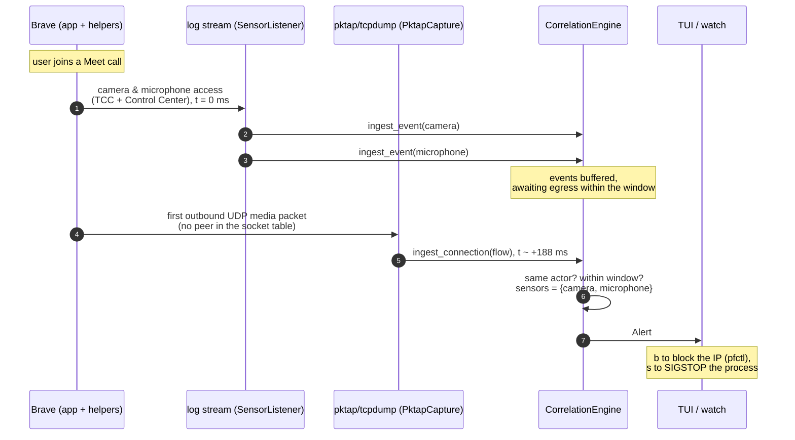
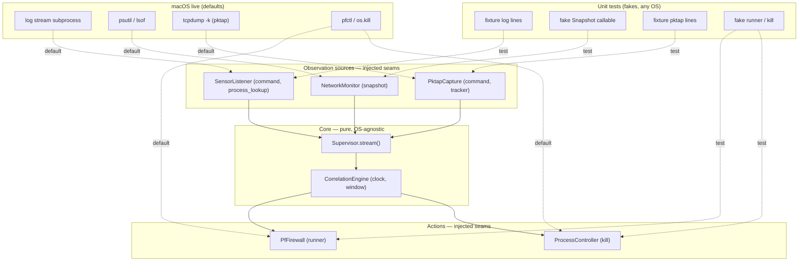
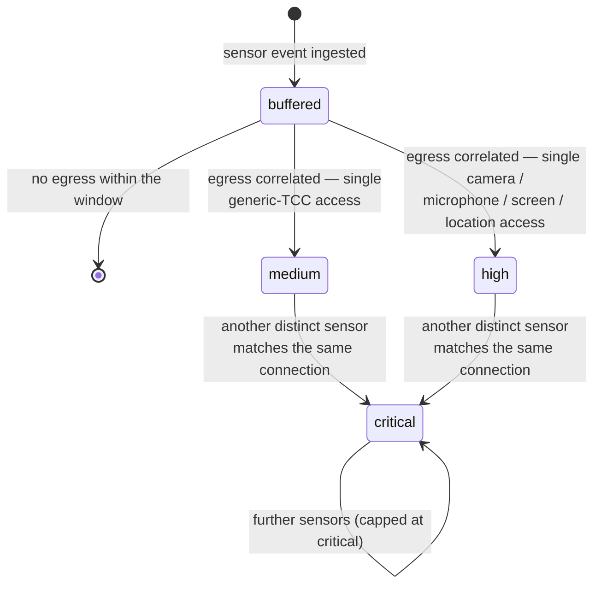
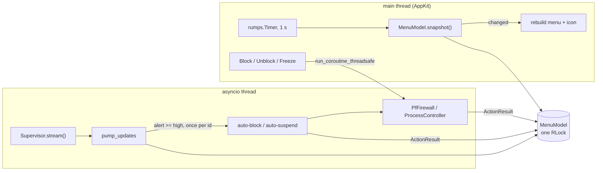

# Architecture

safemaxxing watches two things macOS already reports and asks whether one caused the other: a
process accessed a sensor (camera, microphone, screen, location) and then, within a short
window, opened an outbound connection. The sensor side is read from the unified log; the egress
side from the socket table and, for connection-less UDP, from per-packet metadata. A
correlation engine links them and raises an alert that the TUI, the menu bar, the headless
`watch` command or the automatic responses act on.

The core is pure and OS-agnostic; everything that touches macOS is reached through an injected
seam, so the whole pipeline is driven by fixtures in the unit tests and by real subprocesses on
a Mac. The unit tests need nothing from macOS and run on Linux too; CI runs them on macOS
runners (arm64 and Intel).

## Modules

| Module | Role |
| --- | --- |
| `sensors.py` | `SensorListener`: runs `log stream --style json`, parses TCC / Control Center / CoreAudio / CoreMediaIO / locationd entries into `Event`s. |
| `network.py` | `NetworkMonitor`: polls the socket table (psutil, falling back to `lsof`) and yields each new outbound `NetworkConnection`. |
| `pktap.py` | `PktapCapture`: runs `tcpdump -k` on a pktap interface and turns the first outbound packet of a UDP flow into a `NetworkConnection`. |
| `correlation.py` | `CorrelationEngine`: buffers events and connections and matches them by actor and time window. |
| `supervisor.py` | `Supervisor`: merges the sources into one `stream()` of events, connections and alerts. |
| `firewall.py` | `PfFirewall` (pf block table) and `ProcessController` (SIGSTOP / SIGCONT / SIGKILL). |
| `models.py` | The immutable `Event`, `NetworkConnection`, `Finding`, `Alert` and the `Severity` scale. |
| `tui/` | The Textual dashboard. |
| `menubar.py` | `MenuModel` (pure, clock-injected) and `run_menubar`, the rumps status-bar view over the same `stream()`. |
| `tcc_inspector.py` | Read-only audit of the TCC databases: who already holds a sensitive grant, and which holders look risky. |
| `diagnostics.py` | `doctor`'s checks and `sample`'s summary of a raw log capture. |
| `boot.py` | The launchd job that reapplies the saved blocklist at boot (`/bin/sh` and `/sbin/pfctl` only), and `LaunchdJob`, the load/unload/inspect shared with the daemon. |
| `daemon.py` | `WatchDaemon`: a root LaunchDaemon running `watch --json`, installed only from a root-owned frozen bundle (`unsafe_reason`). |
| `codesign.py` | Signing identity of a binary's app, for the inspector and the TCC audit. |
| `cli.py` | The Typer entry point. |

## A Meet call in Brave, intercepted via pktap

Google Meet in Brave sends its media over UDP that is never `connect()`-ed, so the socket table
shows no peer and only pktap sees where it goes. The sensor access is logged first; the media
flow follows within the correlation window (default 2000 ms; observed deltas are tens to a few
hundred milliseconds — the timings below are illustrative).

## Dependency injection: unit tests vs. macOS live

Each source and action takes its macOS-specific backend as a constructor argument. In production
those default to real subprocesses and syscalls; in tests they are replaced with deterministic
fakes, so the same engine and supervisor run unchanged on any runner, Linux included.

## Severity escalation

An alert's severity starts from the base level of the sensor behind it — medium for a generic
TCC service, high for camera, microphone, screen capture or location — and rises one step, up to
critical, when a second distinct sensor is attributed to the same connection. Each further
sensor re-emits the same alert (same id) at the new, higher level, capped at critical.

One exception lowers the start: when every sensor match behind a new alert is *late* (it only
fits the adaptive, decayed window), the alert starts one step lower, floored at low, so a
delayed upload still alerts, quietly.

## The menu bar: two threads, one model

rumps owns the main thread (AppKit's run loop), so the supervisor runs on a background asyncio
loop. `pump_updates` folds every update into a `MenuModel`; a one-second rumps timer reads a
`MenuSnapshot` and rebuilds the menu only when the snapshot changed, since rebuilding an open
menu closes its submenus. Quick actions are scheduled back onto the loop and their
`ActionResult`s are recorded in the model.

Both threads touch the model, so every `MenuModel` method takes one re-entrant lock. If the
stream fails or ends, `pump_updates` marks the model stopped: the icon turns to ⊘ rather than
staying on idle with nothing behind it, and the loop keeps running so Unblock and Flush All
still work.

## Packaging

`packaging/` builds a PyInstaller onedir bundle per architecture, signs every Mach-O in it
with the hardened runtime, and wraps it in a tarball and a signed `.pkg`. Library validation
and DYLD variables stay enforced: the bundle is signed with one Team ID, so neither
`disable-library-validation` nor `allow-dyld-environment-variables` is needed, and either
would let another process inject code into a binary that runs as root. Root use goes through
the `.pkg`, which installs a root-owned copy; the Homebrew formula installs into a
user-writable prefix and has no root service for that reason. See
[packaging/README.md](packaging/README.md).

## Why the core stays pure

The `CorrelationEngine` takes a `clock` and holds only immutable `Event` / `NetworkConnection`
values, so a test drives it to the millisecond with a fixed clock and hand-built inputs. The
sources normalise their platform-specific input into those same values before the engine sees
them, which is why the engine never imports `psutil`, `subprocess` or anything macOS-specific —
and why the heuristics can be tested without a Mac.
