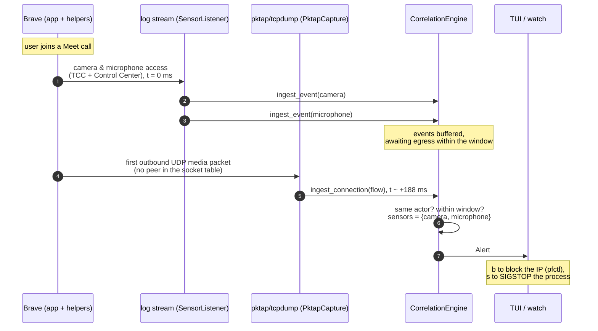
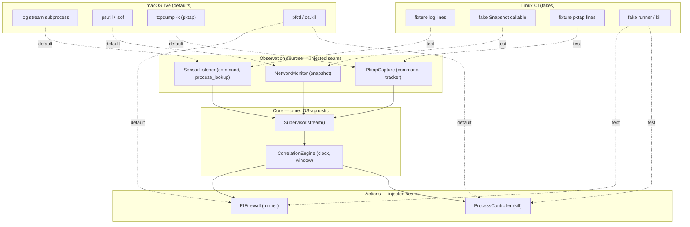
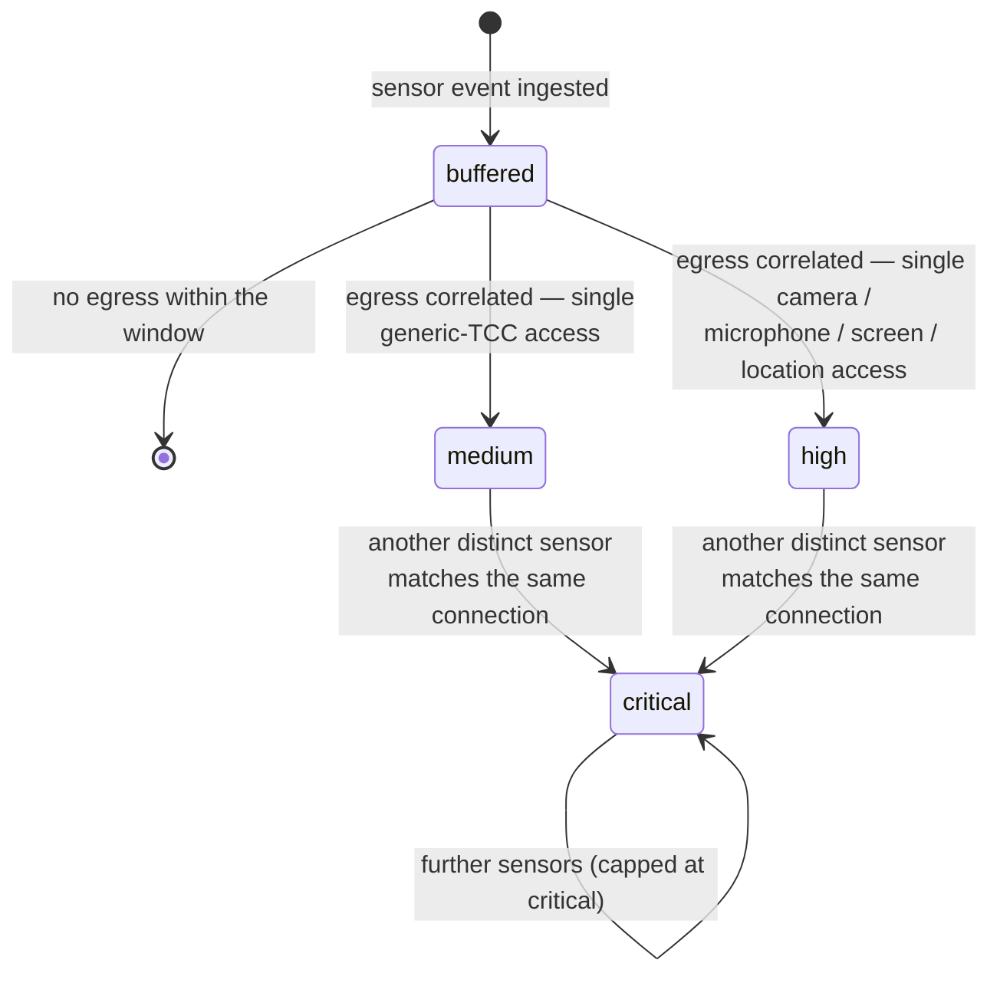

# Architecture

safemaxxing watches two things macOS already reports and asks whether one caused the other: a
process accessed a sensor (camera, microphone, screen, location) and then, within a short
window, opened an outbound connection. The sensor side is read from the unified log; the egress
side from the socket table and, for connection-less UDP, from per-packet metadata. A
correlation engine links them and raises an alert that the TUI, the headless `watch` command or
the automatic responses act on.

The core is pure and OS-agnostic; everything that touches macOS is reached through an injected
seam, so the whole pipeline is driven by fixtures on Linux CI and by real subprocesses on a Mac.

## Modules

| Module | Role |
| --- | --- |
| `sensors.py` | `SensorListener`: runs `log stream --style json`, parses TCC / Control Center / CoreAudio / CoreMediaIO / locationd entries into `Event`s. |
| `network.py` | `NetworkMonitor`: polls the socket table (psutil, falling back to `lsof`) and yields each new outbound `NetworkConnection`. |
| `pktap.py` | `PktapCapture`: runs `tcpdump -k` on a pktap interface and turns the first outbound packet of a UDP flow into a `NetworkConnection`. |
| `correlation.py` | `CorrelationEngine`: buffers events and connections and matches them by actor and time window. |
| `supervisor.py` | `Supervisor`: merges the sources into one `stream()` of events, connections and alerts. |
| `firewall.py` | `PfFirewall` (pf block table) and `ProcessController` (SIGSTOP / SIGCONT / SIGKILL). |
| `models.py` | The immutable `Event`, `NetworkConnection`, `Finding`, `Alert` and the `Severity` scale. |
| `tui/` | The Textual dashboard. |

## A Meet call in Brave, intercepted via pktap

Google Meet in Brave sends its media over UDP that is never `connect()`-ed, so the socket table
shows no peer and only pktap sees where it goes. The sensor access is logged first; the media
flow follows within the correlation window (default 2000 ms; observed deltas are tens to a few
hundred milliseconds — the timings below are illustrative).

## Dependency injection: Linux CI vs. macOS live

Each source and action takes its macOS-specific backend as a constructor argument. In production
those default to real subprocesses and syscalls; in tests they are replaced with deterministic
fakes, so the same engine and supervisor run unchanged on a Linux runner.

## Severity escalation

An alert's severity starts from the base level of the sensor behind it — medium for a generic
TCC service, high for camera, microphone, screen capture or location — and rises one step, up to
critical, when a second distinct sensor is attributed to the same connection. Each further
sensor re-emits the same alert (same id) at the new, higher level, capped at critical.

## Why the core stays pure

The `CorrelationEngine` takes a `clock` and holds only immutable `Event` / `NetworkConnection`
values, so a test drives it to the millisecond with a fixed clock and hand-built inputs. The
sources normalise their platform-specific input into those same values before the engine sees
them, which is why the engine never imports `psutil`, `subprocess` or anything macOS-specific —
and why the heuristics can be tested without a Mac.
