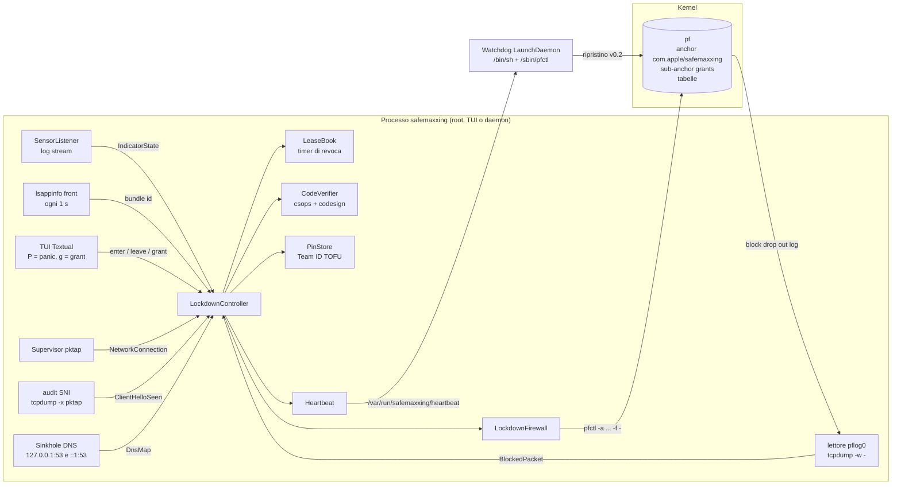
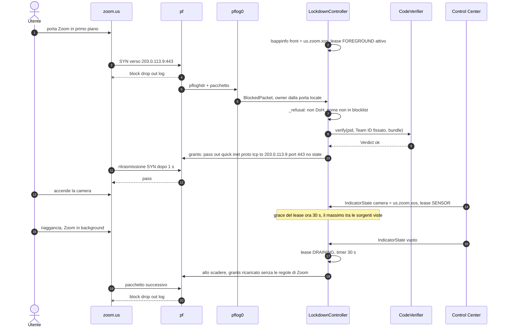
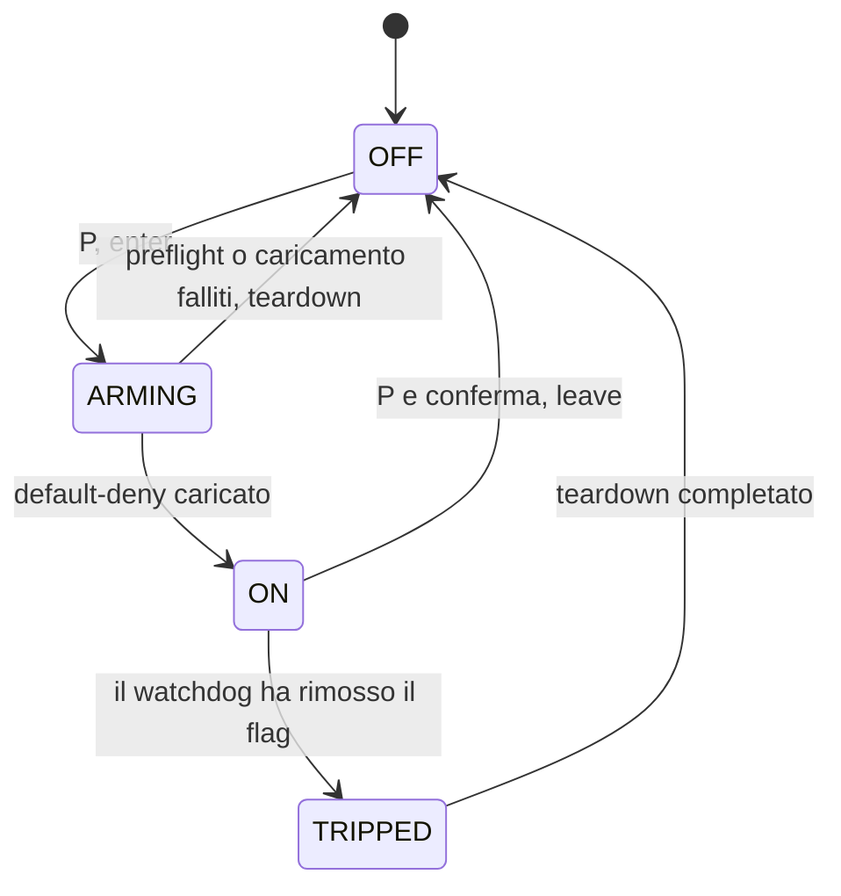
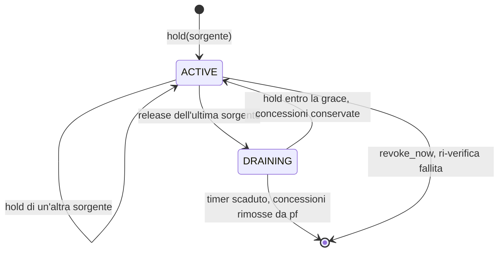

# RFC 0001 — Paranoia Mode (Lockdown Mode) per safemaxxing v0.3.0

| Campo | Valore |
|---|---|
| Stato | Proposta, con implementazione di riferimento validata senza root |
| Versione target | v0.3.0 |
| Data | 2026-10-30 |
| Piattaforma di riferimento | macOS 27.0.1 (26A434), Apple Silicon (arm64), Python 3.13 nel venv (requisito minimo del progetto: 3.12) |
| Privilegi | root per entrare in Paranoia Mode; il watchdog è una LaunchDaemon di sistema |
| Moduli | 1 Default-deny dinamico · 2 Allowlist legata ai sensori · 3 Verifica CDHash e runtime · 4 Panic button e watchdog · 5 DNS sinkhole e SNI |
| Codice | `src/safemaxxing/lockdown/` (nuovo), `src/safemaxxing/codesign.py` (esteso), patch a `models.py`, `sensors.py`, `supervisor.py`, `cli.py`, `tui/app.py`, `tui/safemaxxing.tcss` |
| Test | 57 test nuovi in `tests/lockdown/`; suite completa verde (vedi §10.1) |

Le parole chiave DEVE, NON DEVE, DOVREBBE e PUÒ hanno il significato di RFC 2119.

Ogni blocco di codice di questo documento è il file testato, incluso alla lettera da uno script di assemblaggio. Lo stesso vale per i blocchi di regole pf, generati dal codice e non scritti a mano. I verdetti `pfctl -n` del §10.1 sono stati rimisurati su questo Mac durante l'assemblaggio. Non ci sono placeholder: dove un valore dipende dalla rete dell'utente (i resolver DNS, gli IP di `time.apple.com`), il documento dice da dove il codice lo legge.

---

## 0. Sommario esecutivo

La Paranoia Mode trasforma l'anchor `com.apple/safemaxxing`: oggi blocca soltanto una lista di destinazioni, in Paranoia Mode blocca tutto il traffico in uscita (default-deny). Fanno eccezione quattro cose:

1. una piccola infrastruttura di rete senza la quale il Mac smette di funzionare: DHCP, ICMPv6 di neighbour discovery, mDNS, NTP verso Apple, APNs;
2. il DNS, forzato attraverso un sinkhole locale che risponde NXDOMAIN ai domini di tracker e di C2;
3. le destinazioni che un'app *in uso in questo momento* sta cercando di raggiungere, imparate al volo dai pacchetti che il default-deny scarta;
4. le eccezioni statiche che l'utente elenca (un endpoint VPN, un proxy aziendale).

"In uso in questo momento" ha una definizione operativa: l'app tiene un *lease*. Un lease nasce da tre segnali:
- l'app usa la fotocamera, il microfono o la cattura dello schermo, secondo gli indicatori di Control Center che safemaxxing già legge;
- l'app è in primo piano;
- l'utente l'ha autorizzata a mano dalla TUI.

Quando il segnale finisce, il lease entra in un periodo di grazia (30 s per i sensori) e poi viene revocato: le sue regole spariscono da pf e il pacchetto successivo è già bloccato.

Prima di concedere una destinazione, il processo che la chiede viene verificato. Si leggono dal kernel lo stato della firma (`csops`) e i suoi entitlement, poi `codesign` verifica il codice in esecuzione contro il Team ID fissato al primo uso. Un processo debuggabile, iniettabile via `DYLD_*`, ad-hoc o di un altro team non ottiene nulla.

Un dead-man switch indipendente da Python ripristina le regole v0.2 se safemaxxing smette di battere il cuore per 5 secondi. È una LaunchDaemon che esegue solo `/bin/sh` e `/sbin/pfctl`. Un bug nel processo Python non può quindi lasciare l'utente offline. Il prezzo è che la Paranoia Mode è *fail-open* (§7.5).

Tre limiti strutturali, dichiarati subito e discussi nel §2:
- pf non sa filtrare per processo, quindi le concessioni sono per destinazione e non per PID;
- uno sniffer di SNI non può impedire nulla prima della concessione, quindi è un audit a posteriori;
- un attaccante con root è fuori dal modello di minaccia, come in v0.2.

---

## 1. Contesto: cosa esiste in v0.2

**Firewall.** Lo stock `/etc/pf.conf` di macOS valuta `scrub-anchor`, `nat-anchor`, `rdr-anchor`, `dummynet-anchor` e `anchor "com.apple/*"`. safemaxxing carica le proprie regole in `com.apple/safemaxxing`, senza toccare il ruleset principale. In v0.2 il ruleset dell'anchor è una sola riga, generata da `firewall.anchor_rules()`:

```pf
block drop out quick from any to <safemaxxing_block>
```

La tabella `safemaxxing_block` viene riempita con `pfctl -T add` e non ha una definizione `table` nel ruleset, quindi ricaricare il ruleset non ne azzera il contenuto.

Gli altri componenti di v0.2 che la Paranoia Mode usa:

- **Sensori.** `SensorListener` legge `log stream` dagli indicatori di Control Center e produce `SensorEvent` con il bundle id dell'app che usa camera, microfono, schermo o posizione.
- **Rete.** `supervisor.py` combina psutil e pktap (`tcpdump -k -i pktap,all`) per attribuire ogni flusso a un PID.
- **Azioni.** `ProcessController` sospende (SIGSTOP) o termina un processo.
- **TUI.** Textual (`tui/app.py`) con sensori, connessioni e azioni.
- **Codesign.** `codesign.py` esegue `codesign -dvvv` su un path per mostrare l'identità di firma.

La Paranoia Mode riusa tutto questo. Il ruleset v0.2 resta il punto di ritorno sicuro: uscire dalla modalità, o il watchdog che scatta, riportano l'anchor esattamente alla riga sopra.

---

## 2. Correzioni alle premesse del brief

Il brief di progetto conteneva alcune assunzioni che, verificate sulla macchina di riferimento, non reggono. Il design segue i fatti misurati; la tabella riassume dove e perché diverge.

| # | Premessa del brief | Realtà verificata | Conseguenza nel design |
|---|---|---|---|
| P1 | "Solo Zoom può inviare traffico": filtro per processo | pf non ha un criterio per PID o per bundle. La keyword `user` esiste ma confronta l'UID del socket, e tutte le app dell'utente hanno lo stesso UID. | Le concessioni sono per destinazione (protocollo, IP, porta). Ogni flusso verso una destinazione concessa viene poi controllato processo per processo via pktap; un estraneo riceve SIGSTOP (§5.6). Il vero filtro per processo richiede un `NEFilterDataProvider` (System Extension firmata, candidata a v0.4, §12). |
| P2 | Una tabella `safemaxxing_allow` di IP consentiti | Una tabella pf contiene solo indirizzi. `pass out to <safemaxxing_allow>` aprirebbe *tutte* le porte di quell'IP a *tutti* i processi. | Le concessioni sono regole in un sub-anchor `com.apple/safemaxxing/grants`, una per tupla (protocollo, IP, porta), ricaricate atomicamente (§4.5). Le tabelle restano per le eccezioni statiche. |
| P3 | Eccezioni fisse per DNS 53 e DoH/DoT 853 verso qualunque destinazione | Una porta 53 o 853 aperta verso Internet è un tunnel: chiunque può fare esfiltrazione via DNS o parlare TLS sulla 853 con un server proprio. | Tutto il traffico :53 viene rediretto (`route-to lo0` + `rdr`) al sinkhole locale. Solo il sinkhole, da porte sorgente privilegiate, raggiunge i resolver di sistema. La 853 non è aperta. I resolver DoH/DoT pubblici noti non vengono mai concessi (§8). |
| P4 | Eccezione APNs | APNs usa 5223 e 2197 verso 17.0.0.0/8. Il fallback sulla 443 dello stesso blocco è tutto iCloud, iCloud Drive compreso: un canale di esfiltrazione di file. | 5223 e 2197 verso le reti Apple sono aperte; la 443 è opt-in (`LockdownConfig.apple_443`). |
| P5 | Individuare il PID con `log stream` e le destinazioni con `lsof`/`nettop` | Control Center attribuisce l'uso del sensore a un bundle id, non a un PID. E un'app non ha destinazioni finché la rete non gliele lascia raggiungere: con il default-deny, `lsof` mostra solo socket in `SYN_SENT`. | La sorgente delle destinazioni sono i pacchetti che il default-deny scarta e registra su `pflog0` (§5.3). Il proprietario si trova dall'header pflog o dalla porta locale. I socket già aperti al momento dell'ingresso vengono adottati subito (§5.4). |
| P6 | Il sensore come unico segnale | Un'app ha bisogno della rete *prima* di accendere la camera: login, ingresso nella riunione, sala d'attesa. Con il solo segnale del sensore la chiamata non parte mai. | Tre sorgenti di lease: SENSOR, FOREGROUND, MANUAL (§5.2). |
| P7 | `codesign -dvvv <path>` per verificare il processo | Su un path, `codesign` verifica il file su disco, non il processo in esecuzione. Il CDHash di un binario non cambia se una libreria viene iniettata dopo il lancio. | Lo stato viene letto dal kernel per PID con `csops`: flag, CDHash, Team ID, entitlement. Poi `codesign --verify -R=<requirement> <pid>` sul processo vivo. L'iniezione si previene con hardened runtime, library validation e assenza di `get-task-allow` e `allow-dyld-environment-variables`, non con il CDHash (§6). |
| P8 | Il watchdog esegue un "flush delle regole pf" | `pfctl -F all` cancellerebbe anche le regole di sistema e la blocklist v0.2, lasciando l'utente meno protetto che prima della Paranoia Mode. | Il watchdog ricarica nell'anchor il ruleset v0.2, tabella di blocco inclusa, e svuota solo il sub-anchor delle concessioni (§7). |
| P9 | Leggere i pacchetti scartati da `pflog0` | Su macOS 27.0.1 `pflog0` non esiste finché non viene creata: `ifconfig -l` mostra solo `pktap0` e `pktap1`. | `ensure_interface()` la crea (`ifconfig pflog0 create`) durante l'ingresso. Se fallisce, l'ingresso si interrompe prima di toccare pf (§5.3). |
| P10 | Intercettare lo SNI per bloccare | Lo SNI arriva nel ClientHello, *dopo* il three-way handshake verso una destinazione già concessa. ECH lo cifra; QUIC lo mette in un pacchetto cifrato con chiavi derivate dal Connection ID. Prima di v0.3 safemaxxing non leggeva lo SNI. | SNI è un audit successivo alla concessione: notifica e, se configurato, revoca la concessione. Il blocco preventivo per nome lo fa il sinkhole DNS (§8.6). |

---

## 3. Architettura

### 3.1 Componenti



Un solo processo possiede la Paranoia Mode alla volta: un lock `fcntl` su `/var/run/safemaxxing/owner.lock` impedisce che TUI e daemon carichino ruleset in conflitto. Il watchdog è l'unico componente esterno al processo e non importa mai il pacchetto Python.

### 3.2 Sequenza: una chiamata Zoom in Paranoia Mode



### 3.3 Macchina a stati della Paranoia Mode



`ARMING` è transitorio. Se un passo di `_arm()` fallisce, `_teardown()` riporta pf al ruleset v0.2 e lo stato torna `OFF`, con il motivo mostrato nella TUI.

### 3.4 Stati di un lease



Solo un lease `ACTIVE` impara destinazioni nuove. Un lease `DRAINING` tiene quelle che ha.

### 3.5 Layout dei file

```text
src/safemaxxing/
  codesign.py               esteso: csops, policy, CodeVerifier          (Modulo 3)
  lockdown/
    __init__.py
    rules.py                testo delle regole pf, Grant                 (Modulo 1)
    pf.py                   LockdownFirewall: check, load, tabelle       (Modulo 1)
    pflog.py                pflog0: interfaccia, pcap, pfloghdr          (Modulo 2)
    leases.py               LeaseBook, grace, timer di revoca            (Modulo 2)
    controller.py           LockdownController                           (Moduli 2, 3, 5)
    watchdog.py             script sh, plist, Heartbeat                  (Modulo 4)
    dns.py                  wire format, blocklist, DnsMap, Sinkhole     (Modulo 5)
    sni.py                  ClientHello, filtro BPF, cattura             (Modulo 5)
  models.py                 + IndicatorState, + LOCKDOWN_ON/OFF
  sensors.py                + callback on_indicator
  supervisor.py             + parametro on_indicator
  cli.py                    + safemaxxing paranoia install|uninstall|blocklist
  tui/app.py                + panic button, tema rosso, lease manuale
  tui/safemaxxing.tcss      + stili -lockdown e -blink
tests/lockdown/             57 test
```

---

## 4. Modulo 1 — Default-deny dinamico

### 4.1 Requisiti

- R1.1 In Paranoia Mode, ogni pacchetto in uscita che non rientra in un'eccezione o in una concessione DEVE essere scartato e registrato su `pflog0`.
- R1.2 Il ruleset principale di macOS NON DEVE essere modificato; tutto vive in `com.apple/safemaxxing`.
- R1.3 La tabella di blocco v0.2 DEVE continuare a vincere su qualunque concessione.
- R1.4 Ogni ruleset DEVE passare `pfctl -n` prima di essere caricato, e il caricamento DEVE essere atomico.
- R1.5 Nessuna stringa scelta da un'app PUÒ arrivare al testo delle regole senza validazione.

### 4.2 Perché solo l'uscita e perché `no state`

Lo stock `pf.conf` non ha regole proprie dopo `anchor "com.apple/*"`, quindi pf lascia passare in ingresso tutto ciò che nessun anchor blocca. La Paranoia Mode filtra solo `out`. Ne seguono tre proprietà su cui il resto del design si appoggia:

1. Le risposte ai pacchetti in uscita concessi rientrano senza bisogno di stato. Le concessioni sono `no state`.
2. Una concessione stateless adotta anche le connessioni già aperte a metà flusso: entrare in Paranoia Mode durante una chiamata non la interrompe.
3. Revocare una concessione blocca il pacchetto *successivo*: non c'è uno stato in pf da uccidere con `pfctl -k`.

Il servizio in ascolto sul Mac (per esempio Condivisione schermo) resta raggiungibile in ingresso, ma le sue risposte sono traffico in uscita: in Paranoia Mode vengono scartate finché il processo non tiene un lease. Per una postazione in Paranoia Mode è il comportamento voluto.

`keep state (sloppy)`, che sarebbe servito ad adottare flussi a metà con lo stato, è un errore di sintassi nel pf di Darwin (§10.1).

### 4.3 Il ruleset generato

Con il sinkhole attivo (default), `lockdown_rules()` produce esattamente:

```pf
rdr pass on lo0 inet proto { udp tcp } from any to any port 53 -> 127.0.0.1 port 53
rdr pass on lo0 inet6 proto { udp tcp } from any to any port 53 -> ::1 port 53
block drop out quick from any to <safemaxxing_block>
pass out quick on lo0 all
pass out quick inet proto udp from any port 68 to any port 67
pass out quick inet6 proto udp from any port 546 to any port 547
pass out quick inet6 proto ipv6-icmp from any to any icmp6-type { 133 135 136 143 }
pass out quick inet proto udp from any to 224.0.0.251 port 5353
pass out quick inet6 proto udp from any to ff02::fb port 5353
pass out quick proto { udp tcp } from any port 700:799 to <safemaxxing_dns> port 53
pass out quick route-to lo0 inet proto { udp tcp } from any to any port 53 keep state
pass out quick route-to lo0 inet6 proto { udp tcp } from any to any port 53 keep state
pass out quick proto udp from any to <safemaxxing_ntp> port 123
pass out quick proto tcp from any to <safemaxxing_apple> port { 5223 2197 }
pass out quick from any to <safemaxxing_user>
anchor "grants"
block drop out log quick all
```

Senza sinkhole (`LockdownConfig(sinkhole=False)`), il DNS può raggiungere solo i resolver di sistema e non viene filtrato:

```pf
block drop out quick from any to <safemaxxing_block>
pass out quick on lo0 all
pass out quick inet proto udp from any port 68 to any port 67
pass out quick inet6 proto udp from any port 546 to any port 547
pass out quick inet6 proto ipv6-icmp from any to any icmp6-type { 133 135 136 143 }
pass out quick inet proto udp from any to 224.0.0.251 port 5353
pass out quick inet6 proto udp from any to ff02::fb port 5353
pass out quick proto { udp tcp } from any to <safemaxxing_dns> port 53
pass out quick proto udp from any to <safemaxxing_ntp> port 123
pass out quick proto tcp from any to <safemaxxing_apple> port { 5223 2197 }
pass out quick from any to <safemaxxing_user>
anchor "grants"
block drop out log quick all
```

Con `apple_443=True` cambia solo la regola delle reti Apple:

```pf
rdr pass on lo0 inet proto { udp tcp } from any to any port 53 -> 127.0.0.1 port 53
rdr pass on lo0 inet6 proto { udp tcp } from any to any port 53 -> ::1 port 53
block drop out quick from any to <safemaxxing_block>
pass out quick on lo0 all
pass out quick inet proto udp from any port 68 to any port 67
pass out quick inet6 proto udp from any port 546 to any port 547
pass out quick inet6 proto ipv6-icmp from any to any icmp6-type { 133 135 136 143 }
pass out quick inet proto udp from any to 224.0.0.251 port 5353
pass out quick inet6 proto udp from any to ff02::fb port 5353
pass out quick proto { udp tcp } from any port 700:799 to <safemaxxing_dns> port 53
pass out quick route-to lo0 inet proto { udp tcp } from any to any port 53 keep state
pass out quick route-to lo0 inet6 proto { udp tcp } from any to any port 53 keep state
pass out quick proto udp from any to <safemaxxing_ntp> port 123
pass out quick proto tcp from any to <safemaxxing_apple> port { 5223 2197 443 }
pass out quick from any to <safemaxxing_user>
anchor "grants"
block drop out log quick all
```

L'ordine non è negoziabile:

1. **Le regole `rdr` vengono prima.** pf richiede le regole di traduzione prima di quelle di filtro nello stesso ruleset; lo stock `pf.conf` le valuta tramite `rdr-anchor "com.apple/*"`.
2. **`block ... <safemaxxing_block>` è la prima regola di filtro.** È `quick`, quindi un indirizzo nella blocklist v0.2 resta bloccato anche se un'app in lease lo chiede (R1.3).
3. **Le eccezioni infrastrutturali** vengono subito dopo, poi il sub-anchor `grants`.
4. **`block drop out log quick all` chiude il ruleset.** È l'unica regola con `log`: ogni pacchetto che arriva fin qui finisce su `pflog0` e alimenta l'apprendimento.

### 4.4 Le eccezioni, una per una

| Regola | Perché esiste | Perché non è un canale di uscita |
|---|---|---|
| `pass out quick on lo0 all` | Il traffico locale (XPC su socket, server di sviluppo, il sinkhole stesso) non lascia la macchina. | Non esce da lo0. |
| DHCP `68 → 67`, DHCPv6 `546 → 547` | Senza lease DHCP il Mac perde l'indirizzo. | Le porte sorgente sotto 1024 le può aprire solo root (`configd`); un processo utente non può usare questa regola. |
| ICMPv6 133, 135, 136, 143 | Router solicitation, neighbour solicitation e advertisement (RFC 4861), MLDv2 report (RFC 3810): senza, IPv6 smette di funzionare. | Solo quei tipi; niente echo request, quindi niente tunnel ICMP. |
| mDNS verso `224.0.0.251` e `ff02::fb` porta 5353 | Bonjour: AirDrop, AirPlay, stampanti. | Multicast link-local: non attraversa il router. Il rischio residuo è solo LAN (§9). |
| `port 700:799 → <safemaxxing_dns> port 53` | Le query del sinkhole verso i resolver di sistema. | Porte sorgente privilegiate: solo il sinkhole (root) le apre, e `_privileged_socket()` le sceglie da quell'intervallo. |
| `route-to lo0 ... port 53 keep state` | Ogni altra query DNS, verso qualunque server, viene deviata su lo0 e lì tradotta da `rdr` verso il sinkhole. Una `dig @8.8.8.8` scritta a mano finisce comunque nel sinkhole. | Il pacchetto non esce dall'interfaccia fisica. Questa regola ha lo stato per la traduzione di ritorno. |
| `udp → <safemaxxing_ntp> port 123` | L'orologio: TLS e i certificati si rompono se va alla deriva. | La tabella contiene solo gli IP risolti di `time.apple.com` al momento dell'ingresso (`resolve_hosts`, prima che il DNS venga deviato). |
| `tcp → <safemaxxing_apple> port { 5223 2197 }` | APNs: notifiche push, iMessage, FaceTime. | Solo 17.0.0.0/8 e 2620:149::/32, reti di proprietà Apple; il payload arriva ad Apple e non a un server dell'attaccante. |
| `→ <safemaxxing_user>` | Eccezioni statiche dell'utente (`ParanoiaConfig.user_allow`): endpoint VPN, proxy. | Le sceglie l'utente; vengono normalizzate con `ipaddress.ip_network`. |
| `anchor "grants"` | Le concessioni dinamiche (§4.5). | Una regola per destinazione, solo per lease attivi. |

Il nome relativo `anchor "grants"` dentro `com.apple/safemaxxing` si risolve in `com.apple/safemaxxing/grants`; è il percorso con cui `LockdownFirewall.set_grants()` carica il sub-anchor.

### 4.5 Le concessioni: un sub-anchor, non una tabella

Ogni `Grant(protocol, address, port)` diventa una regola:

```pf
pass out quick inet proto tcp from any to 203.0.113.9 port 443 no state
pass out quick inet proto udp from any to 198.51.100.7 port 8801 no state
pass out quick inet6 proto udp from any to 2001:db8::7 port 3478 no state
```

Le concessioni stanno in un sub-anchor anziché in una tabella (P2) per tre motivi:
- **Una tabella perde protocollo e porta.** Una concessione a Zoom su UDP 8801 aprirebbe a tutti i processi ogni porta di quell'IP.
- **Il sub-anchor si sostituisce in un colpo solo.** `pfctl -a com.apple/safemaxxing/grants -f -` rimpiazza l'intero insieme in una transazione pf: non esiste un istante in cui le concessioni sono a metà.
- **Il testo è sempre ricostruito dallo stato in memoria.** `grant_rules()` ordina e deduplica; il sub-anchor non può divergere da `LeaseBook`.

`Grant.__post_init__` è la frontiera di R1.5:
- l'indirizzo passa per `ipaddress.ip_address` e viene riscritto nella forma canonica, quindi `2001:DB8:0::1` e `2001:db8::1` sono la stessa concessione;
- lo scope IPv6 (`%en0`) viene tolto, perché psutil lo riporta e pflog e pktap no;
- loopback, indirizzo non specificato e multicast vengono rifiutati;
- la porta deve stare in 1–65535.

Qualunque altra cosa solleva `ValueError` e non arriva a `pfctl`.

Le ricariche sono raggruppate: `_flush_loop` aspetta 50 ms dopo il primo cambiamento, così l'apertura di una chiamata, che chiede decine di destinazioni in pochi millisecondi, produce un solo `pfctl -f`. Se `pfctl` rifiuta un caricamento, pf tiene l'insieme precedente (la transazione è atomica): il controller lo notifica e continua. Un errore nelle concessioni significa meno connettività, mai meno protezione, e non fa cadere la modalità.

### 4.6 Codice

`src/safemaxxing/lockdown/rules.py` (146 righe)

```python
"""pf rule text for Paranoia Mode: default-deny egress inside `com.apple/safemaxxing`.

Pure: every function returns text for `pfctl -a <anchor> -f -`. Darwin's `pfctl -n` parses
without root, so the tests check the exact text against the real grammar on any Mac.

Only outbound traffic is filtered. The main ruleset has no rules of its own after
`anchor "com.apple/*"`, so inbound packets, replies included, pass by default: a grant needs
no state, which is why grants are `no state` and a revoked grant stops the very next packet.
"""

from __future__ import annotations

import ipaddress
from collections.abc import Iterable
from dataclasses import dataclass

from safemaxxing.firewall import ANCHOR, TABLE
from safemaxxing.models import Protocol

GRANTS_ANCHOR_NAME = "grants"
GRANTS_ANCHOR = f"{ANCHOR}/{GRANTS_ANCHOR_NAME}"
# Resolvers the sinkhole forwards to (and, without the sinkhole, the only DNS servers allowed).
DNS_TABLE = "safemaxxing_dns"
NTP_TABLE = "safemaxxing_ntp"
APPLE_TABLE = "safemaxxing_apple"
# Static exceptions the user lists (a VPN endpoint, a corporate proxy).
USER_TABLE = "safemaxxing_user"
# Only root can bind a source port below 1024, so a rule that matches this range cannot be
# ridden by an unprivileged process: the sinkhole sends its upstream queries from here.
SINKHOLE_UPSTREAM_PORTS = (700, 799)
SINKHOLE_PORT = 53
# Apple owns 17.0.0.0/8 outright, and 2620:149::/32 is its ARIN IPv6 block.
APPLE_NETWORKS = ("17.0.0.0/8", "2620:149::/32")
# APNs listens on 5223 and 2197. Its 443 fallback is all of iCloud there, iCloud Drive
# included, a way out for files, so it is opt-in (`apple_443`).
APNS_PORTS = (5223, 2197)
# ICMPv6 that IPv6 cannot work without: router solicitation, neighbour solicitation and
# advertisement (RFC 4861), MLDv2 listener report (RFC 3810).
ICMP6_TYPES = (133, 135, 136, 143)
MDNS_V4 = "224.0.0.251"
MDNS_V6 = "ff02::fb"


@dataclass(frozen=True, slots=True)
class LockdownConfig:
    """What the default-deny ruleset lets through besides grants."""

    # Redirect every outbound :53 query into the local sinkhole (Module 5). Off, DNS may only
    # reach the resolvers in `safemaxxing_dns`, unfiltered.
    sinkhole: bool = True
    apple_443: bool = False


def _ports(ports: Iterable[int]) -> str:
    return "{ " + " ".join(str(p) for p in ports) + " }"


DEFAULT_CONFIG = LockdownConfig()


def lockdown_rules(config: LockdownConfig = DEFAULT_CONFIG) -> str:
    """The anchor's ruleset in Paranoia Mode, translation rules first as pf requires.

    The v0.2 block table still comes first, so an explicit block beats any grant; the last
    rule drops and logs to `pflog0`, which is what the learn loop reads.
    """
    low, high = SINKHOLE_UPSTREAM_PORTS
    apple_ports = (*APNS_PORTS, 443) if config.apple_443 else APNS_PORTS
    lines: list[str] = []
    if config.sinkhole:
        lines += [
            f"rdr pass on lo0 inet proto {{ udp tcp }} from any to any port 53 "
            f"-> 127.0.0.1 port {SINKHOLE_PORT}",
            f"rdr pass on lo0 inet6 proto {{ udp tcp }} from any to any port 53 "
            f"-> ::1 port {SINKHOLE_PORT}",
        ]
    lines += [
        f"block drop out quick from any to <{TABLE}>",
        "pass out quick on lo0 all",
        # DHCP and DHCPv6 clients send from privileged ports: only root (configd) can.
        "pass out quick inet proto udp from any port 68 to any port 67",
        "pass out quick inet6 proto udp from any port 546 to any port 547",
        f"pass out quick inet6 proto ipv6-icmp from any to any icmp6-type {_ports(ICMP6_TYPES)}",
        f"pass out quick inet proto udp from any to {MDNS_V4} port 5353",
        f"pass out quick inet6 proto udp from any to {MDNS_V6} port 5353",
    ]
    if config.sinkhole:
        lines += [
            f"pass out quick proto {{ udp tcp }} from any port {low}:{high} "
            f"to <{DNS_TABLE}> port 53",
            *(
                f"pass out quick route-to lo0 {family} proto {{ udp tcp }} "
                "from any to any port 53 keep state"
                for family in ("inet", "inet6")
            ),
        ]
    else:
        lines.append(f"pass out quick proto {{ udp tcp }} from any to <{DNS_TABLE}> port 53")
    lines += [
        f"pass out quick proto udp from any to <{NTP_TABLE}> port 123",
        f"pass out quick proto tcp from any to <{APPLE_TABLE}> port {_ports(apple_ports)}",
        f"pass out quick from any to <{USER_TABLE}>",
        f'anchor "{GRANTS_ANCHOR_NAME}"',
        "block drop out log quick all",
    ]
    return "\n".join(lines) + "\n"


@dataclass(frozen=True, slots=True, order=True)
class Grant:
    """One destination a leased app may reach: (protocol, address, port).

    The address and port end up in pf rule text, so both are validated here: nothing that
    reaches `pfctl` is a string an app chose.
    """

    protocol: Protocol
    address: str
    port: int

    def __post_init__(self) -> None:
        # psutil spells a link-local peer `fe80::1%en0`, pflog and pktap `fe80::1`: one grant.
        ip = ipaddress.ip_address(self.address.split("%", 1)[0])
        if ip.is_unspecified or ip.is_multicast or ip.is_loopback:
            raise ValueError(f"refusing to grant {ip}")
        if not 0 < self.port < 65536:
            raise ValueError(f"port out of range: {self.port}")
        # Normalised spelling, so two spellings of one address are one grant.
        object.__setattr__(self, "address", str(ip))

    @property
    def family(self) -> str:
        """`inet6` or `inet`."""
        return "inet6" if ":" in self.address else "inet"

    def rule(self) -> str:
        """The pass rule for this grant; stateless, see the module docstring."""
        return (
            f"pass out quick {self.family} proto {self.protocol.value} "
            f"from any to {self.address} port {self.port} no state"
        )


def grant_rules(grants: Iterable[Grant]) -> str:
    """The grants sub-anchor's ruleset: one sorted rule per distinct grant ('' for none)."""
    return "".join(f"{g.rule()}\n" for g in sorted(set(grants)))
```

`src/safemaxxing/lockdown/pf.py` (58 righe)

```python
"""Loads the Paranoia Mode rulesets and tables through `pfctl` (needs root)."""

from __future__ import annotations

from collections.abc import Iterable

from safemaxxing.firewall import (
    ANCHOR,
    PFCTL,
    FirewallError,
    Runner,
    anchor_rules,
    meaningful_stderr,
    run_command,
)
from safemaxxing.lockdown.rules import GRANTS_ANCHOR, Grant, grant_rules


class LockdownFirewall:
    """Swaps our anchor between the v0.2 ruleset and the default-deny one, and owns the grants
    sub-anchor. Every ruleset is parsed with `pfctl -n` before it is loaded, and a load
    replaces the anchor atomically (all rule types in one pf transaction)."""

    def __init__(self, runner: Runner = run_command, anchor: str = ANCHOR) -> None:
        self._run = runner
        self.anchor = anchor
        self.grants_anchor = GRANTS_ANCHOR if anchor == ANCHOR else f"{anchor}/grants"

    async def _pfctl(self, argv: list[str], stdin: str | None = None) -> None:
        res = await self._run(argv, stdin=stdin)
        problems = meaningful_stderr(res.stderr)
        if res.returncode != 0 or problems:
            detail = "; ".join(problems) or f"exit {res.returncode}"
            raise FirewallError(f"{' '.join(argv[1:])}: {detail}")

    async def check(self, rules: str, anchor: str | None = None) -> None:
        """Parse `rules` without loading them; raises FirewallError if pf rejects them."""
        await self._pfctl([PFCTL, "-a", anchor or self.anchor, "-n", "-f", "-"], rules)

    async def load(self, rules: str, anchor: str | None = None) -> None:
        """Check, then load `rules` into `anchor` (ours by default), replacing what it held."""
        await self.check(rules, anchor)
        await self._pfctl([PFCTL, "-a", anchor or self.anchor, "-f", "-"], rules)

    async def set_grants(self, grants: Iterable[Grant]) -> None:
        """Replace the grants sub-anchor with one rule per grant."""
        await self.load(grant_rules(grants), self.grants_anchor)

    async def replace_table(self, table: str, addresses: Iterable[str]) -> None:
        """Make `table` hold exactly `addresses` (emptied when there are none)."""
        addrs = sorted(set(addresses))
        verb = ["replace", *addrs] if addrs else ["flush"]
        await self._pfctl([PFCTL, "-a", self.anchor, "-t", table, "-T", *verb])

    async def restore_normal(self) -> None:
        """Back to v0.2: block table only, no grants. The same two steps the watchdog runs."""
        await self.load(anchor_rules())
        await self._pfctl([PFCTL, "-a", self.grants_anchor, "-F", "rules"])
```

`replace_table` usa `pfctl -T replace`, che crea la tabella se non esiste. pfctl crea le tabelle da riga di comando con il flag `persist`, quindi sopravvivono ai caricamenti del ruleset che le referenziano senza definirle, lo stesso meccanismo su cui v0.2 conta per `safemaxxing_block`. Lo spike S3 (§10.2) lo verifica sotto Paranoia Mode.

---

## 5. Modulo 2 — Allowlist legata ai sensori

### 5.1 Requisiti

- R2.1 Solo un'app che tiene un lease PUÒ ottenere nuove destinazioni.
- R2.2 Le destinazioni DEVONO essere imparate dal traffico reale dell'app, non da liste di domini del vendor.
- R2.3 Alla fine dell'uso, le concessioni DEVONO essere revocate dopo un periodo di grazia, senza intervento dell'utente e senza bloccare l'event loop.
- R2.4 Entrare in Paranoia Mode durante una chiamata NON DEVE interromperla.
- R2.5 Un processo estraneo che sfrutta una concessione DEVE essere rilevato.

### 5.2 Sorgenti dei lease e periodo di grazia

| Sorgente | Segnale | Grace | Perché questa durata |
|---|---|---|---|
| `SENSOR` | `IndicatorState`: il bundle id che Control Center attribuisce a camera, microfono o cattura schermo (`COMMS_SENSORS`; la posizione non conta) | 30 s | Copre la segnalazione di fine chiamata, la pagina "valuta la chiamata" e una camera spenta e riaccesa. È 15 volte la finestra di fusione del flicker degli indicatori (2 s), quindi il flicker non la raggiunge mai. |
| `FOREGROUND` | `lsappinfo front`, interrogato ogni secondo | 15 s | Un Cmd-Tab breve non deve tagliare un caricamento; uscire da un'app è un segnale più debole che riagganciare. |
| `MANUAL` | Tasto `g` nella TUI sulla connessione selezionata | 0 s | Revocare a mano è una decisione esplicita e immediata. |

La grace di un lease è la più lunga tra le sorgenti che ha *mai* avuto (`Lease._seen`). Una chiamata iniziata in primo piano, che poi accende la camera e infine finisce in background, ha 30 s, non 15.

`SensorEventParser` emette già `SensorEvent` deduplicati per la UI; per i lease serve invece lo stato grezzo degli indicatori, spento compreso. La patch aggiunge un callback `on_indicator` che riceve ogni fronte (`IndicatorState`) senza la fusione del flicker; il periodo di grazia la sostituisce. Si usa un callback e non lo stream del supervisor perché lo stream scarta gli elementi di tipo sconosciuto.

### 5.3 Il ciclo di apprendimento

1. Il default-deny scarta il primo SYN (o il primo datagramma UDP) dell'app e lo registra su `pflog0`.
2. `blocked_packets()` legge `pflog0` come stream pcap da tcpdump:

```bash
/usr/sbin/tcpdump -n -U -s 128 -i pflog0 -w -
```

3. `PcapReader` decodifica i record in modo incrementale: entrambi gli ordini di byte, timestamp in micro o nanosecondi, controllo del link type `DLT_PFLOG` = 117.
4. `parse_pflog()` interpreta l'header di Darwin (`struct pfloghdr`, 64 byte con l'allineamento BPF), tiene solo `PF_DROP` in direzione `PF_OUT` per IPv4 e IPv6 (`AF_INET6` = 30 su Darwin), ed estrae protocollo, endpoint e porte.
5. **Proprietario.** Il campo `pid` dell'header è valido solo quando pf ha fatto il lookup del socket; altrimenti vale `NO_PID` (oltre 99999), che viene scartato. In quel caso il proprietario si trova cercando la porta locale nella tabella dei socket di psutil, in cache per 250 ms.
6. **Deduplica.** Le ritrasmissioni dello stesso connect, con la stessa 5-tupla `flow`, vengono ignorate per 5 s.
7. `consider(pid, grant)` applica in ordine:
   - il processo appartiene a un'app con lease `ACTIVE`;
   - `_refusal()` non trova obiezioni DNS (§8.4);
   - `CodeVerifier` accetta il processo (§6);
   - il lease non ha superato `MAX_GRANTS` = 512 destinazioni.
8. La concessione entra nel lease e `_flush_loop` la carica. TCP ritrasmette il SYN dopo circa 1 s, e la ritrasmissione passa.

Il costo per l'utente è una latenza sul primo connect verso ogni destinazione nuova, pari al tempo di una ritrasmissione. Lo spike S5 (§10.2) la misura durante una chiamata reale.

`pflog0` non esiste di default su macOS 27.0.1 (P9). `ensure_interface()` la crea durante `_arm()`, dopo il lock e prima di qualunque modifica a pf. Senza di essa la regola `log` non avrebbe un'interfaccia su cui scrivere e il controller non imparerebbe mai nulla. Se il ciclo di cattura termina, il controller si considera non sano e smette di battere il cuore: il watchdog ripristina v0.2 entro 5 s, anziché lasciare un default-deny che non impara più.

### 5.4 Ingresso a chiamata in corso (seeding)

`observe_indicator` gira sempre, anche a modalità spenta, così il controller sa già chi tiene un lease quando l'utente preme P. Prima di caricare il default-deny, `_seed()` percorre la tabella dei socket e passa per `consider()` ogni connessione già stabilita. Le concessioni di un'app in lease, verificata, vengono caricate *prima* del default-deny. La chiamata non vede alcuna interruzione (R2.4).

### 5.5 Revoca graduale

`LeaseBook.release()` porta il lease in `DRAINING` e programma `_expire` con `loop.call_later(grace, ...)`. Non c'è un thread, non c'è un `sleep` in un task e l'event loop non viene bloccato.

Ogni lease ha un contatore di generazione. Un `hold()` arrivato durante la grace cancella il timer e incrementa la generazione, quindi un timer già in volo trova una generazione diversa e non fa nulla. Allo scadere:
- il lease viene rimosso;
- `_on_revoke` notifica;
- `_flush_loop` ricarica il sub-anchor senza le sue regole.

Se due lease condividono una destinazione, per esempio lo stesso CDN, la regola resta finché uno dei due la tiene, perché il sub-anchor è sempre l'unione delle concessioni dei lease vivi.

`revoke_now()` bypassa la grace: lo usa la ri-verifica periodica quando un processo in lease smette di superare la policy (§6.5).

### 5.6 Audit del piggyback

Una concessione apre una destinazione a tutti (P1). Il supervisor già riceve ogni flusso da pktap con il PID del socket; il controller lo esamina con `audit_flow()`. Se il flusso va verso una destinazione concessa e il processo non appartiene a nessuna delle app che la tengono:
- un processo fuori dai percorsi di sistema riceve **SIGSTOP** e una notifica CRITICAL;
- un daemon di sistema (`is_system_path`) riceve solo una notifica HIGH. Sospendere `nsurlsessiond` bloccherebbe ogni download del Mac, e un daemon Apple che parla con un CDN condiviso è il caso normale, non un attacco.

Il limite è dichiarato: pktap vede il flusso quando i primi pacchetti sono già passati. L'audit rileva e ferma, non previene. La prevenzione per processo è il lavoro di v0.4 (§12).

### 5.7 Codice

`src/safemaxxing/lockdown/leases.py` (176 righe)

```python
"""Leases: which apps may reach the network in Paranoia Mode, and for how long after.

A lease is held by one or more *sources*, signals that the user is using the app right now:

* `SENSOR`: Control Center attributes the camera, the microphone or a screen capture to it;
* `FOREGROUND`: it is the frontmost app;
* `MANUAL`: the user granted it from the TUI.

While held, a lease is ACTIVE: new destinations may be learned for it. When its last source
goes away it turns DRAINING: nothing new is learned, but its grants stay, so a camera blink, a
brief Cmd-Tab or the end-of-call signalling are not cut. When the grace period of the sources
it had runs out it is revoked: its grants leave pf at once (`on_revoke`). A source that comes
back while draining makes it ACTIVE again with its grants intact.
"""

from __future__ import annotations

import asyncio
import time
from collections.abc import Callable, Coroutine, Iterable, Iterator, Mapping
from dataclasses import dataclass, field
from enum import StrEnum

from safemaxxing.lockdown.rules import Grant


class LeaseSource(StrEnum):
    """Why an app holds a lease."""

    SENSOR = "sensor"
    FOREGROUND = "foreground"
    MANUAL = "manual"


class LeaseState(StrEnum):
    """ACTIVE learns new destinations; DRAINING only keeps the ones it has."""

    ACTIVE = "active"
    DRAINING = "draining"


# Seconds a lease keeps its grants after its last source of that kind ends. A sensor's grace
# covers the end of a call (hang-up signalling, the "rate this call" page) and a camera
# toggled off and on; it is 15x INDICATOR_MERGE_S, so indicator flicker never reaches it. The
# foreground's is shorter: switching away from an app is a weaker signal than hanging up.
# A manual lease has none: releasing it is an explicit, immediate revocation.
GRACE_S: Mapping[LeaseSource, float] = {
    LeaseSource.SENSOR: 30.0,
    LeaseSource.FOREGROUND: 15.0,
    LeaseSource.MANUAL: 0.0,
}
# A lease asking for more destinations than this is scanning, not calling.
MAX_GRANTS = 512


@dataclass(slots=True)
class Lease:
    """One app's lease. `team_id` is pinned at the first verified grant (see codesign.py)."""

    bundle_id: str
    sources: set[LeaseSource] = field(default_factory=set)
    state: LeaseState = LeaseState.ACTIVE
    grants: set[Grant] = field(default_factory=set)
    team_id: str | None = None
    # Monotonic time the grants go, while DRAINING.
    deadline: float | None = None
    # Sources ever held: the grace period is the longest of theirs.
    _seen: set[LeaseSource] = field(default_factory=set)
    _timer: asyncio.TimerHandle | None = None
    _generation: int = 0


class LeaseBook:
    """Leases by bundle id, with an asynchronous teardown timer per draining lease.

    Called from the event loop only (the sensor callback, the foreground poller, the TUI);
    the timers run on that same loop, so no lock is needed.
    """

    def __init__(
        self,
        on_revoke: Callable[[Lease], Coroutine[object, object, None]],
        grace_s: Mapping[LeaseSource, float] = GRACE_S,
        clock: Callable[[], float] = time.monotonic,
    ) -> None:
        self._on_revoke = on_revoke
        self._grace_s = grace_s
        self._clock = clock
        self._leases: dict[str, Lease] = {}
        # Revocations in flight; kept so they are not garbage-collected mid-run.
        self._tasks: set[asyncio.Task[None]] = set()

    def __iter__(self) -> Iterator[Lease]:
        return iter(list(self._leases.values()))

    def get(self, bundle_id: str) -> Lease | None:
        """The lease, ACTIVE or DRAINING: its grants are still in pf."""
        return self._leases.get(bundle_id)

    def active(self, bundle_id: str) -> Lease | None:
        """The lease only while ACTIVE, the state in which it may learn destinations."""
        lease = self._leases.get(bundle_id)
        return lease if lease is not None and lease.state is LeaseState.ACTIVE else None

    def hold(self, bundle_id: str, source: LeaseSource) -> Lease:
        """`source` now holds `bundle_id`'s lease; a draining lease becomes ACTIVE again."""
        lease = self._leases.get(bundle_id)
        if lease is None:
            lease = self._leases[bundle_id] = Lease(bundle_id)
        lease.sources.add(source)
        lease._seen.add(source)
        if lease.state is LeaseState.DRAINING:
            self._cancel_timer(lease)
            lease.state = LeaseState.ACTIVE
            lease.deadline = None
        return lease

    def release(self, bundle_id: str, source: LeaseSource) -> None:
        """`source` no longer holds the lease; the last one to go starts its grace period."""
        lease = self._leases.get(bundle_id)
        if lease is None or source not in lease.sources:
            return
        lease.sources.discard(source)
        if lease.sources:
            return
        grace = max(self._grace_s[s] for s in lease._seen)
        lease.state = LeaseState.DRAINING
        lease.deadline = self._clock() + grace
        lease._generation += 1
        if grace <= 0:
            self._expire(bundle_id, lease._generation)
            return
        loop = asyncio.get_running_loop()
        lease._timer = loop.call_later(grace, self._expire, bundle_id, lease._generation)

    def set_holders(self, source: LeaseSource, bundle_ids: Iterable[str]) -> None:
        """Make `source` hold exactly `bundle_ids`: hold the new ones, release the others."""
        wanted = set(bundle_ids)
        for bundle_id in wanted:
            self.hold(bundle_id, source)
        for lease in list(self._leases.values()):
            if source in lease.sources and lease.bundle_id not in wanted:
                self.release(lease.bundle_id, source)

    def revoke_now(self, bundle_id: str) -> None:
        """Revoke at once, whatever holds the lease (a failed re-verification)."""
        lease = self._leases.get(bundle_id)
        if lease is not None:
            lease.sources.clear()
            lease._generation += 1
            self._expire(bundle_id, lease._generation)

    def _cancel_timer(self, lease: Lease) -> None:
        if lease._timer is not None:
            lease._timer.cancel()
            lease._timer = None
        lease._generation += 1

    def _expire(self, bundle_id: str, generation: int) -> None:
        lease = self._leases.get(bundle_id)
        # A stale timer: the lease came back (or was revoked) after this one was scheduled.
        if lease is None or lease._generation != generation:
            return
        del self._leases[bundle_id]
        lease._timer = None
        task = asyncio.get_running_loop().create_task(self._on_revoke(lease))
        self._tasks.add(task)
        task.add_done_callback(self._tasks.discard)

    def cancel_all(self) -> list[Lease]:
        """Drop every lease without calling `on_revoke` (leaving lockdown flushes pf itself)."""
        leases = list(self._leases.values())
        for lease in leases:
            self._cancel_timer(lease)
        self._leases.clear()
        return leases
```

`src/safemaxxing/lockdown/pflog.py` (182 righe)

```python
"""What the default-deny rule dropped, read from `pflog0` as a pcap stream.

`tcpdump -w -` writes pcap; each record is a `struct pfloghdr` followed by the dropped IP
packet. The header layout comes from xnu's `bsd/net/if_pflog.h`, which is not in the public
SDK: its pid field is filled only when pf looked the socket up, so it is a hint, and the
socket owner is otherwise found from the packet's local port (see `controller.py`).
"""

from __future__ import annotations

import asyncio
import contextlib
import ipaddress
import struct
from collections.abc import AsyncIterator, Iterator, Sequence
from dataclasses import dataclass

from safemaxxing.firewall import FirewallError, Runner, run_command
from safemaxxing.models import Protocol
from safemaxxing.pktap import TCPDUMP_BINARY

IFCONFIG = "/sbin/ifconfig"
PFLOG_INTERFACE = "pflog0"
DLT_PFLOG = 117
# struct pfloghdr: length, af, action, reason (1 byte each), ifname[16], ruleset[16],
# rulenr, subrulenr (network order), uid, pid, rule_uid, rule_pid (host order), dir, pad[3].
_HDR = struct.Struct("=BBBB16s16s4s4siiiiB3x")
PFLOG_HDRLEN = _HDR.size  # 64, the BPF_WORDALIGN(61) the kernel uses before the packet
PF_DROP = 1
PF_OUT = 2
_AF_INET = 2
_AF_INET6 = 30  # Darwin's value; Linux's 10 never reaches a Mac's pflog0
# Darwin's PID_MAX; pf writes NO_PID (PID_MAX + 1) when it did no socket lookup.
_PID_MAX = 99999
_PROTOCOLS = {6: Protocol.TCP, 17: Protocol.UDP}
# Header (64) + IPv6 (40) + the 4 port bytes, rounded up.
SNAPLEN = 128


@dataclass(frozen=True, slots=True)
class BlockedPacket:
    """An outbound packet the default-deny rule dropped."""

    timestamp: float
    protocol: Protocol
    src: str
    src_port: int
    dst: str
    dst_port: int
    pid: int | None = None

    @property
    def flow(self) -> tuple[Protocol, str, int, str, int]:
        """(protocol, local and remote endpoints): retries of one connect share it."""
        return (self.protocol, self.src, self.src_port, self.dst, self.dst_port)


async def ensure_interface(runner: Runner = run_command, interface: str = PFLOG_INTERFACE) -> None:
    """Create `pflog0` if missing: macOS 27.0.1 has none until asked, and without it the
    default-deny rule's `log` goes nowhere and nothing is ever learned. Needs root."""
    if (await runner([IFCONFIG, interface])).returncode == 0:
        return
    res = await runner([IFCONFIG, interface, "create"])
    if res.returncode != 0:
        raise FirewallError(f"cannot create {interface}: {res.stderr.strip() or res.returncode}")


def pflog_command(interface: str = PFLOG_INTERFACE) -> list[str]:
    """`tcpdump` writing raw pcap to stdout, flushed per packet (`-U`). Needs root."""
    return [TCPDUMP_BINARY, "-n", "-U", "-s", str(SNAPLEN), "-i", interface, "-w", "-"]


def _l4(packet: bytes) -> tuple[int, str, str, bytes] | None:
    """(protocol number, source, destination, transport header) of an IPv4/IPv6 packet."""
    if not packet:
        return None
    version = packet[0] >> 4
    if version == 4 and len(packet) >= 20:
        ihl = (packet[0] & 0x0F) * 4
        src = str(ipaddress.IPv4Address(packet[12:16]))
        dst = str(ipaddress.IPv4Address(packet[16:20]))
        return packet[9], src, dst, packet[ihl:]
    if version == 6 and len(packet) >= 40:
        # Extension headers are not walked: TCP and UDP follow the fixed header directly in
        # the traffic the default-deny rule sees from an app.
        src = str(ipaddress.IPv6Address(packet[8:24]))
        dst = str(ipaddress.IPv6Address(packet[24:40]))
        return packet[6], src, dst, packet[40:]
    return None


def parse_pflog(record: bytes, timestamp: float) -> BlockedPacket | None:
    """The dropped outbound TCP/UDP packet in one pflog record, or None for anything else."""
    if len(record) < PFLOG_HDRLEN:
        return None
    _length, af, action, _reason, _ifn, _rs, _nr, _sub, _uid, pid, _ru, _rp, direction = (
        _HDR.unpack_from(record)
    )
    if action != PF_DROP or direction != PF_OUT or af not in (_AF_INET, _AF_INET6):
        return None
    parsed = _l4(record[PFLOG_HDRLEN:])
    if parsed is None:
        return None
    number, src, dst, l4 = parsed
    protocol = _PROTOCOLS.get(number)
    if protocol is None or len(l4) < 4:
        return None
    sport, dport = struct.unpack_from("!HH", l4)
    return BlockedPacket(
        timestamp,
        protocol,
        src,
        sport,
        dst,
        dport,
        pid if 1 < pid <= _PID_MAX else None,
    )


class PcapReader:
    """Incremental pcap decoder: feed it bytes as they arrive, get (timestamp, data) back."""

    def __init__(self, linktype: int = DLT_PFLOG) -> None:
        self._buf = bytearray()
        self._linktype = linktype
        self._order: str | None = None
        self._ts_scale = 1e-6

    def feed(self, chunk: bytes) -> Iterator[tuple[float, bytes]]:
        """Records completed by `chunk`; raises ValueError on a file that is not ours."""
        self._buf += chunk
        if self._order is None:
            if len(self._buf) < 24:
                return
            magic = bytes(self._buf[:4])
            if magic in (b"\xd4\xc3\xb2\xa1", b"\x4d\x3c\xb2\xa1"):
                self._order = "<"
            elif magic in (b"\xa1\xb2\xc3\xd4", b"\xa1\xb2\x3c\x4d"):
                self._order = ">"
            else:
                raise ValueError(f"not a pcap stream: magic {magic.hex()}")
            self._ts_scale = 1e-9 if magic in (b"\x4d\x3c\xb2\xa1", b"\xa1\xb2\x3c\x4d") else 1e-6
            (linktype,) = struct.unpack_from(f"{self._order}I", self._buf, 20)
            if linktype != self._linktype:
                raise ValueError(f"link type {linktype}, expected {self._linktype}")
            del self._buf[:24]
        record = struct.Struct(f"{self._order}IIII")
        while len(self._buf) >= record.size:
            sec, frac, incl, _orig = record.unpack_from(self._buf)
            end = record.size + incl
            if len(self._buf) < end:
                return
            data = bytes(self._buf[record.size : end])
            del self._buf[:end]
            yield sec + frac * self._ts_scale, data


async def blocked_packets(
    command: Sequence[str] | None = None,
) -> AsyncIterator[BlockedPacket]:
    """Dropped outbound packets as pf logs them; tcpdump is always stopped and reaped."""
    proc = await asyncio.create_subprocess_exec(
        *(command or pflog_command()),
        stdout=asyncio.subprocess.PIPE,
        stderr=asyncio.subprocess.DEVNULL,
    )
    assert proc.stdout is not None
    reader = PcapReader()
    try:
        while chunk := await proc.stdout.read(65536):
            for timestamp, record in reader.feed(chunk):
                if packet := parse_pflog(record, timestamp):
                    yield packet
    finally:
        if proc.returncode is None:
            proc.terminate()
            try:
                await asyncio.wait_for(proc.wait(), 2.0)
            except TimeoutError:
                with contextlib.suppress(ProcessLookupError):
                    proc.kill()
                await proc.wait()
```

`src/safemaxxing/lockdown/controller.py` (673 righe)

```python
"""LockdownController: turns Paranoia Mode on and off and runs it while it is on.

Entering is ordered so that no step can leave the user offline without a way back:

1. preflight: root, the watchdog job loaded, the single-owner lock, resolvers found, the
   ruleset accepted by `pfctl -n`;
2. the sinkhole listening, the exception tables filled, grants seeded for the leases already
   held (a call in progress keeps going);
3. the watchdog armed: from here, silence restores v0.2;
4. the default-deny ruleset loaded, atomically.

While on, the learn loop reads what the default-deny rule dropped (`pflog0`), finds the socket
owner, and grants the destination when the owner belongs to an ACTIVE lease's app, passes code
verification and the DNS checks. pktap flows are audited for processes outside a lease reaching
a granted destination (a piggyback, stopped with SIGSTOP), and leased processes are
re-verified on a timer.
"""

from __future__ import annotations

import asyncio
import contextlib
import fcntl
import ipaddress
import json
import os
import re
import socket
import tempfile
import time
from collections.abc import AsyncIterator, Awaitable, Callable, Iterable, Mapping
from dataclasses import dataclass, field
from enum import StrEnum
from pathlib import Path
from typing import IO

import psutil

from safemaxxing.boot import LaunchdJob
from safemaxxing.codesign import CodeVerifier, Verdict, assess, kernel_code_status, start_time
from safemaxxing.firewall import (
    STATE_DIR,
    FirewallError,
    ProcessController,
    Runner,
    is_root,
    run_command,
)
from safemaxxing.lockdown.dns import DnsMap, DomainBlocklist, Sinkhole, system_resolvers
from safemaxxing.lockdown.leases import GRACE_S, MAX_GRANTS, Lease, LeaseBook, LeaseSource
from safemaxxing.lockdown.pf import LockdownFirewall
from safemaxxing.lockdown.pflog import BlockedPacket, blocked_packets, ensure_interface
from safemaxxing.lockdown.rules import (
    APPLE_NETWORKS,
    APPLE_TABLE,
    DNS_TABLE,
    NTP_TABLE,
    USER_TABLE,
    Grant,
    LockdownConfig,
    lockdown_rules,
)
from safemaxxing.lockdown.sni import ClientHelloSeen, SniOutcome
from safemaxxing.lockdown.watchdog import RUN_DIR, Heartbeat, WatchdogJob
from safemaxxing.models import (
    ActionKind,
    ActionResult,
    IndicatorState,
    NetworkConnection,
    Protocol,
    SensorType,
    Severity,
    is_system_path,
)
from safemaxxing.network import bundle_id_for_exe, enclosing_apps

PINS = STATE_DIR / "pins.json"
LOCK = RUN_DIR / "owner.lock"
SCUTIL = "/usr/sbin/scutil"
LSAPPINFO = "/usr/bin/lsappinfo"
# Sensors whose use means "the user is communicating": location is not one of them.
COMMS_SENSORS = frozenset({SensorType.CAMERA, SensorType.MICROPHONE, SensorType.SCREEN_CAPTURE})
# Public DNS-over-HTTPS/TLS resolvers: an app reaching one on 443/853 would resolve around
# the sinkhole, so they are never granted; browsers then fall back to the system resolver.
DOH_RESOLVERS = frozenset(
    {
        "1.1.1.1",
        "1.0.0.1",
        "8.8.8.8",
        "8.8.4.4",
        "9.9.9.9",
        "149.112.112.112",
        "2606:4700:4700::1111",
        "2606:4700:4700::1001",
        "2001:4860:4860::8888",
        "2001:4860:4860::8844",
        "2620:fe::fe",
        "2620:fe::9",
    }
)
_RETRY_TTL_S = 5.0
_SOCKETS_TTL_S = 0.25
_VERIFIED_TTL_S = 10.0
_BUNDLE_RE = re.compile(r'(?:bundleID|"CFBundleIdentifier")\s*=\s*"([^"]+)"')


class LockdownState(StrEnum):
    """OFF, ARMING while entering, ON, or TRIPPED once the watchdog took pf back."""

    OFF = "off"
    ARMING = "arming"
    ON = "on"
    TRIPPED = "tripped"


@dataclass(frozen=True, slots=True)
class LockdownNotice:
    """Something the user should see: a refused grant, a piggyback, a trip."""

    severity: Severity
    message: str
    pid: int | None = None
    timestamp: float = field(default_factory=time.time)


@dataclass(frozen=True, slots=True)
class ParanoiaConfig:
    """Everything about Paranoia Mode a user may set."""

    rules: LockdownConfig = LockdownConfig()
    foreground_leases: bool = True
    # What a blocked SNI on a granted flow does: "alert" only, or "revoke" the grant too.
    sni_action: str = "alert"
    # TCP 443 to an address no DNS answer named: unusual for an app, normal for WebRTC media
    # (UDP, ICE candidates). Refused when True.
    require_dns_for_https: bool = False
    ntp_hosts: tuple[str, ...] = ("time.apple.com",)
    user_allow: tuple[str, ...] = ()


DEFAULT_PARANOIA = ParanoiaConfig()


@dataclass(frozen=True, slots=True)
class SocketOwner:
    """A local socket and the pid that owns it."""

    protocol: Protocol
    address: str
    port: int
    pid: int
    remote: tuple[str, int] | None


def psutil_sockets() -> list[SocketOwner]:
    """Every inet socket with an owner (needs root to see other users' processes)."""
    owners: list[SocketOwner] = []
    for conn in psutil.net_connections(kind="inet"):
        if conn.pid is None or not conn.laddr:
            continue
        protocol = Protocol.TCP if conn.type == socket.SOCK_STREAM else Protocol.UDP
        remote = (conn.raddr.ip, conn.raddr.port) if conn.raddr else None
        owners.append(SocketOwner(protocol, conn.laddr.ip, conn.laddr.port, conn.pid, remote))
    return owners


def exe_of(pid: int) -> str | None:
    """Executable path of `pid`, or None."""
    try:
        return psutil.Process(pid).exe() or None
    except psutil.Error:
        return None


class PinStore:
    """Team ID pinned per bundle id at its first verified grant (trust on first use).

    A later process claiming the bundle id with another Team ID is refused: that is either a
    spoofed bundle id or a vendor change, and the user decides (`unpin`). Platform binaries
    pin as '' (Apple, no Team ID).
    """

    def __init__(self, path: Path = PINS) -> None:
        self.path = path
        try:
            data = json.loads(path.read_text())
        except (FileNotFoundError, ValueError):
            data = {}
        self._pins: dict[str, str] = {
            k: v for k, v in data.items() if isinstance(k, str) and isinstance(v, str)
        }

    def get(self, bundle_id: str) -> str | None:
        """The pinned Team ID, '' for Apple, None if never pinned."""
        return self._pins.get(bundle_id)

    def pin(self, bundle_id: str, team_id: str) -> None:
        """Record `team_id` for `bundle_id` and save."""
        self._pins[bundle_id] = team_id
        self._save()

    def unpin(self, bundle_id: str) -> None:
        """Forget a pin, so the next grant pins again."""
        if self._pins.pop(bundle_id, None) is not None:
            self._save()

    def _save(self) -> None:
        """Replace the file atomically (root-owned, 0644)."""
        self.path.parent.mkdir(mode=0o755, parents=True, exist_ok=True)
        fd, tmp = tempfile.mkstemp(dir=self.path.parent, prefix=".pins-")
        try:
            with os.fdopen(fd, "w") as fh:
                json.dump(self._pins, fh, indent=1, sort_keys=True)
            os.chmod(tmp, 0o644)
            os.replace(tmp, self.path)
        except BaseException:
            os.unlink(tmp)
            raise


async def frontmost_bundle(runner: Runner = run_command) -> str | None:
    """Bundle id of the frontmost app, from `lsappinfo`; None if it cannot tell."""
    front = await runner([LSAPPINFO, "front"])
    asn = front.stdout.strip()
    if front.returncode != 0 or not asn:
        return None
    info = await runner([LSAPPINFO, "info", "-only", "bundleid", asn])
    match = _BUNDLE_RE.search(info.stdout)
    return match.group(1) if match else None


async def resolve_hosts(hosts: Iterable[str]) -> list[str]:
    """Addresses of `hosts`, resolved now (before lockdown, while DNS still works)."""
    found: set[str] = set()
    for host in hosts:
        with contextlib.suppress(OSError):
            for *_, sockaddr in await asyncio.get_running_loop().getaddrinfo(host, 123):
                found.add(str(sockaddr[0]).split("%", 1)[0])
    return sorted(found)


class LockdownController:
    """Owns Paranoia Mode. Every seam is injected; the defaults are the real Mac ones."""

    def __init__(
        self,
        config: ParanoiaConfig = DEFAULT_PARANOIA,
        firewall: LockdownFirewall | None = None,
        verifier: CodeVerifier | None = None,
        pins: PinStore | None = None,
        heartbeat: Heartbeat | None = None,
        watchdog: LaunchdJob | None = None,
        processes: ProcessController | None = None,
        blocklist: DomainBlocklist | None = None,
        runner: Runner = run_command,
        sockets: Callable[[], list[SocketOwner]] = psutil_sockets,
        exe: Callable[[int], str | None] = exe_of,
        blocked: Callable[[], AsyncIterator[BlockedPacket]] = blocked_packets,
        hellos: Callable[[], AsyncIterator[ClientHelloSeen]] | None = None,
        foreground: Callable[[], Awaitable[str | None]] | None = None,
        sinkhole: Callable[[list[str]], Sinkhole] | None = None,
        notify: Callable[[LockdownNotice], None] = lambda notice: None,
        root: Callable[[], bool] = is_root,
        lock_path: Path = LOCK,
        grace_s: Mapping[LeaseSource, float] = GRACE_S,
        started: Callable[[int], float | None] = start_time,
    ) -> None:
        self.config = config
        self.firewall = firewall or LockdownFirewall(runner)
        self.verifier = verifier or CodeVerifier()
        self.pins = pins or PinStore()
        self.watchdog = watchdog or WatchdogJob(runner)
        self.processes = processes or ProcessController()
        self.blocklist = blocklist or DomainBlocklist()
        self.dns_map = DnsMap()
        self._run = runner
        self._sockets_fn = sockets
        self._exe = exe
        self._blocked = blocked
        self._hellos = hellos
        self._foreground = foreground or (lambda: frontmost_bundle(runner))
        self._make_sinkhole = sinkhole or self._default_sinkhole
        self.notify = notify
        self._root = root
        self._lock_path = lock_path
        self.heartbeat = heartbeat or Heartbeat()
        # Beats mean "lockdown is working", whoever built the heartbeat.
        self.heartbeat.healthy = self._healthy
        self.leases = LeaseBook(self._on_revoke, grace_s)
        self._started = started
        self.state = LockdownState.OFF
        self.sinkhole: Sinkhole | None = None
        self.denied = 0
        self._lock: IO[str] | None = None
        self._tasks: list[asyncio.Task[None]] = []
        self._sni_task: asyncio.Task[None] | None = None
        self._dirty = asyncio.Event()
        self._retries: dict[tuple[Protocol, str, int, str, int], float] = {}
        self._socket_cache: tuple[float, list[SocketOwner]] = (0.0, [])
        # (pid, start time) -> (bundle id, when verified); the re-verify loop walks it.
        self._verified: dict[tuple[int, float], tuple[str, float]] = {}
        self._background: set[asyncio.Task[object]] = set()

    # Signals that hold leases (run whatever the state, so entering mid-call knows the call)

    def observe_indicator(self, state: IndicatorState) -> None:
        """Sensor callback from the listener: comms sensors in use hold SENSOR leases."""
        self.leases.set_holders(LeaseSource.SENSOR, state.bundles(COMMS_SENSORS))

    def grant_manual(self, bundle_id: str) -> None:
        """The user granted `bundle_id` from the TUI."""
        self.leases.hold(bundle_id, LeaseSource.MANUAL)

    def release_manual(self, bundle_id: str) -> None:
        """The user withdrew a manual grant: revoked at once, unless another source holds it."""
        self.leases.release(bundle_id, LeaseSource.MANUAL)

    # Entering and leaving

    def _default_sinkhole(self, upstreams: list[str]) -> Sinkhole:
        def blocked(name: str) -> None:
            self.notify(LockdownNotice(Severity.LOW, f"DNS sinkholed {name}"))

        return Sinkhole(self.blocklist, self.dns_map, upstreams, on_block=blocked)

    async def enter(self) -> ActionResult:
        """Turn Paranoia Mode on (see the module docstring for the order)."""
        if self.state is not LockdownState.OFF:
            return ActionResult(ActionKind.LOCKDOWN_ON, "pf", False, f"already {self.state}")
        self.state = LockdownState.ARMING
        try:
            await self._arm()
        except (FirewallError, OSError, ValueError) as exc:
            await self._teardown()
            self.state = LockdownState.OFF
            return ActionResult(ActionKind.LOCKDOWN_ON, "pf", False, str(exc))
        self.state = LockdownState.ON
        for job in (self._learn_loop, self._flush_loop, self._reverify_loop, self._beat):
            self._tasks.append(asyncio.create_task(job()))
        if self.config.foreground_leases:
            self._tasks.append(asyncio.create_task(self._foreground_loop()))
        if self._hellos is not None:
            self._sni_task = asyncio.create_task(self._sni_loop(self._hellos))
            self._tasks.append(self._sni_task)
        held = sum(1 for _ in self.leases)
        return ActionResult(ActionKind.LOCKDOWN_ON, "pf", True, f"{held} leases held")

    async def _arm(self) -> None:
        if not self._root():
            raise FirewallError("Paranoia Mode needs root")
        if await self.watchdog.print() is None:
            raise FirewallError(
                "the watchdog is not loaded: run `sudo safemaxxing paranoia install` first"
            )
        self._take_lock()
        await ensure_interface(self._run)
        rules = lockdown_rules(self.config.rules)
        await self.firewall.check(rules)
        resolvers = system_resolvers((await self._run([SCUTIL, "--dns"])).stdout)
        if self.config.rules.sinkhole:
            self.sinkhole = self._make_sinkhole(resolvers)
            await self.sinkhole.start()
        tables = {
            DNS_TABLE: resolvers,
            NTP_TABLE: await resolve_hosts(self.config.ntp_hosts),
            APPLE_TABLE: list(APPLE_NETWORKS),
            USER_TABLE: [
                str(ipaddress.ip_network(a, strict=False)) for a in self.config.user_allow
            ],
        }
        for table, addresses in tables.items():
            await self.firewall.replace_table(table, addresses)
        await self._seed()
        await self.firewall.set_grants(self._all_grants())
        self.heartbeat.arm()
        await self.firewall.load(rules)

    async def leave(self) -> ActionResult:
        """Turn Paranoia Mode off: v0.2 rules back, grants flushed, watchdog disarmed."""
        if self.state is LockdownState.OFF:
            return ActionResult(ActionKind.LOCKDOWN_OFF, "pf", True, "already off")
        try:
            await self._teardown()
        except (FirewallError, OSError) as exc:
            # Still armed: the watchdog restores pf within MISSED_BEATS seconds anyway.
            return ActionResult(ActionKind.LOCKDOWN_OFF, "pf", False, str(exc))
        self.state = LockdownState.OFF
        return ActionResult(ActionKind.LOCKDOWN_OFF, "pf", True, "")

    async def _teardown(self) -> None:
        current = asyncio.current_task()
        for task in self._tasks:
            if task is not current:
                task.cancel()
        await asyncio.gather(*(t for t in self._tasks if t is not current), return_exceptions=True)
        self._tasks.clear()
        self._sni_task = None
        if self.sinkhole is not None:
            await self.sinkhole.close()
            self.sinkhole = None
        try:
            # pf first, then disarm: a crash in between leaves the watchdog to finish the job.
            await self.firewall.restore_normal()
            self.heartbeat.disarm()
        finally:
            for lease in self.leases:
                lease.grants.clear()
            self._verified.clear()
            self._release_lock()

    def _take_lock(self) -> None:
        self._lock_path.parent.mkdir(mode=0o755, parents=True, exist_ok=True)
        handle = open(self._lock_path, "w")  # noqa: SIM115 - held until _release_lock
        try:
            fcntl.flock(handle, fcntl.LOCK_EX | fcntl.LOCK_NB)
        except OSError:
            handle.close()
            raise FirewallError("another safemaxxing (TUI or daemon) owns Paranoia Mode") from None
        self._lock = handle

    def _release_lock(self) -> None:
        if self._lock is not None:
            self._lock.close()
            self._lock = None

    def _on_tripped(self) -> None:
        if self.state is not LockdownState.ON:
            return
        self.state = LockdownState.TRIPPED
        self.notify(
            LockdownNotice(
                Severity.CRITICAL,
                "watchdog restored the v0.2 rules: Paranoia Mode is OFF (no heartbeat)",
            )
        )
        self._spawn(self._after_trip())

    async def _after_trip(self) -> None:
        with contextlib.suppress(FirewallError, OSError):
            await self._teardown()
        self.state = LockdownState.OFF

    def _healthy(self) -> bool:
        # The SNI audit only reports after a grant: losing it must not drop the lockdown.
        skip = (asyncio.current_task(), self._sni_task)
        return all(not t.done() for t in self._tasks if t not in skip)

    async def _beat(self) -> None:
        await self.heartbeat.run(self._on_tripped)

    # Grants

    def _all_grants(self) -> set[Grant]:
        return {g for lease in self.leases for g in lease.grants}

    def _owners_of(self, grant: Grant) -> set[str]:
        return {lease.bundle_id for lease in self.leases if grant in lease.grants}

    async def _on_revoke(self, lease: Lease) -> None:
        if lease.grants and self.state is LockdownState.ON:
            self.notify(
                LockdownNotice(
                    Severity.LOW, f"lease of {lease.bundle_id} ended: {len(lease.grants)} cut"
                )
            )
            self._dirty.set()

    async def _flush_loop(self) -> None:
        """Reload the grants sub-anchor when they change, batching bursts (50 ms)."""
        while True:
            await self._dirty.wait()
            await asyncio.sleep(0.05)
            self._dirty.clear()
            try:
                await self.firewall.set_grants(self._all_grants())
            except FirewallError as exc:
                # The load is atomic, so pf still holds the previous grants: fewer, not more.
                # Ending this loop would stop the heartbeat and drop the whole lockdown.
                self.notify(LockdownNotice(Severity.HIGH, f"grants not updated: {exc}"))

    def _socket_table(self) -> list[SocketOwner]:
        now = time.monotonic()
        stamp, table = self._socket_cache
        if now - stamp > _SOCKETS_TTL_S:
            table = self._sockets_fn()
            self._socket_cache = (now, table)
        return table

    def _owner(self, packet: BlockedPacket) -> int | None:
        if packet.pid is not None:
            return packet.pid
        wildcard = "::" if ":" in packet.src else "0.0.0.0"
        for owner in self._socket_table():
            if (
                owner.protocol is packet.protocol
                and owner.port == packet.src_port
                and owner.address in (packet.src, wildcard, "::")
            ):
                return owner.pid
        return None

    async def _verify(self, pid: int, bundle_id: str, exe: str) -> Verdict:
        started = self._started(pid)
        if started is None:
            return Verdict(False, ("process gone",))
        key = (pid, started)
        cached = self._verified.get(key)
        if cached is not None and time.monotonic() - cached[1] < _VERIFIED_TTL_S:
            return Verdict(True)
        apps = enclosing_apps(exe)
        pinned = self.pins.get(bundle_id)
        verdict = await self.verifier.verify(pid, pinned, apps[0] if apps else None)
        if verdict.ok and pinned is None and verdict.status is not None:
            self.pins.pin(bundle_id, verdict.status.team_id or "")
        if verdict.ok:
            self._verified[key] = (bundle_id, time.monotonic())
        return verdict

    def _refusal(self, grant: Grant) -> str | None:
        """Why `grant` must not be given whoever asks, from DNS knowledge alone."""
        if grant.address in DOH_RESOLVERS and grant.port in (443, 853):
            return "public DNS-over-HTTPS/TLS resolver (would bypass the sinkhole)"
        names = self.dns_map.names(grant.address)
        if tracker := next((n for n in sorted(names) if self.blocklist.blocks(n)), None):
            return f"resolved from blocklisted {tracker}"
        if (
            self.config.require_dns_for_https
            and not names
            and grant.protocol is Protocol.TCP
            and grant.port == 443
        ):
            return "HTTPS to an address no DNS answer named"
        return None

    async def consider(self, pid: int, grant: Grant) -> bool:
        """Grant `grant` to `pid`'s lease if every check passes; True if granted."""
        exe = self._exe(pid)
        bundle_id = bundle_id_for_exe(exe) if exe else None
        lease = self.leases.active(bundle_id) if bundle_id else None
        if lease is None or exe is None or bundle_id is None:
            self.denied += 1
            return False
        if grant in lease.grants:
            return True
        if (why := self._refusal(grant)) is not None:
            self.notify(LockdownNotice(Severity.MEDIUM, f"{bundle_id} -> {grant.address}: {why}"))
            return False
        verdict = await self._verify(pid, bundle_id, exe)
        if not verdict.ok:
            reasons = "; ".join(verdict.reasons)
            self.notify(LockdownNotice(Severity.CRITICAL, f"{bundle_id} refused: {reasons}", pid))
            return False
        if len(lease.grants) >= MAX_GRANTS:
            self.notify(LockdownNotice(Severity.HIGH, f"{bundle_id} hit {MAX_GRANTS} grants", pid))
            return False
        lease.grants.add(grant)
        self._dirty.set()
        return True

    async def _seed(self) -> None:
        """Grant held leases the destinations their apps already talk to."""
        for owner in self._socket_table():
            if owner.remote is None:
                continue
            with contextlib.suppress(ValueError):
                grant = Grant(owner.protocol, owner.remote[0], owner.remote[1])
                await self.consider(owner.pid, grant)

    async def _learn_loop(self) -> None:
        async for packet in self._blocked():
            now = time.monotonic()
            if self._retries.get(packet.flow, 0.0) > now:
                continue  # a retransmission of a connect already judged
            self._retries[packet.flow] = now + _RETRY_TTL_S
            if len(self._retries) > 4096:
                self._retries = {k: t for k, t in self._retries.items() if t > now}
            pid = self._owner(packet)
            if pid is None:
                self.denied += 1
                continue
            with contextlib.suppress(ValueError):
                await self.consider(pid, Grant(packet.protocol, packet.dst, packet.dst_port))
        raise FirewallError("pflog capture ended")

    async def _reverify_loop(self, interval_s: float = 10.0) -> None:
        """Re-read every granted process's kernel status; revoke on any failure."""
        while True:
            await asyncio.sleep(interval_s)
            for (pid, _), (bundle_id, _) in list(self._verified.items()):
                status = kernel_code_status(pid)
                if status is None:
                    continue
                verdict = assess(status, self.pins.get(bundle_id), self.verifier.strictness)
                if not verdict.ok:
                    self.leases.revoke_now(bundle_id)
                    self._suspend(pid, f"{bundle_id} failed re-verification: {verdict.reasons}")

    async def _foreground_loop(self, interval_s: float = 1.0) -> None:
        while True:
            bundle_id = await self._foreground()
            self.leases.set_holders(LeaseSource.FOREGROUND, [bundle_id] if bundle_id else [])
            await asyncio.sleep(interval_s)

    async def _sni_loop(self, hellos: Callable[[], AsyncIterator[ClientHelloSeen]]) -> None:
        try:
            await self._sni_audit(hellos)
        except (OSError, ValueError) as exc:
            self.notify(LockdownNotice(Severity.MEDIUM, f"SNI audit stopped: {exc}"))
        else:
            self.notify(LockdownNotice(Severity.MEDIUM, "SNI audit stopped: capture ended"))

    async def _sni_audit(self, hellos: Callable[[], AsyncIterator[ClientHelloSeen]]) -> None:
        async for seen in hellos():
            name = seen.hello.server_name
            if seen.hello.outcome is not SniOutcome.FOUND or name is None:
                continue
            self.dns_map.record(name, [])
            if not self.blocklist.blocks(name):
                continue
            pkt = seen.packet
            message = f"{pkt.process_name} ({pkt.pid}) sent SNI {name}, a blocklisted name"
            self.notify(LockdownNotice(Severity.HIGH, message, pkt.pid))
            if self.config.sni_action == "revoke":
                for lease in self.leases:
                    lease.grants = {g for g in lease.grants if g.address != pkt.dest_ip}
                self._dirty.set()

    # Piggyback audit (called for every connection the supervisor streams)

    def audit_flow(self, conn: NetworkConnection) -> None:
        """Stop a process outside a lease that reaches a granted destination."""
        if self.state is not LockdownState.ON or conn.pid <= 1:
            return
        try:
            grant = Grant(conn.protocol, conn.remote_address, conn.remote_port)
        except ValueError:
            return
        owners = self._owners_of(grant)
        if not owners:
            return
        exe = conn.exe_path or self._exe(conn.pid)
        bundle_id = conn.bundle_id or (bundle_id_for_exe(exe) if exe else None)
        if bundle_id in owners:
            return
        who = bundle_id or conn.process_name
        message = f"piggyback: {who} ({conn.pid}) reached {conn.remote}, granted to {owners}"
        if exe is not None and is_system_path(exe):
            # Never SIGSTOP a system daemon (nsurlsessiond stalls every download): flag only.
            self.notify(LockdownNotice(Severity.HIGH, message, conn.pid))
            return
        self._suspend(conn.pid, message)

    def _suspend(self, pid: int, message: str) -> None:
        result = self.processes.suspend(pid)
        verdict = "SIGSTOP" if result.ok else f"SIGSTOP failed: {result.detail}"
        self.notify(LockdownNotice(Severity.CRITICAL, f"{message} [{verdict}]", pid))

    def _spawn(self, coro: Awaitable[object]) -> None:
        task: asyncio.Task[object] = asyncio.ensure_future(coro)
        self._background.add(task)
        task.add_done_callback(self._background.discard)

    def summary(self) -> str:
        """One line for the TUI: state, leases with their countdowns, grants, denied."""
        if self.state is not LockdownState.ON:
            return f"lockdown {self.state}"
        now = time.monotonic()
        parts = []
        for lease in self.leases:
            tail = f" {max(0.0, lease.deadline - now):.0f}s" if lease.deadline else ""
            parts.append(f"{lease.bundle_id.rsplit('.', 1)[-1]}({len(lease.grants)}){tail}")
        leases = ", ".join(parts) or "no lease"
        return f"LOCKDOWN · {leases} · {len(self._all_grants())} grants · {self.denied} denied"
```

Patch ai moduli esistenti per lo stato degli indicatori:

```diff
--- a/src/safemaxxing/models.py
+++ b/src/safemaxxing/models.py
@@ -63,6 +63,8 @@
     SUSPEND = "suspend"
     RESUME = "resume"
     KILL = "kill"
+    LOCKDOWN_ON = "lockdown_on"
+    LOCKDOWN_OFF = "lockdown_off"
 
 
 @dataclass(frozen=True, slots=True)
@@ -90,6 +92,23 @@
     def from_indicator(self) -> bool:
         """Whether Control Center's sensor indicator reported it: its identity is a bundle id."""
         return self.service is not None and self.service.startswith("indicator:")
+
+
+@dataclass(frozen=True, slots=True)
+class IndicatorState:
+    """Control Center's full set of sensor attributions after a change, as (sensor, bundle id).
+
+    Unlike `Event`, which fires once when a use starts, this also reports a use ending: the
+    lockdown leases need the off edge to start their grace period. It is not merged across
+    flicker; the lease grace (longer than `INDICATOR_MERGE_S`) absorbs that.
+    """
+
+    timestamp: float
+    active: frozenset[tuple[SensorType, str]]
+
+    def bundles(self, sensors: frozenset[SensorType]) -> frozenset[str]:
+        """Bundle ids holding any of `sensors`."""
+        return frozenset(bundle for sensor, bundle in self.active if sensor in sensors)
 
 
 @dataclass(frozen=True, slots=True)
```

```diff
--- a/src/safemaxxing/sensors.py
+++ b/src/safemaxxing/sensors.py
@@ -15,7 +15,7 @@
 
 import psutil
 
-from safemaxxing.models import Event, SensorType, is_system_path
+from safemaxxing.models import Event, IndicatorState, SensorType, is_system_path
 from safemaxxing.network import bundle_id_for_app, bundle_id_for_exe, enclosing_apps
 
 ProcessInfo = Callable[[int], tuple[str, str | None] | None]
@@ -426,7 +426,13 @@
     It also drops coreaudiod's TCC *preflights*. Only tccd's REQUEST_MSG says `preflight=true`,
     but every line of one request shares its activityIdentifier (macOS 27.0.1)."""
 
-    def __init__(self, max_requests: int = 1024, merge_s: float = INDICATOR_MERGE_S) -> None:
+    def __init__(
+        self,
+        max_requests: int = 1024,
+        merge_s: float = INDICATOR_MERGE_S,
+        on_indicator: Callable[[IndicatorState], None] | None = None,
+    ) -> None:
+        self._on_indicator = on_indicator
         self._active: frozenset[tuple[str, str]] = frozenset()
         # Attributions that went off, and when: one coming back within `merge_s` is not new.
         self._off_since: dict[tuple[str, str], float] = {}
@@ -476,6 +482,12 @@
             self._off_since[gone] = timestamp
         horizon = timestamp - self._merge_s
         added = [a for a in current - self._active if self._off_since.pop(a, horizon) <= horizon]
+        if self._on_indicator is not None and current != self._active:
+            # Raw edges, off included and flicker not merged: the lockdown leases want both.
+            active = frozenset(
+                (INDICATOR_SENSORS.get(kind, SensorType.TCC), bundle) for kind, bundle in current
+            )
+            self._on_indicator(IndicatorState(timestamp, active))
         self._active = current
         self._off_since = {k: t for k, t in self._off_since.items() if t > horizon}
         return [
@@ -607,8 +619,10 @@
         bundle_exes: BundleExes = possible_exes_for_bundle,
         bundle_lookup_timeout_s: float = 1.0,
         buffer_entries: int = 1024,
+        on_indicator: Callable[[IndicatorState], None] | None = None,
     ) -> None:
         self._command = list(command) if command is not None else log_stream_command()
+        self._on_indicator = on_indicator
         self._cooldown = _Cooldown(cooldown_s)
         self._enrich = _ProcessEnricher(process_lookup)
         self._bundle_exes = bundle_exes
@@ -698,7 +712,7 @@
     async def events(self) -> AsyncIterator[Event]:
         queue: asyncio.Queue[dict[str, object] | None] = asyncio.Queue(maxsize=self._buffer_entries)
         reader = asyncio.create_task(self._read_into(queue))
-        parser = SensorEventParser()
+        parser = SensorEventParser(on_indicator=self._on_indicator)
         try:
             while True:
                 entry = await queue.get()
```

```diff
--- a/src/safemaxxing/supervisor.py
+++ b/src/safemaxxing/supervisor.py
@@ -8,7 +8,7 @@
 from typing import Final, TypeVar
 
 from safemaxxing.correlation import CorrelationConfig, CorrelationEngine
-from safemaxxing.models import Alert, Event, NetworkConnection
+from safemaxxing.models import Alert, Event, IndicatorState, NetworkConnection
 from safemaxxing.network import HostnameResolver, NetworkMonitor
 from safemaxxing.pktap import PktapCapture, PktapFlowTracker, capture_filter, pktap_command
 from safemaxxing.process_tree import ProcessChainResolver
@@ -54,6 +54,7 @@
         tcp_flows: bool = False,
         throughput: bool = False,
         attribute_children: bool = True,
+        on_indicator: Callable[[IndicatorState], None] | None = None,
     ) -> Supervisor:
         """Build a Supervisor on the real sensor listener and a polling NetworkMonitor.
 
@@ -65,7 +66,8 @@
         pre-established flow when its outbound rate spikes (over TCP only when `tcp_flows` is
         also on, since it needs the TCP packets). `attribute_children` links a socket back to
         the app that spawned its owner or is responsible for it (off macOS, or without the
-        privilege to inspect a process, this resolves to a no-op).
+        privilege to inspect a process, this resolves to a no-op). `on_indicator` receives
+        every change of Control Center's sensor attributions (Paranoia Mode's leases).
         """
         config = config or CorrelationConfig()
         resolver = HostnameResolver() if resolve_hostnames else None
@@ -81,7 +83,7 @@
                 config, include_loopback, resolver, udp_flows, tcp_flows, throughput
             )
         return cls(
-            events=SensorListener().events(),
+            events=SensorListener(on_indicator=on_indicator).events(),
             connections=monitor.connections(),
             engine=CorrelationEngine(config, actor_chain=actor_chain),
             monitor=monitor,
```

---

## 6. Modulo 3 — Verifica del codice: CDHash, hardened runtime, Team ID

### 6.1 Requisiti

- R3.1 Prima di ogni prima concessione a un processo, il codice *in esecuzione* DEVE essere verificato, non solo il file su disco.
- R3.2 Un processo iniettabile tramite `DYLD_INSERT_LIBRARIES` o tramite una task port (debugger, `task_for_pid`) NON DEVE ottenere concessioni.
- R3.3 Un'app che finge il bundle id di un'altra NON DEVE ereditarne il lease.
- R3.4 Un processo verificato DOVREBBE essere riverificato mentre tiene concessioni.

### 6.2 Cosa protegge davvero dall'iniezione

Il CDHash identifica il codice firmato caricato all'`exec`. Una dylib iniettata dopo, o codice scritto in memoria da chi possiede la task port, non lo cambia (P7). Le difese sono altre, e il kernel le espone per PID:

| Vettore | Difesa del sistema | Cosa controlla safemaxxing |
|---|---|---|
| `DYLD_INSERT_LIBRARIES` | Con l'hardened runtime, dyld ignora le variabili `DYLD_*` a meno che il binario abbia `allow-dyld-environment-variables` | `CS_RUNTIME` presente; entitlement `allow-dyld-environment-variables` rifiutato |
| Dylib non firmata dallo stesso team | La library validation la rifiuta, a meno che il binario abbia `disable-library-validation` | Entitlement segnalato (STANDARD) o rifiutato (STRICT) |
| Task port / `task_for_pid` | Negata sui processi hardened senza `get-task-allow` (con SIP attivo) | `CS_GET_TASK_ALLOW` e l'entitlement `get-task-allow` rifiutati; `CS_DEBUGGED` rifiutato: un debugger è o è stato attaccato |
| Pagine di codice modificate | Una pagina con hash non valido azzera `CS_VALID`, e uccide il processo se ha `CS_KILL` | `CS_VALID` presente; avviso se manca `CS_KILL` (allora la ri-verifica periodica fa da rete) |
| Binario o bundle sostituito su disco | La firma non corrisponde | `codesign --verify -R=<req> <pid>` sul processo vivo, poi verifica del sigillo del bundle |
| Bundle id falsificato | Nessuna | Team ID fissato al primo uso (TOFU) e requirement `anchor apple generic and certificate leaf[subject.OU] = "<TEAM>"` |

### 6.3 Lettura dal kernel con `csops`

`kernel_code_status(pid)` chiama `csops(2)` via ctypes. Le costanti vengono da `xnu/bsd/sys/codesign.h` e sono state misurate senza root su macOS 27.0.1:

| Operazione | Valore | Risultato |
|---|---|---|
| `CS_OPS_STATUS` | 0 | flag a 32 bit |
| `CS_OPS_CDHASH` | 5 | 20 byte |
| `CS_OPS_ENTITLEMENTS_BLOB` | 7 | blob `0xfade7171`, la lunghezza include l'header di 8 byte, XML terminato da NUL da togliere. Una prima sonda di 8 byte risponde `ERANGE` con la lunghezza necessaria in big-endian ai byte 4–8. |
| `CS_OPS_TEAMID` | 14 | header di 8 byte, poi stringa terminata da NUL; `ENOENT` per i binari di piattaforma |

`errno` va letto solo quando la chiamata restituisce -1: con rc=0 contiene un valore residuo.

Misure su Brave Browser, macOS 27.0.1:
- **CDHash.** Quello letto dal kernel (`5aba0c03…`) coincide con quello su disco.
- **Entitlement.** L'helper di rete (pid 937) ha `com.apple.security.cs.disable-library-validation`; il renderer (pid 1183) ha `allow-jit`.
- **Permessi del bundle.** `/Applications/Brave Browser.app` appartiene all'utente, quindi è scrivibile senza root: la verifica del sigillo non è teorica.
- **`--strict`.** `codesign --verify --strict` fallisce su un Brave non modificato per uno xattr FinderInfo ("detritus"). `--verify` senza `--strict` passa in 50 ms; `--deep` impiega 0,55 s.
- **Verifica per PID.** `codesign --verify -R='anchor apple generic and certificate leaf[subject.OU] = "KL8N8XSYF4"' <pid>` impiega circa 30 ms: rc=0 per il team giusto, rc=3 per un altro.
- **Ambiente.** L'ambiente di Brave non è leggibile senza root, quindi `DYLD_*` non si può controllare leggendo l'ambiente: va escluso dalla policy (hardened runtime), come sopra.

### 6.4 Policy

`assess()` è puro e testabile senza un processo vero. Richiede tutto quanto segue:

| Controllo | Esito se manca |
|---|---|
| `CS_VALID` | rifiuto |
| `CS_SIGNED` | rifiuto |
| `CS_ADHOC` assente | rifiuto |
| `CS_RUNTIME`, oppure binario di piattaforma | rifiuto |
| `CS_DEBUGGED` assente | rifiuto |
| `CS_GET_TASK_ALLOW` assente | rifiuto |
| Team ID presente (terze parti) e uguale a quello fissato | rifiuto |
| `CS_KILL` | avviso |

Gli entitlement di iniezione:

| Entitlement | `Strictness.STANDARD` | `Strictness.STRICT` |
|---|---|---|
| `com.apple.security.get-task-allow` | rifiuto | rifiuto |
| `com.apple.security.cs.allow-dyld-environment-variables` | rifiuto | rifiuto |
| `com.apple.security.cs.disable-library-validation` | avviso | rifiuto |
| `com.apple.security.cs.allow-unsigned-executable-memory` | avviso | rifiuto |
| `com.apple.security.cs.disable-executable-page-protection` | avviso | rifiuto |

STANDARD è il default perché l'helper di rete di Brave porta `disable-library-validation`: rifiutarlo romperebbe proprio le chiamate che la Paranoia Mode vuole lasciar funzionare. In STANDARD l'avviso resta visibile.

### 6.5 Sequenza di verifica e ri-verifica

`CodeVerifier.verify(pid, pinned_team, app_path)` procede così:

1. Legge il tempo di avvio del processo, per rilevare il riuso del PID.
2. Legge lo stato dal kernel e applica `assess()`. Nessun sottoprocesso: il rifiuto più comune costa microsecondi.
3. Per il codice di terze parti esegue `codesign --verify -R=<requirement del team> <pid>`, che confronta il codice in esecuzione con il file e con il requirement.
4. Verifica il sigillo del bundle con lo stesso requirement. Il risultato è in cache finché non cambia l'mtime di `Contents/_CodeSignature/CodeResources`.
5. Se il tempo di avvio è cambiato durante i passi 1–4, il PID è stato riusato e il verdetto è un rifiuto.

Il primo verdetto positivo per un bundle id fissa il suo Team ID in `/Library/Application Support/safemaxxing/pins.json` (`PinStore`, scrittura atomica, root, 0644). Un processo successivo con lo stesso bundle id e un Team ID diverso viene rifiutato. Se il vendor cambia davvero team, l'utente rimuove il pin.

Il controller tiene in cache i verdetti positivi per (pid, tempo di avvio) per 10 s. Il ciclo `_reverify_loop` rilegge ogni 10 s lo stato dal kernel di ogni processo verificato. Un fallimento, per esempio `CS_DEBUGGED` comparso perché un debugger si è attaccato, revoca subito il lease (`revoke_now`) e sospende il processo.

### 6.6 Codice

`codesign.py` mantiene le funzioni di v0.2 (`signing_target`, `parse_codesign`, `signing_identity`) e aggiunge tutto il resto:

`src/safemaxxing/codesign.py` (322 righe)

```python
"""Code-signing identity of a binary (`codesign -dv`, for the TUI's inspector) and, for
Paranoia Mode, of a *running process*, read from the kernel with `csops(2)`.

What the kernel knows about a live process is what matters before granting it the network:
the CDHash of the code it actually mapped, whether every page it ran so far validated
(`CS_VALID`), whether it runs with the hardened runtime and whether a debugger got in. These
come from `csops`, a stable libsystem call (used by `codesign` itself) whose constants live in
xnu's `bsd/sys/codesign.h`, not in the public SDK. Measured on macOS 27.0.1 as a normal user:
it answers for other users' processes and root daemons alike; the Team ID comes back behind an
8-byte header; the entitlements blob has magic 0xfade7171 and ends with a NUL; and errno is
stale whenever the call succeeds, so it is read only on failure.
"""

from __future__ import annotations

import asyncio
import ctypes
import errno
import os
import plistlib
import re
from collections.abc import Callable
from dataclasses import dataclass
from enum import StrEnum

import psutil

from safemaxxing.firewall import Runner, run_command
from safemaxxing.network import enclosing_apps

CODESIGN = "/usr/bin/codesign"


def signing_target(exe_path: str) -> str:
    """What to ask codesign about: the outermost .app holding `exe_path`, else the binary.

    A browser helper's own signature is the vendor's too, but the outer app names the product.
    """
    apps = enclosing_apps(exe_path)
    return apps[0] if apps else exe_path


def parse_codesign(stderr: str, returncode: int) -> str:
    """One-line identity from `codesign -dv --verbose=2` output (it writes to stderr).

    The leaf `Authority=` line wins (e.g. `Developer ID Application: Brave Software, Inc.
    (KL8N8XSYF4)`, or `Software Signing` for Apple's binaries); then `ad-hoc`, `unsigned`,
    or `unknown` when codesign failed for another reason.
    """
    if "not signed at all" in stderr:
        return "unsigned"
    lines = [line.strip() for line in stderr.splitlines()]
    for line in lines:
        if line.startswith("Authority="):
            return line.removeprefix("Authority=")
    if "Signature=adhoc" in lines:
        return "ad-hoc"
    return "unknown" if returncode != 0 else "signed, no authority"


async def signing_identity(
    exe_path: str, runner: Runner = run_command, timeout_s: float = 3.0
) -> str:
    """The signing identity of `exe_path`'s app (see `parse_codesign`); `unknown` if codesign
    is missing or does not answer within `timeout_s`."""
    argv = [CODESIGN, "-dv", "--verbose=2", signing_target(exe_path)]
    try:
        result = await asyncio.wait_for(runner(argv), timeout_s)
    except (TimeoutError, OSError):
        return "unknown"
    return parse_codesign(result.stderr, result.returncode)


# csops(2) operations and code-signing flags, from xnu's bsd/sys/codesign.h.
CS_OPS_STATUS = 0
CS_OPS_CDHASH = 5
CS_OPS_ENTITLEMENTS_BLOB = 7
CS_OPS_TEAMID = 14
CS_VALID = 0x00000001
CS_ADHOC = 0x00000002
CS_GET_TASK_ALLOW = 0x00000004
CS_HARD = 0x00000100
CS_KILL = 0x00000200
CS_RUNTIME = 0x00010000
CS_PLATFORM_BINARY = 0x04000000
CS_DEBUGGED = 0x10000000
CS_SIGNED = 0x20000000
CS_CDHASH_LEN = 20
_ENTITLEMENTS_MAGIC = 0xFADE7171

type Csops = Callable[[int, int, ctypes.Array[ctypes.c_char], int], tuple[int, int]]


def _load_csops() -> Csops | None:
    """Bind libsystem's `csops`, or None off macOS. Returns (rc, errno) per call."""
    try:
        fn = ctypes.CDLL(None, use_errno=True).csops
    except (OSError, AttributeError):
        return None
    fn.restype = ctypes.c_int
    fn.argtypes = (ctypes.c_int, ctypes.c_uint, ctypes.c_void_p, ctypes.c_size_t)

    def call(pid: int, op: int, buf: ctypes.Array[ctypes.c_char], size: int) -> tuple[int, int]:
        rc = int(fn(pid, op, buf, size))
        return rc, ctypes.get_errno() if rc == -1 else 0

    return call


_CSOPS = _load_csops()


@dataclass(frozen=True, slots=True)
class CodeStatus:
    """What the kernel holds about a running process's code signature."""

    pid: int
    flags: int
    cdhash: str | None
    team_id: str | None
    # Entitlement keys whose value is true (the only kind the policy below looks at).
    entitlements: frozenset[str]

    def has(self, flag: int) -> bool:
        """Whether every bit of `flag` is set."""
        return self.flags & flag == flag

    @property
    def platform(self) -> bool:
        """An Apple platform binary: no Team ID, trusted by the OS itself."""
        return self.has(CS_PLATFORM_BINARY)


def _entitlements(pid: int, csops: Csops) -> frozenset[str] | None:
    probe = ctypes.create_string_buffer(8)
    rc, err = csops(pid, CS_OPS_ENTITLEMENTS_BLOB, probe, 8)
    if rc == 0:
        return frozenset()  # fits in 8 bytes: no entitlements at all
    if err != errno.ERANGE:
        return None
    size = int.from_bytes(probe.raw[4:8], "big")
    blob = ctypes.create_string_buffer(size)
    rc, _ = csops(pid, CS_OPS_ENTITLEMENTS_BLOB, blob, size)
    if rc != 0 or int.from_bytes(blob.raw[:4], "big") != _ENTITLEMENTS_MAGIC:
        return None
    length = int.from_bytes(blob.raw[4:8], "big")
    try:
        data = plistlib.loads(blob.raw[8:length].rstrip(b"\x00"))
    except (plistlib.InvalidFileException, ValueError):
        return None
    return frozenset(k for k, v in data.items() if v is True) if isinstance(data, dict) else None


def kernel_code_status(pid: int, csops: Csops | None = _CSOPS) -> CodeStatus | None:
    """The kernel's view of `pid`'s code; None if it is gone, unreadable or off macOS."""
    if csops is None:
        return None
    status = ctypes.create_string_buffer(4)
    rc, _ = csops(pid, CS_OPS_STATUS, status, 4)
    if rc != 0:
        return None
    flags = int.from_bytes(status.raw, "little")
    cd = ctypes.create_string_buffer(CS_CDHASH_LEN)
    rc, _ = csops(pid, CS_OPS_CDHASH, cd, CS_CDHASH_LEN)
    cdhash = cd.raw.hex() if rc == 0 else None
    team = ctypes.create_string_buffer(8 + 64)
    rc, _ = csops(pid, CS_OPS_TEAMID, team, len(team))
    # Behind an 8-byte header, NUL-terminated; ENOENT for platform binaries, which have none.
    team_id = team.raw[8:].split(b"\x00", 1)[0].decode("ascii", "replace") if rc == 0 else None
    entitlements = _entitlements(pid, csops)
    if entitlements is None:
        return None
    return CodeStatus(pid, flags, cdhash, team_id or None, entitlements)


class Strictness(StrEnum):
    """How much injection surface a leased process may carry."""

    STANDARD = "standard"
    STRICT = "strict"


# Entitlements that open a process to code that is not its own: each maps to whether it is
# refused under STANDARD (STRICT refuses them all). Brave's network helper carries
# disable-library-validation (macOS 27.0.1), so refusing it by default would break the very
# calls Paranoia Mode is meant to keep working.
INJECTION_ENTITLEMENTS: dict[str, bool] = {
    "com.apple.security.get-task-allow": True,
    "com.apple.security.cs.allow-dyld-environment-variables": True,
    "com.apple.security.cs.disable-library-validation": False,
    "com.apple.security.cs.allow-unsigned-executable-memory": False,
    "com.apple.security.cs.disable-executable-page-protection": False,
}
_TEAM_ID_RE = re.compile(r"^[A-Z0-9]{10}$")


@dataclass(frozen=True, slots=True)
class Verdict:
    """Whether a process may be granted the network, why not, and what to flag anyway."""

    ok: bool
    reasons: tuple[str, ...] = ()
    warnings: tuple[str, ...] = ()
    status: CodeStatus | None = None


def assess(
    status: CodeStatus, pinned_team: str | None, strictness: Strictness = Strictness.STANDARD
) -> Verdict:
    """Judge a process's kernel code status against the policy and its app's pinned Team ID.

    Required: valid pages so far, signed, not ad-hoc, hardened runtime, no debugger, not
    debuggable, and (for third-party code) the pinned Team ID.
    """
    reasons: list[str] = []
    warnings: list[str] = []
    checks = (
        (status.has(CS_VALID), "code signature no longer valid (CS_VALID cleared)"),
        (status.has(CS_SIGNED), "not signed"),
        (not status.has(CS_ADHOC), "ad-hoc signature"),
        (status.has(CS_RUNTIME) or status.platform, "no hardened runtime"),
        (not status.has(CS_DEBUGGED), "a debugger is or was attached (CS_DEBUGGED)"),
        (not status.has(CS_GET_TASK_ALLOW), "debuggable (CS_GET_TASK_ALLOW)"),
    )
    reasons += [why for passed, why in checks if not passed]
    if not status.has(CS_KILL):
        warnings.append("an invalid page would not kill it (no CS_KILL): re-verified on a timer")
    if not status.platform:
        if status.team_id is None:
            reasons.append("no Team ID")
        elif pinned_team is not None and status.team_id != pinned_team:
            reasons.append(f"Team ID {status.team_id} does not match the pinned {pinned_team}")
    for key, refused_in_standard in INJECTION_ENTITLEMENTS.items():
        if key in status.entitlements:
            short = key.rsplit(".", 1)[-1]
            if refused_in_standard or strictness is Strictness.STRICT:
                reasons.append(f"entitlement {short}")
            else:
                warnings.append(f"entitlement {short}")
    return Verdict(not reasons, tuple(reasons), tuple(warnings), status)


def team_requirement(team_id: str) -> str:
    """A code requirement satisfied only by Apple-anchored code of `team_id`."""
    if not _TEAM_ID_RE.match(team_id):
        raise ValueError(f"not a Team ID: {team_id!r}")
    return f'anchor apple generic and certificate leaf[subject.OU] = "{team_id}"'


async def satisfies(
    target: str, requirement: str, runner: Runner = run_command, timeout_s: float = 3.0
) -> bool:
    """`codesign --verify -R=<requirement> <target>`: a pid checks the running code against
    its file on disk (the kernel CDHash included), a path checks the bundle's seal. 30-50 ms.

    No `--strict`: it rejects a stock Brave install for a Finder xattr (macOS 27.0.1).
    """
    argv = [CODESIGN, "--verify", f"-R={requirement}", target]
    try:
        result = await asyncio.wait_for(runner(argv), timeout_s)
    except (TimeoutError, OSError):
        return False
    return result.returncode == 0


def start_time(pid: int) -> float | None:
    """When `pid` started, to notice a pid reused while it was being checked."""
    try:
        return psutil.Process(pid).create_time()
    except psutil.Error:
        return None


class CodeVerifier:
    """Verifies a process before it is granted the network: kernel status and policy first
    (no subprocess), then `codesign` on the running pid and on its app's seal (cached until
    the bundle's signature file changes)."""

    def __init__(
        self,
        strictness: Strictness = Strictness.STANDARD,
        status: Callable[[int], CodeStatus | None] = kernel_code_status,
        runner: Runner = run_command,
        started: Callable[[int], float | None] = start_time,
    ) -> None:
        self.strictness = strictness
        self._status = status
        self._run = runner
        self._started = started
        self._seals: dict[str, tuple[float, bool]] = {}

    async def _sealed(self, app_path: str, requirement: str) -> bool:
        try:
            stamp = os.stat(f"{app_path}/Contents/_CodeSignature/CodeResources").st_mtime
        except OSError:
            return False
        cached = self._seals.get(app_path)
        if cached is not None and cached[0] == stamp:
            return cached[1]
        ok = await satisfies(app_path, requirement, self._run)
        self._seals[app_path] = (stamp, ok)
        return ok

    async def verify(self, pid: int, pinned_team: str | None, app_path: str | None) -> Verdict:
        """Verdict for `pid`; a pid that exits or is reused during the check is refused."""
        before = self._started(pid)
        status = self._status(pid)
        if before is None or status is None:
            return Verdict(False, ("process gone or unreadable",))
        verdict = assess(status, pinned_team, self.strictness)
        if verdict.ok and not status.platform and status.team_id is not None:
            requirement = team_requirement(pinned_team or status.team_id)
            problems = list(verdict.reasons)
            if not await satisfies(str(pid), requirement, self._run):
                problems.append("running code fails codesign --verify against its Team ID")
            if app_path is not None and not await self._sealed(app_path, requirement):
                problems.append(f"bundle seal broken: {app_path}")
            if problems:
                verdict = Verdict(False, tuple(problems), verdict.warnings, status)
        if self._started(pid) != before:
            return Verdict(False, ("pid reused during verification",), status=status)
        return verdict
```

---

## 7. Modulo 4 — Panic button e dead-man switch

### 7.1 Requisiti

- R4.1 Se safemaxxing muore, si blocca o perde la capacità di imparare mentre la Paranoia Mode è attiva, pf DEVE tornare a v0.2 entro pochi secondi, senza intervento dell'utente.
- R4.2 Il watchdog NON DEVE eseguire codice che un utente non privilegiato può modificare.
- R4.3 Il watchdog NON DEVE scattare per un salto dell'orologio o per lo sleep del Mac.
- R4.4 L'interfaccia DEVE rendere inequivocabile che la Paranoia Mode è attiva, e uscirne DEVE richiedere conferma.

### 7.2 Perché `/bin/sh` e non Python

Il venv del progetto vive nella home dell'utente. Una LaunchDaemon che eseguisse quel Python come root sarebbe una shell di root per chiunque possa scrivere nella home: è lo stesso ragionamento che `boot.py` applica in v0.2. Il watchdog esegue soltanto `/bin/sh`, `/sbin/pfctl`, `/bin/sleep`, `/bin/date` e `/bin/rm`, tutti binari di sistema protetti da SIP. Il ruleset v0.2 da ripristinare viene scritto nello script al momento dell'installazione. Il test `test_plist_runs_only_sh_and_keeps_alive` verifica che lo script non citi python, `.venv` o `-m`.

### 7.3 Protocollo del battito

- `Heartbeat.beat()` scrive ogni secondo un contatore crescente in `/var/run/safemaxxing/heartbeat`, con scrittura atomica (`os.replace`), così il `read` della shell non vede mai mezza riga.
- `/var/run` appartiene a root e viene svuotata al boot. Un processo non privilegiato non può simulare un battito, né armare il watchdog. Una Paranoia Mode non sopravvive al riavvio.
- Il watchdog legge il contatore a ogni tick (1 s). Se per 5 tick consecutivi non cambia, scatta.
- **Conta iterazioni, non confronta timestamp (R4.3).** Un salto dell'orologio non lo acceca e non lo fa scattare. Durante lo sleep nessuno dei due gira, quindi il risveglio non conta come battito mancato.
- **Un battito significa "la Paranoia Mode funziona", non "il processo è vivo".** `_healthy()` richiede che tutti i task essenziali (apprendimento, flush, ri-verifica, battito, primo piano) siano vivi. Se la cattura di `pflog0` termina, il battito si ferma. L'audit SNI è escluso: è un controllo successivo, e perderlo non deve far cadere la modalità. Il controller collega `healthy` a qualunque `Heartbeat` riceva, anche iniettato.

Il watchdog è inattivo finché non esiste il flag `/var/run/safemaxxing/lockdown`. Quando scatta:
1. ricarica nell'anchor il ruleset v0.2;
2. svuota il sub-anchor delle concessioni;
3. rimuove il flag.

Il controller se ne accorge (flag sparito), passa a `TRIPPED`, notifica CRITICAL e chiude in ordine.

Lo script generato:

```sh
hb=/var/run/safemaxxing/heartbeat
armed=/var/run/safemaxxing/lockdown
last=
stale=0
while :; do
  if [ -e "$armed" ]; then
    beat=
    read -r beat 2>/dev/null < "$hb"
    if [ -n "$beat" ] && [ "$beat" != "$last" ]; then
      last=$beat
      stale=0
    else
      stale=$((stale + 1))
    fi
    if [ "$stale" -ge 5 ]; then
      echo "$(/bin/date) no heartbeat for 5 ticks: leaving lockdown"
      printf %s 'block drop out quick from any to <safemaxxing_block>
' | /sbin/pfctl -a com.apple/safemaxxing -f -
      /sbin/pfctl -a com.apple/safemaxxing/grants -F rules
      /bin/rm -f "$armed"
      stale=0
      last=
    fi
  else
    stale=0
    last=
  fi
  /bin/sleep 1
done
```

Il job launchd (`/Library/LaunchDaemons/io.github.carlobaratta.safemaxxing.watchdog.plist`):

```xml
<?xml version="1.0" encoding="UTF-8"?>
<!DOCTYPE plist PUBLIC "-//Apple//DTD PLIST 1.0//EN" "http://www.apple.com/DTDs/PropertyList-1.0.dtd">
<plist version="1.0">
<dict>
	<key>KeepAlive</key>
	<true/>
	<key>Label</key>
	<string>io.github.carlobaratta.safemaxxing.watchdog</string>
	<key>ProgramArguments</key>
	<array>
		<string>/bin/sh</string>
		<string>-c</string>
		<string>hb=/var/run/safemaxxing/heartbeat
armed=/var/run/safemaxxing/lockdown
last=
stale=0
while :; do
  if [ -e "$armed" ]; then
    beat=
    read -r beat 2&gt;/dev/null &lt; "$hb"
    if [ -n "$beat" ] &amp;&amp; [ "$beat" != "$last" ]; then
      last=$beat
      stale=0
    else
      stale=$((stale + 1))
    fi
    if [ "$stale" -ge 5 ]; then
      echo "$(/bin/date) no heartbeat for 5 ticks: leaving lockdown"
      printf %s 'block drop out quick from any to &lt;safemaxxing_block&gt;
' | /sbin/pfctl -a com.apple/safemaxxing -f -
      /sbin/pfctl -a com.apple/safemaxxing/grants -F rules
      /bin/rm -f "$armed"
      stale=0
      last=
    fi
  else
    stale=0
    last=
  fi
  /bin/sleep 1
done
</string>
	</array>
	<key>RunAtLoad</key>
	<true/>
	<key>StandardErrorPath</key>
	<string>/var/log/safemaxxing-watchdog.log</string>
	<key>StandardOutPath</key>
	<string>/var/log/safemaxxing-watchdog.log</string>
</dict>
</plist>
```

`KeepAlive` lo riavvia se il processo `sh` viene ucciso. Un root che vuole fermarlo può farlo, ed è fuori dal modello di minaccia.

### 7.4 Ordine di armamento e disarmo

L'ingresso (`_arm()`) è ordinato in modo che nessun passo possa lasciare l'utente offline senza via d'uscita:

1. Il processo è root.
2. Il watchdog è caricato (`launchctl print`). Senza watchdog la Paranoia Mode rifiuta di partire: `sudo safemaxxing paranoia install`.
3. Lock esclusivo `fcntl`.
4. `pflog0` esiste, o viene creata.
5. `pfctl -n` accetta il ruleset.
6. I resolver di sistema sono letti da `scutil --dns`, senza loopback e senza `%scope`.
7. Il sinkhole è in ascolto.
8. Le tabelle sono riempite (DNS, NTP, Apple, utente).
9. Le concessioni dei lease esistenti sono calcolate (seeding) e caricate nel sub-anchor.
10. Il watchdog è armato: da qui in poi il silenzio ripristina v0.2.
11. Il default-deny viene caricato, atomicamente.

Il test `test_enter_seeds_the_call_and_arms_before_default_deny` verifica che, al momento del caricamento del default-deny, il flag fosse già presente.

L'uscita (`leave()`) ferma i task, chiude il sinkhole, ricarica v0.2 e svuota le concessioni, e *poi* disarma. Un crash fra i due passi lascia comunque il watchdog a finire il lavoro.

### 7.5 Fail-open: una scelta dichiarata

Il watchdog sceglie la connettività: quando scatta, la protezione torna a quella di v0.2, non al default-deny.

L'alternativa *fail-closed* lascerebbe il default-deny caricato con un processo morto: niente più concessioni, niente più DNS (il sinkhole è morto con il processo), quindi un Mac senza rete finché l'utente non trova da solo il comando di ripristino. Per un supervisore di privacy di uso quotidiano è il guasto peggiore.

Oggi non esiste una modalità fail-closed: `_arm()` rifiuta di partire senza il watchdog. Renderla configurabile è una delle domande aperte (§12).

Ripristino manuale di emergenza, identico a quello che fa il watchdog:

```bash
printf 'block drop out quick from any to <safemaxxing_block>\n' | sudo pfctl -a com.apple/safemaxxing -f -
sudo pfctl -a com.apple/safemaxxing/grants -F rules
sudo rm -f /var/run/safemaxxing/lockdown
```

### 7.6 Il panic button nella TUI

- **Tasto `P`** (maiuscolo, non una binding prioritaria, così non scatta mentre si scrive in un campo) oppure il pulsante `#panic` in cima al pannello laterale.
- **Entrare è immediato:** l'ingresso gira in un worker e la UI resta reattiva.
- **Uscire chiede conferma** (`ConfirmScreen`), perché riapre l'uscita a tutto.
- **Tema rosso.** In Paranoia Mode lo schermo principale riceve la classe `-lockdown`: sfondo `#1a0006`, header `#8b0016`, bordi `heavy` `#ff2e4d` su pannelli e tab. Un timer di 0,5 s alterna la classe `-blink` sui bordi. Il pulsante mostra "LOCKDOWN ON".
- **Sottotitolo.** `summary()` mostra lo stato della modalità, ogni lease con il numero di concessioni e il conto alla rovescia della grace, il totale delle concessioni e dei rifiuti.
- **Tasto `g`.** Concede un lease MANUAL all'app della connessione selezionata.
- **Notifiche.** Ogni `LockdownNotice` (concessione rifiutata, piggyback, SNI, scatto del watchdog) arriva come notifica Textual con la severità corrispondente.
- **Se il watchdog ha ripreso pf,** il tick successivo toglie il tema rosso: lo schermo non mente mai sullo stato.

### 7.7 Codice

`src/safemaxxing/lockdown/watchdog.py` (171 righe)

```python
"""Dead-man switch: if safemaxxing stops beating while Paranoia Mode is on, put pf back.

A root LaunchDaemon (KeepAlive) runs a `/bin/sh` loop and `/sbin/pfctl` only, never this
package, for the reason `boot.py` gives. It is idle unless `/var/run/safemaxxing/lockdown`
exists. While it does, the loop reads a counter safemaxxing rewrites every second; after
`MISSED_BEATS` iterations without a change it reloads the v0.2 ruleset (block table kept),
flushes the grants and removes the flag.

It counts its own iterations rather than comparing timestamps: no clock jump can blind or
trip it, and during system sleep neither side runs, so waking up is not a missed beat.
`/var/run` is emptied at boot, so a lockdown never survives a restart either.
"""

from __future__ import annotations

import asyncio
import os
import plistlib
import shlex
import tempfile
from collections.abc import Callable
from pathlib import Path

from safemaxxing.boot import LaunchdJob
from safemaxxing.firewall import ANCHOR, PFCTL, Runner, anchor_rules, run_command
from safemaxxing.lockdown.rules import GRANTS_ANCHOR

LABEL = "io.github.carlobaratta.safemaxxing.watchdog"
PLIST = Path("/Library/LaunchDaemons") / f"{LABEL}.plist"
LOG = Path("/var/log/safemaxxing-watchdog.log")
# Root-owned and emptied at boot: an unprivileged process can neither fake a beat (keeping a
# dead lockdown up) nor arm it.
RUN_DIR = Path("/var/run/safemaxxing")
HEARTBEAT = RUN_DIR / "heartbeat"
ARMED = RUN_DIR / "lockdown"
MISSED_BEATS = 5
TICK_S = "1"


def watchdog_script(
    heartbeat: Path = HEARTBEAT,
    armed: Path = ARMED,
    anchor: str = ANCHOR,
    grants_anchor: str = GRANTS_ANCHOR,
    pfctl: str = PFCTL,
    missed: int = MISSED_BEATS,
    tick: str = TICK_S,
) -> str:
    """The POSIX sh loop the job runs. `read` is a builtin: an idle tick forks only `sleep`."""
    q = shlex.quote
    return "\n".join(
        (
            f"hb={q(str(heartbeat))}",
            f"armed={q(str(armed))}",
            "last=",
            "stale=0",
            "while :; do",
            '  if [ -e "$armed" ]; then',
            "    beat=",
            '    read -r beat 2>/dev/null < "$hb"',
            '    if [ -n "$beat" ] && [ "$beat" != "$last" ]; then',
            "      last=$beat",
            "      stale=0",
            "    else",
            "      stale=$((stale + 1))",
            "    fi",
            f'    if [ "$stale" -ge {missed} ]; then',
            f'      echo "$(/bin/date) no heartbeat for {missed} ticks: leaving lockdown"',
            f"      printf %s {q(anchor_rules())} | {q(pfctl)} -a {q(anchor)} -f -",
            f"      {q(pfctl)} -a {q(grants_anchor)} -F rules",
            '      /bin/rm -f "$armed"',
            "      stale=0",
            "      last=",
            "    fi",
            "  else",
            "    stale=0",
            "    last=",
            "  fi",
            f"  /bin/sleep {q(tick)}",
            "done",
            "",
        )
    )


def watchdog_plist(script: str) -> bytes:
    """The job's property list: start at load, restart whenever it exits, log to LOG."""
    return plistlib.dumps(
        {
            "Label": LABEL,
            "ProgramArguments": ["/bin/sh", "-c", script],
            "RunAtLoad": True,
            "KeepAlive": True,
            "StandardOutPath": str(LOG),
            "StandardErrorPath": str(LOG),
        }
    )


class WatchdogJob(LaunchdJob):
    """The watchdog in launchd's system domain. Installing it changes nothing until armed."""

    def __init__(self, runner: Runner = run_command, plist: Path = PLIST) -> None:
        super().__init__(LABEL, plist, runner)

    async def install(self, script: str | None = None) -> str:
        """Write the plist and (re)load it; return a problem or ''."""
        return await self.load(watchdog_plist(script or watchdog_script()))


class Heartbeat:
    """Writes the counter the watchdog watches, and arms or disarms it.

    `healthy` gates every beat: the loop being alive is not enough, the learn loop and its
    capture must be too, or a lockdown that stopped learning would hold the user offline.
    """

    def __init__(
        self,
        run_dir: Path = RUN_DIR,
        interval_s: float = 1.0,
        healthy: Callable[[], bool] = lambda: True,
    ) -> None:
        self.run_dir = run_dir
        self.heartbeat = run_dir / HEARTBEAT.name
        self.armed_flag = run_dir / ARMED.name
        self.interval_s = interval_s
        self.healthy = healthy
        self.count = 0

    def _write(self, path: Path, text: str) -> None:
        self.run_dir.mkdir(mode=0o755, parents=True, exist_ok=True)
        fd, tmp = tempfile.mkstemp(dir=self.run_dir, prefix=f".{path.name}-")
        try:
            with os.fdopen(fd, "w") as fh:
                fh.write(text)
            os.chmod(tmp, 0o644)
            # Atomic, so the shell's `read` never sees half a line.
            os.replace(tmp, path)
        except BaseException:
            os.unlink(tmp)
            raise

    def beat(self) -> None:
        """Write the next counter value."""
        self.count += 1
        self._write(self.heartbeat, f"{self.count}\n")

    def arm(self) -> None:
        """Beat, then create the flag: from now on silence means restore."""
        self.beat()
        self._write(self.armed_flag, "armed\n")

    def disarm(self) -> None:
        """Remove the flag; the watchdog goes idle."""
        self.armed_flag.unlink(missing_ok=True)

    @property
    def armed(self) -> bool:
        """False after the watchdog tripped (it removes the flag), or before `arm`."""
        return self.armed_flag.exists()

    async def run(self, on_tripped: Callable[[], None]) -> None:
        """Beat every `interval_s` while healthy; call `on_tripped` once the flag is gone."""
        while True:
            if not self.armed:
                on_tripped()
                return
            if self.healthy():
                self.beat()
            await asyncio.sleep(self.interval_s)
```

```diff
--- a/src/safemaxxing/tui/app.py
+++ b/src/safemaxxing/tui/app.py
@@ -31,10 +31,22 @@
 from textual.containers import Horizontal, Vertical
 from textual.css.query import NoMatches
 from textual.events import DescendantFocus
-from textual.widgets import DataTable, Footer, Header, Input, RichLog, TabbedContent, TabPane
+from textual.timer import Timer
+from textual.widgets import (
+    Button,
+    DataTable,
+    Footer,
+    Header,
+    Input,
+    RichLog,
+    TabbedContent,
+    TabPane,
+)
 
 from safemaxxing.codesign import signing_identity
 from safemaxxing.firewall import BlockList, PfFirewall, ProcessController, is_root
+from safemaxxing.lockdown.controller import LockdownController, LockdownNotice, LockdownState
+from safemaxxing.lockdown.leases import LeaseSource
 from safemaxxing.models import (
     PKTAP_STATUS,
     ActionResult,
@@ -43,6 +55,7 @@
     NetworkConnection,
     Severity,
 )
+from safemaxxing.network import bundle_id_for_exe
 from safemaxxing.supervisor import Supervisor
 from safemaxxing.tui.badges import (
     MUTED,
@@ -161,8 +174,14 @@
         Binding("slash", "filter", "Filter", key_display="/"),
         Binding("escape", "clear_filter", "Clear filter", show=False),
         Binding("c", "clear_feed", "Clear feed"),
+        # Not a priority binding: typed into the filter box, P is just a letter.
+        Binding("P", "panic", "PANIC", key_display="P"),
+        Binding("g", "lease", "Grant app"),
         Binding("q", "quit", "Quit"),
     ]
+    PANIC_OFF = "◉ PANIC · LOCKDOWN"
+    PANIC_ON = "■ LOCKDOWN ON · press to leave"
+    BLINK_S = 0.5
 
     def __init__(
         self,
@@ -171,11 +190,17 @@
         processes: ProcessController | None = None,
         signer: Signer = signing_identity,
         root: Callable[[], bool] = is_root,
+        lockdown: LockdownController | None = None,
     ) -> None:
         super().__init__()
         self.supervisor = supervisor
         self.firewall = firewall or PfFirewall(store=BlockList())
         self.processes = processes or ProcessController()
+        # Built by the CLI only when root; None leaves the panic button explaining why.
+        self.lockdown = lockdown
+        if lockdown is not None:
+            lockdown.notify = self.show_notice
+        self._blink_timer: Timer | None = None
         self._signer = signer
         self._root = root
         self.alerts: dict[str, Alert] = {}
@@ -215,6 +240,7 @@
                     with TabPane("Active egress", id="tab-egress"):
                         yield DataTable(id="connections", cursor_type="row")
             with Vertical(id="side"):
+                yield Button(self.PANIC_OFF, id="panic", variant="error")
                 yield FirewallPanel(id="firewall", classes="pane")
                 yield InspectorPanel(id="inspector", classes="pane")
         yield StatusBar(id="status")
@@ -252,8 +278,11 @@
                 elif isinstance(update, Event):
                     self._events_seen += 1
                     self.log_event(update)
-                elif update.status == PKTAP_STATUS:
-                    self._flows_seen += 1
+                elif isinstance(update, NetworkConnection):
+                    if update.status == PKTAP_STATUS:
+                        self._flows_seen += 1
+                    if self.lockdown is not None:
+                        self.lockdown.audit_flow(update)
         except Exception as exc:
             self.log_line(Text(f"supervisor stopped: {exc}", style="bold #e06c75"))
             self.notify(f"Supervisor stopped: {exc}", severity="error", timeout=10)
@@ -503,6 +532,11 @@
             return
         self.refresh_connections()
         self._refresh_feed_rows()
+        if self.lockdown is not None:
+            self.sub_title = self.lockdown.summary()
+            # The watchdog may have taken pf back on its own: drop the red theme with it.
+            if self.lockdown.state is LockdownState.OFF and self._blink_timer is not None:
+                self._set_lockdown_theme(False)
         self.stats = self._sample_stats()
         self.query_one(FirewallPanel).show(self.pf_status, self.stats)
         self.query_one(StatusBar).show(self.stats)
@@ -696,6 +730,86 @@
         box.remove_class("-open")
         self.query_one("#feed", DataTable).focus()
 
+    # Paranoia Mode
+
+    def show_notice(self, notice: LockdownNotice) -> None:
+        """A lockdown notice in the event log; HIGH and above also as a toast."""
+        ink = SEVERITY_INK[notice.severity]
+        self.log_line(Text.assemble(severity_badge(notice.severity), (f" {notice.message}", ink)))
+        if notice.severity >= Severity.HIGH:
+            self.notify(notice.message, title="Paranoia Mode", severity="error", timeout=10)
+        if notice.severity is Severity.CRITICAL:
+            self.bell()
+
+    def _set_lockdown_theme(self, on: bool) -> None:
+        """Turn the whole dashboard red with blinking borders, or back to normal."""
+        screen = self.screen_stack[0]
+        screen.set_class(on, "-lockdown")
+        if self._blink_timer is not None:
+            self._blink_timer.stop()
+            self._blink_timer = None
+        screen.remove_class("-blink")
+        if on:
+            self._blink_timer = self.set_interval(self.BLINK_S, self._blink)
+        self.query_one("#panic", Button).label = self.PANIC_ON if on else self.PANIC_OFF
+
+    def _blink(self) -> None:
+        self.screen_stack[0].toggle_class("-blink")
+
+    @on(Button.Pressed, "#panic")
+    async def _panic_pressed(self) -> None:
+        await self.action_panic()
+
+    async def action_panic(self) -> None:
+        """Enter Paranoia Mode at once; leaving asks first (it reopens egress)."""
+        lockdown = self.lockdown
+        if lockdown is None:
+            self.notify("Paranoia Mode needs root (run with sudo)", severity="error")
+            return
+        if lockdown.state is LockdownState.ARMING:
+            self.notify("Paranoia Mode is arming…", severity="warning")
+            return
+        if lockdown.state is LockdownState.OFF:
+            # The red is shown before pf is touched, so the press is felt at once.
+            self._set_lockdown_theme(True)
+            result = await lockdown.enter()
+            if not result.ok:
+                self._set_lockdown_theme(False)
+            self.report(result)
+            return
+
+        def on_answer(confirmed: bool | None) -> None:
+            if confirmed:
+                self.leave_lockdown()
+
+        self.push_screen(ConfirmScreen("Leave Paranoia Mode and reopen egress?"), on_answer)
+
+    @work(exclusive=True, group="lockdown")
+    async def leave_lockdown(self) -> None:
+        """Leave Paranoia Mode and drop the red theme once pf is back to v0.2."""
+        assert self.lockdown is not None
+        result = await self.lockdown.leave()
+        if result.ok:
+            self._set_lockdown_theme(False)
+        self.report(result)
+
+    def action_lease(self) -> None:
+        """Grant (or withdraw) the selected connection's app a manual lease."""
+        conn = self._require_selection()
+        if conn is None or self.lockdown is None:
+            return
+        bundle_id = conn.bundle_id or (bundle_id_for_exe(conn.exe_path) if conn.exe_path else None)
+        if bundle_id is None:
+            self.notify(f"{conn.process_name} is not inside an app bundle", severity="warning")
+            return
+        lease = self.lockdown.leases.get(bundle_id)
+        if lease is not None and LeaseSource.MANUAL in lease.sources:
+            self.lockdown.release_manual(bundle_id)
+            self.notify(f"manual lease withdrawn: {bundle_id}")
+        else:
+            self.lockdown.grant_manual(bundle_id)
+            self.notify(f"manual lease granted: {bundle_id}")
+
     def action_clear_feed(self) -> None:
         """Empty the feed and the alerts held by the UI; the event log and pf are untouched."""
         self.alerts.clear()
```

```diff
--- a/src/safemaxxing/tui/safemaxxing.tcss
+++ b/src/safemaxxing/tui/safemaxxing.tcss
@@ -158,3 +158,36 @@
     border-title-style: bold;
     border-subtitle-color: #5c6370;
 }
+
+/* Paranoia Mode: the whole dashboard turns red, borders blink (app.py toggles -blink). */
+#panic {
+    width: 100%;
+    margin: 0 0 1 0;
+    text-style: bold;
+}
+
+Screen.-lockdown {
+    background: #1a0006;
+}
+
+Screen.-lockdown Header {
+    background: #8b0016;
+    color: #ffffff;
+}
+
+Screen.-lockdown .pane,
+Screen.-lockdown #detail-tabs {
+    border: heavy #ff2e4d;
+    border-title-color: #ff2e4d;
+}
+
+Screen.-lockdown.-blink .pane,
+Screen.-lockdown.-blink #detail-tabs {
+    border: heavy #5c0010;
+}
+
+Screen.-lockdown #panic {
+    background: #ff2e4d;
+    color: #ffffff;
+    text-style: bold reverse;
+}
```

```diff
--- a/src/safemaxxing/cli.py
+++ b/src/safemaxxing/cli.py
@@ -7,6 +7,7 @@
 import dataclasses
 import json
 import sys
+from collections.abc import Callable
 from pathlib import Path
 from typing import Annotated
 
@@ -24,7 +25,12 @@
 from safemaxxing.daemon import WatchDaemon, WatchOptions, recent_alerts, unsafe_reason
 from safemaxxing.diagnostics import Status, collect_log_sample, run_doctor, summarize_sample
 from safemaxxing.firewall import BLOCKLIST, BlockList, PfFirewall, ProcessController, is_root
-from safemaxxing.models import ActionResult, Alert, Event, Severity
+from safemaxxing.lockdown.controller import LockdownController
+from safemaxxing.lockdown.dns import BLOCKLIST_CACHE, fetch_blocklist, load_blocklist
+from safemaxxing.lockdown.sni import client_hellos
+from safemaxxing.lockdown.watchdog import PLIST as WATCHDOG_PLIST
+from safemaxxing.lockdown.watchdog import WatchdogJob
+from safemaxxing.models import ActionResult, Alert, Event, IndicatorState, Severity
 from safemaxxing.pktap import pktap_unavailable
 from safemaxxing.sensors import (
     DISCOVERY_PREDICATE,
@@ -50,6 +56,10 @@
     no_args_is_help=True,
 )
 app.add_typer(daemon_app, name="daemon")
+paranoia_app = typer.Typer(
+    help="Paranoia Mode: the dead-man watchdog and the DNS blocklist.", no_args_is_help=True
+)
+app.add_typer(paranoia_app, name="paranoia")
 
 WindowMs = Annotated[int, typer.Option("--window-ms", help="Correlation window in ms.", min=1)]
 DecayWindowMs = Annotated[
@@ -130,6 +140,7 @@
     tcp_flows: bool = False,
     throughput: bool = False,
     decay_window_ms: int = 0,
+    on_indicator: Callable[[IndicatorState], None] | None = None,
 ) -> Supervisor:
     if (udp_flows or tcp_flows or throughput) and (problem := pktap_unavailable()):
         flag = "--udp-flows" if udp_flows else "--tcp-flows" if tcp_flows else "--throughput"
@@ -150,6 +161,7 @@
         udp_flows=udp_flows,
         tcp_flows=tcp_flows,
         throughput=throughput,
+        on_indicator=on_indicator,
     )
 
 
@@ -203,6 +215,10 @@
     from safemaxxing.tui.app import SafemaxxingApp
 
     _warn_if_not_root()
+    # Paranoia Mode (P) needs root; without it the button only says so.
+    lockdown = (
+        LockdownController(blocklist=load_blocklist(), hellos=client_hellos) if is_root() else None
+    )
     supervisor = _supervisor(
         window_ms,
         poll_ms,
@@ -215,8 +231,9 @@
         tcp_flows,
         throughput,
         decay_window_ms,
+        on_indicator=lockdown.observe_indicator if lockdown is not None else None,
     )
-    SafemaxxingApp(supervisor).run()
+    SafemaxxingApp(supervisor, lockdown=lockdown).run()
 
 
 @app.command()
@@ -651,5 +668,39 @@
             console.print(f"[green]parsed {name}:[/] {escape(example)}")
 
 
+@paranoia_app.command("install")
+def paranoia_install() -> None:
+    """Load the watchdog that restores pf if safemaxxing stops while Paranoia Mode is on.
+
+    Idle until Paranoia Mode arms it; Paranoia Mode refuses to start without it.
+    """
+    _require_root()
+    problem = asyncio.run(WatchdogJob().install())
+    if problem:
+        console.print(f"[bold red]launchctl bootstrap failed:[/] {escape(problem)}")
+        raise typer.Exit(1)
+    console.print(f"[green]installed {WATCHDOG_PLIST}[/]")
+
+
+@paranoia_app.command("uninstall")
+def paranoia_uninstall() -> None:
+    """Unload and delete the watchdog job (Paranoia Mode will refuse to start)."""
+    _require_root()
+    asyncio.run(WatchdogJob().uninstall())
+    console.print(f"[green]removed {WATCHDOG_PLIST}[/]")
+
+
+@paranoia_app.command("blocklist")
+def paranoia_blocklist(
+    url: Annotated[str, typer.Option(help="HTTPS URL of a hosts or Adblock Plus list.")] = (
+        "https://raw.githubusercontent.com/StevenBlack/hosts/master/hosts"
+    ),
+) -> None:
+    """Download the DNS blocklist the sinkhole uses (run it outside Paranoia Mode)."""
+    _require_root()
+    blocklist = asyncio.run(fetch_blocklist(url))
+    console.print(f"[green]{len(blocklist)} domains saved to {BLOCKLIST_CACHE}[/]")
+
+
 if __name__ == "__main__":
     app()
```

---

## 8. Modulo 5 — DNS sinkhole e audit SNI

### 8.1 Requisiti

- R5.1 La blocklist di tracker e C2 DEVE essere scaricabile in modo asincrono, in formato hosts o Adblock Plus, e applicata senza rete al momento dell'ingresso.
- R5.2 Ogni query DNS del Mac DEVE passare dal sinkhole, anche se diretta esplicitamente a un resolver esterno.
- R5.3 Una concessione verso un IP risolto da un nome in blocklist NON DEVE essere data, nemmeno all'app in lease.
- R5.4 Il DNS cifrato verso resolver pubblici NON DEVE aggirare il sinkhole.
- R5.5 Lo SNI dei flussi verso destinazioni concesse DOVREBBE essere confrontato con la blocklist.

### 8.2 Intercettazione: `route-to lo0` e `rdr`

È la stessa tecnica che sshuttle usa su macOS:
1. Nel filtro in uscita, `pass out quick route-to lo0 ... port 53 keep state` devia ogni pacchetto DNS sull'interfaccia di loopback, qualunque sia la destinazione.
2. Sull'arrivo a lo0, `rdr pass on lo0 ... port 53 -> 127.0.0.1 port 53` (e `::1` per IPv6) lo traduce verso il sinkhole.
3. La risposta torna tradotta all'indirizzo originale, quindi `mDNSResponder` o `dig @8.8.8.8` vedono una risposta dal server che avevano interrogato.

Le query del sinkhole stesso escono dalle porte 700–799 (`_privileged_socket`) e incontrano prima la regola `quick` che le lascia passare verso `<safemaxxing_dns>`, quindi non vengono deviate in un ciclo.

Lo spike S3 (§10.2) verifica il comportamento con pf caricato; la sintassi è verificata da `pfctl -n`.

### 8.3 Il sinkhole

`Sinkhole` è un forwarder DNS asincrono su UDP e TCP, in ascolto su `127.0.0.1:53` e `::1:53`. Per ogni query:

1. Il messaggio viene interpretato nel wire format: nomi compressi con una guardia di 64 salti contro i cicli. Un messaggio malformato viene ignorato; uno senza domanda riceve SERVFAIL.
2. Se il nome, o un suo suffisso, è in blocklist e non in allowlist, la risposta è **NXDOMAIN** e la TUI riceve una notifica LOW.
3. Altrimenti la query va ai resolver di sistema via UDP; se la risposta è troncata (TC), si ripete via TCP. Un resolver che non risponde entro 2 s passa al successivo; se nessuno risponde, SERVFAIL.
4. **CNAME cloaking.** Se la risposta contiene un CNAME verso un nome in blocklist, anche la risposta è NXDOMAIN. È il tracker travestito da sottodominio del sito: `metrics.example.com CNAME collector.tracker.net`.
5. Le risposte A e AAAA, catene CNAME comprese, vengono registrate nella `DnsMap`: IP → nomi, con TTL limitato fra 60 e 3600 s, al massimo 65536 indirizzi.

### 8.4 Il controllo incrociato DNS ↔ concessione

Prima di ogni concessione, `_refusal(grant)` rifiuta se:
- **l'IP è un resolver DoH o DoT pubblico noto** (`DOH_RESOLVERS`: Cloudflare, Google, Quad9, IPv4 e IPv6) e la porta è 443 o 853 (R5.4). I browser, se il DoH fallisce, ripiegano sul resolver di sistema, quindi sul sinkhole;
- **l'IP è stato risolto da un nome in blocklist** (R5.3). È il caso del brief: Zoom tiene un lease, la sua telemetria risolve `telemetry.zoom.us`, l'IP risultante non viene concesso. Il sinkhole avrebbe già risposto NXDOMAIN; questo controllo copre l'IP raggiunto per altre vie (IP scritto nel codice, cache), se una risposta precedente lo aveva legato a quel nome;
- **opzionale** (`require_dns_for_https`): HTTPS su TCP 443 verso un IP che nessuna risposta DNS ha nominato. È disattivato di default perché il media WebRTC (UDP, candidati ICE) usa IP senza DNS per natura; su TCP 443 è insolito ed è un buon segnale di C2 con IP scritto nel codice.

### 8.5 La blocklist

- **Formati** (`parse_blocklist`):
  - hosts: `0.0.0.0 dominio` oppure `127.0.0.1 dominio`;
  - Adblock Plus: `||dominio^` per bloccare, `@@||dominio^` per eccezione;
  - le regole ABP con opzioni `$` o con un percorso vengono ignorate, perché un sinkhole DNS non sa applicarle.
- **Corrispondenza.** Per suffisso: `ads.example.com` blocca anche `x.ads.example.com`. Un'eccezione vince sempre.
- **Download.** `fetch_blocklist(url)` gira in `asyncio.to_thread` per non bloccare l'event loop. Rifiuta tutto ciò che non è HTTPS, si ferma a 32 MiB e scrive la cache in modo atomico in `/Library/Application Support/safemaxxing/dns-blocklist.txt`.
- **Default.** La lista hosts di StevenBlack.
- **Quando scaricarla.** Il download si fa *fuori* dalla Paranoia Mode, con `sudo safemaxxing paranoia blocklist [--url URL]`. All'ingresso `load_blocklist()` legge la cache dal disco: nessuna dipendenza dalla rete nel momento in cui la rete viene chiusa.

### 8.6 Audit SNI

Il filtro BPF seleziona solo i segmenti TCP che iniziano con un record TLS handshake di tipo ClientHello, sia su IPv4 sia su IPv6:

```text
(tcp dst port 443 and tcp[((tcp[12:1] & 0xf0) >> 2):1] = 0x16 and tcp[((tcp[12:1] & 0xf0) >> 2) + 5:1] = 0x01) or (ip6 and ip6[6] = 6 and tcp dst port 443 and ip6[40 + ((ip6[52] & 0xf0) >> 2)] = 0x16 and ip6[45 + ((ip6[52] & 0xf0) >> 2)] = 0x01)
```

Il comando di cattura (pktap, con il PID del processo per ogni pacchetto):

```bash
/usr/sbin/tcpdump -k -n -tt -l --immediate-mode -x -s 1600 -i pktap,all -Q dir=out '(tcp dst port 443 and tcp[((tcp[12:1] & 0xf0) >> 2):1] = 0x16 and tcp[((tcp[12:1] & 0xf0) >> 2) + 5:1] = 0x01) or (ip6 and ip6[6] = 6 and tcp dst port 443 and ip6[40 + ((ip6[52] & 0xf0) >> 2)] = 0x16 and ip6[45 + ((ip6[52] & 0xf0) >> 2)] = 0x01)'
```

`parse_client_hello()` estrae lo SNI e registra se il ClientHello offre ECH. Il risultato distingue quattro casi: `FOUND`, `NO_SNI`, `TRUNCATED` (il ClientHello moderno con key share post-quantum supera i 1500 byte, misurato a 1524 con l'OpenSSL di Python su questo Mac, quindi può arrivare spezzato) e `NOT_CLIENT_HELLO`.

Per ogni SNI trovato, il controller:
1. lo registra nella `DnsMap`;
2. se è in blocklist, notifica HIGH con processo, PID e nome;
3. con `sni_action="revoke"`, toglie anche la concessione verso quell'IP a tutti i lease.

Limiti dichiarati:
- **Non è un filtro.** Il ClientHello passa, perché la destinazione era già concessa (P10).
- **ECH.** Lo SNI visibile è il nome esterno del provider ECH.
- **QUIC.** HTTP/3 non viene letto: non è TCP e il suo ClientHello è cifrato.
- **Le cifre di cui sopra** sono valide per macOS 27.0.1 e per i client misurati.

L'audit SNI è facoltativo per la salute della modalità (§7.3): se la cattura termina, per esempio perché pktap con `-x` si comporta diversamente da quanto atteso (spike S4), il controller notifica MEDIUM e la Paranoia Mode resta attiva.

### 8.7 Codice

`src/safemaxxing/lockdown/dns.py` (514 righe)

```python
"""DNS sinkhole for Paranoia Mode: block tracker and C2 names, and learn which name an IP
was resolved from.

On macOS every lookup goes through mDNSResponder, so a query on the wire never carries the
app's pid; what it does carry is the name, and the answer ties that name to the IPs the app
connects to next. In lockdown pf redirects every outbound :53 query to this forwarder
(`route-to lo0` + `rdr`, see rules.py). It answers NXDOMAIN for a blocked name, or for an
answer whose CNAME chain reaches one (CNAME cloaking), and forwards the rest to the resolvers
the system had, from a privileged source port so that pf can let only it through.
"""

from __future__ import annotations

import asyncio
import contextlib
import errno
import ipaddress
import os
import random
import re
import socket
import struct
import tempfile
import time
import urllib.request
from collections import OrderedDict
from collections.abc import Callable, Iterable, Sequence
from dataclasses import dataclass
from pathlib import Path

from safemaxxing.firewall import STATE_DIR
from safemaxxing.lockdown.rules import SINKHOLE_PORT, SINKHOLE_UPSTREAM_PORTS

TYPE_A = 1
TYPE_CNAME = 5
TYPE_AAAA = 28
RCODE_SERVFAIL = 2
RCODE_NXDOMAIN = 3
_FLAG_TC = 0x0200
BLOCKLIST_CACHE = STATE_DIR / "dns-blocklist.txt"
# Default source: Steven Black's unified hosts (adware + malware), MIT licensed.
DEFAULT_BLOCKLIST_URL = "https://raw.githubusercontent.com/StevenBlack/hosts/master/hosts"
MAX_BLOCKLIST_BYTES = 32 * 1024 * 1024


class DnsError(ValueError):
    """A malformed DNS message."""


@dataclass(frozen=True, slots=True)
class Record:
    """One answer record: an address for A/AAAA, the target for CNAME, '' otherwise."""

    name: str
    rtype: int
    ttl: int
    data: str


@dataclass(frozen=True, slots=True)
class Message:
    """The parts of a DNS message the sinkhole needs."""

    id: int
    flags: int
    qname: str | None
    qtype: int | None
    question_end: int
    answers: tuple[Record, ...]

    @property
    def truncated(self) -> bool:
        """Whether the TC bit is set (retry over TCP)."""
        return bool(self.flags & _FLAG_TC)


def _read_name(buf: bytes, offset: int) -> tuple[str, int]:
    """Decode a (possibly compressed) name at `offset`; return it and the offset after it."""
    labels: list[str] = []
    end: int | None = None
    jumps = 0
    while True:
        if offset >= len(buf):
            raise DnsError("name runs past the message")
        length = buf[offset]
        if length & 0xC0 == 0xC0:
            if offset + 1 >= len(buf):
                raise DnsError("truncated compression pointer")
            if end is None:
                end = offset + 2
            offset = ((length & 0x3F) << 8) | buf[offset + 1]
            jumps += 1
            if jumps > 64:
                raise DnsError("compression loop")
            continue
        if length & 0xC0:
            raise DnsError("unsupported label type")
        offset += 1
        if length == 0:
            break
        if offset + length > len(buf):
            raise DnsError("label runs past the message")
        labels.append(buf[offset : offset + length].decode("ascii", "replace").lower())
        offset += length
    return ".".join(labels), end if end is not None else offset


def parse_message(buf: bytes) -> Message:
    """Header, first question and answer records of `buf`; raises DnsError when malformed."""
    if len(buf) < 12:
        raise DnsError("shorter than a header")
    ident, flags, qdcount, ancount, _ns, _ar = struct.unpack_from("!HHHHHH", buf)
    offset = 12
    qname = qtype = None
    for i in range(qdcount):
        name, offset = _read_name(buf, offset)
        if offset + 4 > len(buf):
            raise DnsError("truncated question")
        if i == 0:
            qname, qtype = name, struct.unpack_from("!H", buf, offset)[0]
        offset += 4
    question_end = offset
    answers: list[Record] = []
    for _ in range(ancount):
        name, offset = _read_name(buf, offset)
        if offset + 10 > len(buf):
            raise DnsError("truncated record")
        rtype, _class, ttl, rdlength = struct.unpack_from("!HHIH", buf, offset)
        offset += 10
        rdata = buf[offset : offset + rdlength]
        if len(rdata) != rdlength:
            raise DnsError("truncated rdata")
        data = ""
        if rtype == TYPE_A and rdlength == 4:
            data = str(ipaddress.IPv4Address(rdata))
        elif rtype == TYPE_AAAA and rdlength == 16:
            data = str(ipaddress.IPv6Address(rdata))
        elif rtype == TYPE_CNAME:
            data = _read_name(buf, offset)[0]
        answers.append(Record(name, rtype, ttl, data))
        offset += rdlength
    return Message(ident, flags, qname, qtype, question_end, tuple(answers))


def error_response(query: bytes, rcode: int) -> bytes:
    """An answer to `query` with `rcode` and no records: QR and RA set, RD and opcode kept."""
    message = parse_message(query)
    flags = 0x8000 | (message.flags & 0x7900) | 0x0080 | rcode
    qdcount = 1 if message.qname is not None else 0
    header = struct.pack("!HHHHHH", message.id, flags, qdcount, 0, 0, 0)
    return header + query[12 : message.question_end]


_LABEL_RE = re.compile(r"^[a-z0-9_]([a-z0-9_-]{0,61}[a-z0-9_])?$")
_SINK_ADDRESSES = frozenset({"0.0.0.0", "127.0.0.1", "::", "::1"})
_NOT_DOMAINS = frozenset(
    {"localhost", "localhost.localdomain", "local", "broadcasthost", "ip6-localhost"}
)


def normalise_domain(raw: str) -> str | None:
    """`raw` lower-cased without a trailing dot if it is a plausible domain, else None."""
    name = raw.strip().lower().rstrip(".")
    if not name or "." not in name or len(name) > 253 or name in _NOT_DOMAINS:
        return None
    return name if all(_LABEL_RE.match(label) for label in name.split(".")) else None


def parse_blocklist(text: str) -> tuple[set[str], set[str]]:
    """(blocked, allowed) domains from hosts, Adblock Plus or one-domain-per-line text.

    ABP: `||domain^` blocks, `@@||domain^` allows; rules with `$` options or paths are
    skipped (they are browser rules, not DNS ones). Hosts: lines whose address is a sink.
    """
    blocked: set[str] = set()
    allowed: set[str] = set()
    for raw in text.splitlines():
        line = raw.split("#", 1)[0].strip()
        if not line or line.startswith(("!", "[")):
            continue
        if line.startswith(("||", "@@||")):
            target = allowed if line.startswith("@@") else blocked
            body = line.removeprefix("@@").removeprefix("||")
            if "$" in body or "/" in body or not body.endswith("^"):
                continue
            if name := normalise_domain(body.removesuffix("^")):
                target.add(name)
            continue
        fields = line.split()
        if len(fields) == 1:
            if name := normalise_domain(fields[0]):
                blocked.add(name)
        elif fields[0] in _SINK_ADDRESSES:
            blocked.update(n for f in fields[1:] if (n := normalise_domain(f)))
    return blocked, allowed


class DomainBlocklist:
    """Blocked domains, each covering its subdomains; an allowed domain wins over a block."""

    def __init__(self, blocked: Iterable[str] = (), allowed: Iterable[str] = ()) -> None:
        self._blocked = frozenset(blocked)
        self._allowed = frozenset(allowed)

    @classmethod
    def from_text(cls, text: str) -> DomainBlocklist:
        """Parse hosts / ABP / plain text (see `parse_blocklist`)."""
        return cls(*parse_blocklist(text))

    def __len__(self) -> int:
        return len(self._blocked)

    def blocks(self, name: str) -> bool:
        """Whether `name` or any parent domain of it is blocked and none is allowed."""
        labels = name.lower().rstrip(".").split(".")
        suffixes = [".".join(labels[i:]) for i in range(len(labels))]
        if any(s in self._allowed for s in suffixes):
            return False
        return any(s in self._blocked for s in suffixes)


def _download(url: str, limit: int, timeout_s: float) -> bytes:
    if not url.startswith("https://"):
        raise ValueError(f"refusing a non-HTTPS blocklist URL: {url}")
    with urllib.request.urlopen(url, timeout=timeout_s) as response:
        data: bytes = response.read(limit + 1)
    if len(data) > limit:
        raise ValueError(f"blocklist larger than {limit} bytes")
    return data


async def fetch_blocklist(
    url: str = DEFAULT_BLOCKLIST_URL,
    cache: Path = BLOCKLIST_CACHE,
    limit: int = MAX_BLOCKLIST_BYTES,
    timeout_s: float = 30.0,
) -> DomainBlocklist:
    """Download `url` (HTTPS only, size-capped) off the event loop, save it atomically to
    the root-owned `cache`, and parse it. Run it outside lockdown: inside, nothing reaches the
    list's host."""
    data = await asyncio.to_thread(_download, url, limit, timeout_s)
    text = data.decode("utf-8", "replace")
    blocklist = DomainBlocklist.from_text(text)
    cache.parent.mkdir(mode=0o755, parents=True, exist_ok=True)
    fd, tmp = tempfile.mkstemp(dir=cache.parent, prefix=f".{cache.name}-")
    try:
        with os.fdopen(fd, "w") as fh:
            fh.write(text)
        os.chmod(tmp, 0o644)
        os.replace(tmp, cache)
    except BaseException:
        os.unlink(tmp)
        raise
    return blocklist


def load_blocklist(cache: Path = BLOCKLIST_CACHE) -> DomainBlocklist:
    """The cached list, or an empty one when none was fetched yet."""
    try:
        return DomainBlocklist.from_text(cache.read_text(errors="replace"))
    except FileNotFoundError:
        return DomainBlocklist()


class DnsMap:
    """IP -> names it was resolved from, kept for the answer's TTL clamped to [min, max]."""

    def __init__(
        self,
        min_ttl_s: float = 60.0,
        max_ttl_s: float = 3600.0,
        max_ips: int = 65536,
        clock: Callable[[], float] = time.monotonic,
    ) -> None:
        self._min, self._max, self._cap, self._clock = min_ttl_s, max_ttl_s, max_ips, clock
        self._names: OrderedDict[str, dict[str, float]] = OrderedDict()

    def __len__(self) -> int:
        return len(self._names)

    def record(self, qname: str, answers: Iterable[Record]) -> None:
        """Map every address in `answers` to `qname` and every CNAME on the way to it."""
        now = self._clock()
        records = list(answers)
        cnames = (r.data for r in records if r.rtype == TYPE_CNAME)
        chain = {qname, *(r.name for r in records), *cnames}
        for rec in records:
            if rec.rtype not in (TYPE_A, TYPE_AAAA):
                continue
            expiry = now + min(max(rec.ttl, self._min), self._max)
            names = self._names.setdefault(rec.data, {})
            self._names.move_to_end(rec.data)
            for name in chain:
                names[name] = max(names.get(name, 0.0), expiry)
        while len(self._names) > self._cap:
            self._names.popitem(last=False)

    def names(self, address: str) -> frozenset[str]:
        """Unexpired names `address` was resolved from (empty: never seen in DNS)."""
        now = self._clock()
        entry = self._names.get(address, {})
        return frozenset(name for name, expiry in entry.items() if expiry > now)


def system_resolvers(scutil_dns: str) -> list[str]:
    """Resolver addresses from `scutil --dns`, in order, without loopback ones (forwarding
    to those would loop back into the sinkhole)."""
    found: list[str] = []
    for line in scutil_dns.splitlines():
        key, _, value = line.strip().partition(" : ")
        if not key.startswith("nameserver["):
            continue
        address = value.strip().split("%", 1)[0]
        try:
            ip = ipaddress.ip_address(address)
        except ValueError:
            continue
        if not ip.is_loopback and str(ip) not in found:
            found.append(str(ip))
    return found


def _privileged_socket(family: int, kind: int, ports: tuple[int, int]) -> socket.socket:
    """A socket bound to a random port in `ports`; below 1024 only root may bind one."""
    low, high = ports
    candidates = random.sample(range(low, high + 1), k=high - low + 1)
    for port in candidates:
        sock = socket.socket(family, kind)
        sock.setblocking(False)
        try:
            sock.bind(("::" if family == socket.AF_INET6 else "0.0.0.0", port))
        except OSError as exc:
            sock.close()
            if exc.errno == errno.EADDRINUSE:
                continue
            raise
        return sock
    raise OSError(errno.EADDRINUSE, f"no free source port in {low}-{high}")


class _UdpServer(asyncio.DatagramProtocol):
    def __init__(self, sinkhole: Sinkhole) -> None:
        self._sinkhole = sinkhole
        self._transport: asyncio.DatagramTransport | None = None

    def connection_made(self, transport: asyncio.BaseTransport) -> None:
        assert isinstance(transport, asyncio.DatagramTransport)
        self._transport = transport

    def datagram_received(self, data: bytes, addr: tuple[str | object, ...]) -> None:
        self._sinkhole.spawn(self._answer(data, addr))

    async def _answer(self, data: bytes, addr: tuple[str | object, ...]) -> None:
        reply = await self._sinkhole.resolve(data)
        if reply is not None and self._transport is not None:
            self._transport.sendto(reply, addr)


class Sinkhole:
    """Local DNS forwarder that refuses blocked names; one per lockdown.

    `on_block(name)` is called for every refused query. `listen`, `port` and
    `upstream_ports` are parameters only so the tests can run it unprivileged.
    """

    def __init__(
        self,
        blocklist: DomainBlocklist,
        dns_map: DnsMap,
        upstreams: Sequence[str],
        on_block: Callable[[str], None] = lambda name: None,
        listen: Sequence[str] = ("127.0.0.1", "::1"),
        port: int = SINKHOLE_PORT,
        upstream_port: int = 53,
        upstream_ports: tuple[int, int] = SINKHOLE_UPSTREAM_PORTS,
        timeout_s: float = 2.0,
    ) -> None:
        if not upstreams:
            raise ValueError("no upstream resolver: refusing a sinkhole that cannot resolve")
        self.blocklist = blocklist
        self.dns_map = dns_map
        self.upstreams = list(upstreams)
        self._on_block = on_block
        self._listen = list(listen)
        self.port = port
        self._upstream_port = upstream_port
        self._upstream_ports = upstream_ports
        self._timeout_s = timeout_s
        self._closers: list[Callable[[], object]] = []
        self._tasks: set[asyncio.Task[None]] = set()
        self.blocked = 0
        self.forwarded = 0

    def spawn(self, coro: object) -> None:
        """Run a reply in the background, keeping a reference until it finishes."""
        assert asyncio.iscoroutine(coro)
        task: asyncio.Task[None] = asyncio.get_running_loop().create_task(coro)
        self._tasks.add(task)
        task.add_done_callback(self._tasks.discard)

    async def start(self) -> None:
        """Listen on UDP and TCP on every `listen` address."""
        loop = asyncio.get_running_loop()
        try:
            for host in self._listen:
                transport, _ = await loop.create_datagram_endpoint(
                    lambda: _UdpServer(self), local_addr=(host, self.port)
                )
                self._closers.append(transport.close)
                server = await asyncio.start_server(self._tcp_client, host, self.port)
                self._closers.append(server.close)
        except BaseException:
            await self.close()
            raise

    async def close(self) -> None:
        """Stop listening and drop in-flight replies."""
        for close in self._closers:
            close()
        self._closers.clear()
        for task in list(self._tasks):
            task.cancel()

    async def _tcp_client(self, reader: asyncio.StreamReader, writer: asyncio.StreamWriter) -> None:
        try:
            while True:
                (length,) = struct.unpack("!H", await reader.readexactly(2))
                reply = await self.resolve(await reader.readexactly(length))
                if reply is None:
                    break
                writer.write(struct.pack("!H", len(reply)) + reply)
                await writer.drain()
        except (asyncio.IncompleteReadError, ConnectionError):
            pass
        finally:
            writer.close()

    def _refuses(self, names: Iterable[str]) -> str | None:
        return next((n for n in names if n and self.blocklist.blocks(n)), None)

    async def resolve(self, query: bytes) -> bytes | None:
        """The reply to `query`: NXDOMAIN for a blocked name, else the upstream answer
        (recorded in the DNS map). None drops a message too malformed to answer."""
        try:
            message = parse_message(query)
        except DnsError:
            return None
        if message.qname is None:
            return error_response(query, RCODE_SERVFAIL)
        if (name := self._refuses([message.qname])) is not None:
            return self._refuse(query, name)
        try:
            answer = await self._forward(query, message.id)
            parsed = parse_message(answer)
        except (OSError, TimeoutError, DnsError):
            return error_response(query, RCODE_SERVFAIL)
        cnames = [r.data for r in parsed.answers if r.rtype == TYPE_CNAME]
        if (name := self._refuses(cnames)) is not None:
            return self._refuse(query, name)
        self.dns_map.record(message.qname, parsed.answers)
        self.forwarded += 1
        return answer

    def _refuse(self, query: bytes, name: str) -> bytes:
        self.blocked += 1
        self._on_block(name)
        return error_response(query, RCODE_NXDOMAIN)

    async def _forward(self, query: bytes, ident: int) -> bytes:
        last: Exception = OSError("no upstream answered")
        for upstream in self.upstreams:
            try:
                answer = await asyncio.wait_for(self._udp(upstream, query, ident), self._timeout_s)
                if parse_message(answer).truncated:
                    answer = await asyncio.wait_for(self._tcp(upstream, query), self._timeout_s)
                return answer
            except (OSError, TimeoutError, DnsError) as exc:
                last = exc
        raise last

    def _family(self, upstream: str) -> int:
        return socket.AF_INET6 if ":" in upstream else socket.AF_INET

    async def _udp(self, upstream: str, query: bytes, ident: int) -> bytes:
        loop = asyncio.get_running_loop()
        sock = _privileged_socket(self._family(upstream), socket.SOCK_DGRAM, self._upstream_ports)
        with contextlib.closing(sock):
            await loop.sock_sendto(sock, query, (upstream, self._upstream_port))
            while True:
                data, addr = await loop.sock_recvfrom(sock, 65535)
                # Only the upstream we asked, answering this query, counts.
                if addr[0] == upstream and data[:2] == struct.pack("!H", ident):
                    return data

    async def _tcp(self, upstream: str, query: bytes) -> bytes:
        loop = asyncio.get_running_loop()
        sock = _privileged_socket(self._family(upstream), socket.SOCK_STREAM, self._upstream_ports)
        with contextlib.closing(sock):
            await loop.sock_connect(sock, (upstream, self._upstream_port))
            await loop.sock_sendall(sock, struct.pack("!H", len(query)) + query)
            head = await self._recv_exactly(loop, sock, 2)
            return await self._recv_exactly(loop, sock, struct.unpack("!H", head)[0])

    @staticmethod
    async def _recv_exactly(
        loop: asyncio.AbstractEventLoop, sock: socket.socket, size: int
    ) -> bytes:
        data = b""
        while len(data) < size:
            chunk = await loop.sock_recv(sock, size - len(data))
            if not chunk:
                raise ConnectionError("upstream closed the connection")
            data += chunk
        return data
```

`src/safemaxxing/lockdown/sni.py` (228 righe)

```python
"""TLS ClientHello SNI from pktap, to audit where a *granted* app's TLS actually goes.

It runs after a grant, not before: the default-deny rule drops a SYN before any ClientHello
exists, so SNI cannot decide a grant, only check one. The capture keeps just the packet that
starts a ClientHello (BPF on the TLS record and handshake type bytes), with pktap's process
metadata and a hex dump (`-x`) of the packet.

Limits, by design rather than by bug: a ClientHello split across two TCP segments (common
with post-quantum key shares, ~1.8 KB) yields its SNI only when the extension sits in the
first segment; Encrypted Client Hello shows only its public outer name; QUIC (UDP 443) is
not parsed. In those cases the DNS map is the only name the flow has.
"""

from __future__ import annotations

import asyncio
import contextlib
import ipaddress
import re
import struct
from collections.abc import AsyncIterator, Sequence
from dataclasses import dataclass
from enum import StrEnum

from safemaxxing.models import PktapEvent
from safemaxxing.pktap import TCPDUMP_BINARY, parse_pktap_line

EXT_SERVER_NAME = 0x0000
EXT_ECH = 0xFE0D
_IPV4_CLIENT_HELLO = (
    "(tcp dst port 443"
    " and tcp[((tcp[12:1] & 0xf0) >> 2):1] = 0x16"
    " and tcp[((tcp[12:1] & 0xf0) >> 2) + 5:1] = 0x01)"
)
_IPV6_CLIENT_HELLO = (
    "(ip6 and ip6[6] = 6 and tcp dst port 443"
    " and ip6[40 + ((ip6[52] & 0xf0) >> 2)] = 0x16"
    " and ip6[45 + ((ip6[52] & 0xf0) >> 2)] = 0x01)"
)
CLIENT_HELLO_FILTER = f"{_IPV4_CLIENT_HELLO} or {_IPV6_CLIENT_HELLO}"
_HEX_RE = re.compile(r"^\s+0x[0-9a-f]+:\s+((?:[0-9a-f]{2,4}\s?)+)")


class SniOutcome(StrEnum):
    """What a ClientHello said about its destination name."""

    FOUND = "found"
    NO_SNI = "no_sni"
    TRUNCATED = "truncated"
    NOT_CLIENT_HELLO = "not_client_hello"


@dataclass(frozen=True, slots=True)
class ClientHello:
    """The SNI of one ClientHello, and whether it offered ECH (then SNI is the outer name)."""

    outcome: SniOutcome
    server_name: str | None = None
    ech: bool = False


class _Truncated(Exception):
    pass


class _Cursor:
    def __init__(self, data: bytes) -> None:
        self.data, self.pos = data, 0

    def take(self, size: int) -> bytes:
        if self.pos + size > len(self.data):
            raise _Truncated
        chunk = self.data[self.pos : self.pos + size]
        self.pos += size
        return chunk

    def u8(self) -> int:
        return self.take(1)[0]

    def u16(self) -> int:
        return int(struct.unpack("!H", self.take(2))[0])

    def u24(self) -> int:
        return int.from_bytes(self.take(3), "big")


def parse_client_hello(payload: bytes) -> ClientHello:
    """SNI from the start of a TCP payload holding a TLS record with a ClientHello.

    Reads as far as the bytes go: an SNI found before the end is FOUND even if the rest of
    the hello is in the next segment.
    """
    cur = _Cursor(payload)
    server_name: str | None = None
    ech = False
    try:
        if cur.u8() != 0x16:
            return ClientHello(SniOutcome.NOT_CLIENT_HELLO)
        cur.take(4)  # record version, record length
        if cur.u8() != 0x01:
            return ClientHello(SniOutcome.NOT_CLIENT_HELLO)
        cur.u24()
        cur.take(2 + 32)  # client_version, random
        cur.take(cur.u8())  # session id
        cur.take(cur.u16())  # cipher suites
        cur.take(cur.u8())  # compression methods
        end = cur.pos + cur.u16()
        while cur.pos < end:
            ext_type, ext_len = cur.u16(), cur.u16()
            if ext_type == EXT_ECH:
                ech = True
                cur.take(ext_len)
            elif ext_type == EXT_SERVER_NAME:
                body = _Cursor(cur.take(ext_len))
                body.u16()  # server_name_list length
                if body.u8() == 0:  # host_name
                    name = body.take(body.u16()).decode("ascii", "replace").lower()
                    server_name = name.rstrip(".") or None
            else:
                cur.take(ext_len)
    except _Truncated:
        if server_name is None:
            return ClientHello(SniOutcome.TRUNCATED, None, ech)
    if server_name is None:
        return ClientHello(SniOutcome.NO_SNI, None, ech)
    return ClientHello(SniOutcome.FOUND, server_name, ech)


def tcp_payload(packet: bytes) -> tuple[str, int, str, int, bytes] | None:
    """(source, sport, destination, dport, payload) of an IPv4/IPv6 TCP packet."""
    if not packet:
        return None
    src: ipaddress.IPv4Address | ipaddress.IPv6Address
    dst: ipaddress.IPv4Address | ipaddress.IPv6Address
    if packet[0] >> 4 == 4 and len(packet) >= 20 and packet[9] == 6:
        ihl = (packet[0] & 0x0F) * 4
        total = struct.unpack_from("!H", packet, 2)[0]
        src, dst = ipaddress.IPv4Address(packet[12:16]), ipaddress.IPv4Address(packet[16:20])
        segment = packet[ihl:total]
    elif packet[0] >> 4 == 6 and len(packet) >= 40 and packet[6] == 6:
        plen = struct.unpack_from("!H", packet, 4)[0]
        src, dst = ipaddress.IPv6Address(packet[8:24]), ipaddress.IPv6Address(packet[24:40])
        segment = packet[40 : 40 + plen]
    else:
        return None
    if len(segment) < 20:
        return None
    sport, dport = struct.unpack_from("!HH", segment)
    offset = (segment[12] >> 4) * 4
    return str(src), sport, str(dst), dport, segment[offset:]


def client_hello_command(interface: str = "pktap,all") -> list[str]:
    """`tcpdump` with pktap metadata (`-k`) and a hex dump (`-x`) of each ClientHello start."""
    return [
        TCPDUMP_BINARY,
        "-k",
        "-n",
        "-tt",
        "-l",
        "--immediate-mode",
        "-x",
        "-s",
        "1600",
        "-i",
        interface,
        "-Q",
        "dir=out",
        CLIENT_HELLO_FILTER,
    ]


@dataclass(frozen=True, slots=True)
class ClientHelloSeen:
    """A ClientHello a process sent, with the pid pktap attributed it to."""

    packet: PktapEvent
    hello: ClientHello


def parse_dump(lines: Sequence[str]) -> ClientHelloSeen | None:
    """One packet's header line plus its `-x` hex lines -> who sent which SNI."""
    if not lines:
        return None
    header = parse_pktap_line(lines[0])
    if header is None:
        return None
    hexdigits = "".join(
        m.group(1).replace(" ", "") for line in lines[1:] if (m := _HEX_RE.match(line))
    )
    try:
        parsed = tcp_payload(bytes.fromhex(hexdigits))
    except ValueError:
        return None
    if parsed is None:
        return None
    return ClientHelloSeen(header, parse_client_hello(parsed[4]))


async def client_hellos(command: Sequence[str] | None = None) -> AsyncIterator[ClientHelloSeen]:
    """ClientHellos as they leave; tcpdump is always stopped and reaped."""
    proc = await asyncio.create_subprocess_exec(
        *(command or client_hello_command()),
        stdout=asyncio.subprocess.PIPE,
        stderr=asyncio.subprocess.DEVNULL,
    )
    assert proc.stdout is not None
    pending: list[str] = []
    try:
        async for raw in proc.stdout:
            line = raw.decode(errors="replace").rstrip("\n")
            if _HEX_RE.match(line):
                pending.append(line)
                continue
            if seen := parse_dump(pending):
                yield seen
            pending = [line]
        if seen := parse_dump(pending):
            yield seen
    finally:
        if proc.returncode is None:
            proc.terminate()
            try:
                await asyncio.wait_for(proc.wait(), 2.0)
            except TimeoutError:
                with contextlib.suppress(ProcessLookupError):
                    proc.kill()
                await proc.wait()
```

---

## 9. Modello di minaccia aggiornato

Attaccante: codice dell'utente non privilegiato (malware, app compromessa, estensione) che vuole far uscire dati o raggiungere un C2 mentre la Paranoia Mode è attiva. Root, SIP disattivato e kernel compromesso sono fuori dal modello, come in v0.2.

| Minaccia | Mitigazione | Residuo |
|---|---|---|
| Processo senza lease che apre una connessione | Default-deny; il pacchetto è scartato e registrato | Nessuno |
| Processo senza lease verso una destinazione concessa ad altri (piggyback) | Regole per destinazione e porta; audit pktap con SIGSTOP | I primi pacchetti passano prima che pktap li veda; i daemon di sistema vengono solo segnalati |
| Iniezione nel processo in lease via `DYLD_INSERT_LIBRARIES` | Hardened runtime obbligatorio; `allow-dyld-environment-variables` rifiutato | Nessuno, se il vendor non concede l'entitlement |
| Dylib caricata in un processo con `disable-library-validation` | Avviso (STANDARD) o rifiuto (STRICT) | In STANDARD resta possibile: è il caso di Brave |
| Debugger o `task_for_pid` | `CS_DEBUGGED`, `CS_GET_TASK_ALLOW`, `get-task-allow` rifiutati; ri-verifica ogni 10 s | Una finestra fino a 10 s tra l'attacco e la revoca, se il debugger si attacca dopo la verifica |
| App falsa con il bundle id di Zoom | Team ID fissato al primo uso; requirement per PID; sigillo del bundle | Il primo uso in assoluto si fida (TOFU) |
| Bundle in lease modificato su disco (scrivibile dall'utente) | `codesign --verify` sul PID e sul sigillo; `CS_VALID` dal kernel | Nessuno noto |
| Esfiltrazione via DNS | Tutto il :53 nel sinkhole; nomi in blocklist → NXDOMAIN | Un dominio non in blocklist inoltra comunque le query: il tunneling DNS verso un dominio nuovo resta possibile (§12) |
| DoH o DoT verso resolver pubblici | Mai concessi; 853 non aperta | Un endpoint DoH sconosciuto è raggiungibile solo da un'app in lease e verificata |
| iCloud Drive come canale di uscita | 443 verso le reti Apple solo con opt-in | Con `apple_443=True`, qualunque processo raggiunge iCloud |
| APNs 5223 e 2197, NTP 123 | Solo verso reti e IP Apple | Canale verso Apple, non verso l'attaccante |
| mDNS | Solo multicast link-local | Esfiltrazione verso un complice sulla stessa LAN |
| C2 con IP nel codice, TCP 443 | Il processo deve tenere un lease ed essere verificato; opzionale `require_dns_for_https` | Con l'opzione disattivata, un'app in lease compromessa raggiunge l'IP |
| SNI di un tracker su un flusso concesso | Audit, notifica, revoca opzionale | ECH e QUIC sono invisibili |
| safemaxxing ucciso, bloccato o con la cattura morta | Watchdog: v0.2 entro circa 5 s | Fail-open: la protezione torna a quella di v0.2 (§7.5) |
| Battito falsificato da un processo utente | `/var/run/safemaxxing` appartiene a root | Nessuno |

---

## 10. Piano di validazione

### 10.1 Validato in questo lavoro (senza root)

Risultati dei controlli di qualità sull'implementazione di riferimento, rieseguiti durante l'assemblaggio di questo documento:

```text
$ ruff check src tests
All checks passed!
$ ruff format --check src tests
60 files already formatted
$ mypy (strict, intero progetto)
Success: no issues found in 60 source files
$ pytest (suite completa)
423 passed, 7 skipped in 13.66s
$ pytest tests/lockdown
57 passed in 4.42s
```

La suite `tests/lockdown` è stata eseguita più volte di fila con lo stesso risultato. Copre:
- **Ruleset.** La sintassi di ogni ruleset generato con il `pfctl -n` di Darwin (saltato altrove), l'ordine delle regole, i casi senza sinkhole e con `apple_443`.
- **Concessioni.** La validazione, compresi i tentativi di iniezione nel testo della regola.
- **pflog.** Decodifica di record pflog sintetici in entrambi gli ordini di byte.
- **LeaseBook.** Grace, ripresa durante la grace, generazione dei timer, revoca immediata.
- **csops.** Decodifica con un kernel finto che risponde come quello misurato (header del Team ID, blob degli entitlement con sonda `ERANGE`), più una lettura reale `csops` del processo di test su macOS.
- **Policy.** Ogni flag e ogni entitlement, Team ID diverso, iniezione nel requirement, riuso del PID.
- **Watchdog.** Lo script `sh` vero, con un `pfctl` finto: resta inattivo senza flag, tace finché il contatore avanza, e scatta ripristinando v0.2.
- **Sinkhole.** End to end su porte non privilegiate, contro un upstream locale: NXDOMAIN per nome e per CNAME, inoltro, ripiego su TCP, SERVFAIL.
- **SNI.** Estrazione da un ClientHello reale prodotto da OpenSSL.
- **Controller.**
  - Il seeding di una chiamata in corso, con il watchdog armato prima del default-deny.
  - Il rifiuto senza watchdog.
  - L'apprendimento solo per app in lease, con i controlli DoH e blocklist.
  - La revoca dopo la grace e l'audit del piggyback.
  - Lo scatto del watchdog, la fine dell'audit SNI senza perdita della modalità, il rifiuto di un caricamento delle concessioni senza perdita della modalità.
- **TUI.** Panic button, tema rosso, lampeggio e conferma all'uscita, con `app.run_test`.

Verdetti `pfctl -n` misurati durante l'assemblaggio:

```text
pfctl -a com.apple/safemaxxing -n -f -  →  rc=0, 17 regole, nessun errore
pfctl -a com.apple/safemaxxing -n -f -  →  rc=0, 13 regole, nessun errore
pfctl -a com.apple/safemaxxing -n -f -  →  rc=0, 17 regole, nessun errore
pfctl -a com.apple/safemaxxing/grants -n -f -  →  rc=0, 3 regole, nessun errore
pfctl -a com.apple/safemaxxing/grants -n -f -  →  rc=1, 1 regola, stderr: stdin:1: syntax error
```

L'ultima riga è il controllo negativo: `(sloppy)` viene rifiutato, ed è per questo che le concessioni sono `no state` (§4.2).

Altri fatti misurati su macOS 27.0.1 senza root:
- le costanti `csops` e i formati delle risposte (§6.3);
- i tempi di `codesign` per PID e per bundle;
- `lsappinfo front` funziona e restituisce `bundleID="..."`;
- `pflog0` assente;
- il ClientHello di 1524 byte;
- i due filtri BPF compilano;
- pf accetta un indirizzo IPv6 con o senza `%scope` in una regola.

### 10.2 Spike che richiedono root

Questi controlli non si possono fare senza root e vanno eseguiti sul Mac di riferimento prima del rilascio. Ognuno ha un criterio di successo. Gli spike S1 e S4 non toccano l'anchor di produzione: usano `com.apple/safemaxxing-spike`, valutato dallo stesso `anchor "com.apple/*"`. Richiedono pf attivo (`sudo pfctl -s info` deve mostrare `Status: Enabled`).

**S1 — header pflog di Darwin e campo pid.**

```bash
sudo ifconfig pflog0 create
printf 'block drop out log quick proto tcp from any to 192.0.2.1 port 9\n' | sudo pfctl -a com.apple/safemaxxing-spike -f -
sudo tcpdump -n -U -s 128 -i pflog0 -w /tmp/s1.pcap -c 3 &
nc -z -G 1 192.0.2.1 9
sudo pfctl -a com.apple/safemaxxing-spike -F all
PYTHONPATH=src .venv/bin/python -c 'import sys; from safemaxxing.lockdown.pflog import PcapReader, parse_pflog; r = PcapReader(); [print(parse_pflog(d, t)) for t, d in r.feed(open("/tmp/s1.pcap", "rb").read())]'
```

Successo: tre `BlockedPacket` con `dst='192.0.2.1'`, `dst_port=9`, protocollo TCP. Il `pid` è quello di `nc` oppure `None`. Se i campi risultano sfasati, il layout `_HDR` va corretto prima del rilascio.

**S2 — `lsappinfo` come root e dal contesto di una LaunchDaemon.**

```bash
sudo /usr/bin/lsappinfo front
sudo launchctl bsexec 1 /usr/bin/lsappinfo front
```

Successo: entrambi restituiscono l'ASN dell'app in primo piano. Se il secondo fallisce, i lease FOREGROUND funzionano solo dalla TUI (avviata con sudo nella sessione grafica) e il daemon li disattiva (`foreground_leases=False`).

**S3 — Paranoia Mode dal vivo: sinkhole, tabelle, sub-anchor.** Con `sudo safemaxxing tui` e P premuto:

```bash
sudo pfctl -a com.apple/safemaxxing -s nat
sudo pfctl -a com.apple/safemaxxing -s rules
sudo pfctl -a com.apple/safemaxxing/grants -s rules
sudo pfctl -a com.apple/safemaxxing -t safemaxxing_dns -T show
dig +short example.com
dig doubleclick.net
dig @8.8.8.8 doubleclick.net
curl -m 5 -sI https://1.1.1.1/dns-query
```

Successo:
- le regole `rdr` e di filtro corrispondono al §4.3;
- la tabella contiene i resolver di `scutil --dns`;
- `example.com` risolve;
- `doubleclick.net` restituisce `NXDOMAIN` anche con `@8.8.8.8`;
- `curl` verso il DoH va in timeout;
- dopo l'uscita da Paranoia Mode, `-s rules` mostra di nuovo la sola riga v0.2.

**S4 — pktap con `-k` e `-x` insieme.** In un terminale, con `sudo` davanti, il comando di cattura generato da `client_hello_command()` (lo stesso del §8.6):

```bash
/usr/sbin/tcpdump -k -n -tt -l --immediate-mode -x -s 1600 -i pktap,all -Q dir=out '(tcp dst port 443 and tcp[((tcp[12:1] & 0xf0) >> 2):1] = 0x16 and tcp[((tcp[12:1] & 0xf0) >> 2) + 5:1] = 0x01) or (ip6 and ip6[6] = 6 and tcp dst port 443 and ip6[40 + ((ip6[52] & 0xf0) >> 2)] = 0x16 and ip6[45 + ((ip6[52] & 0xf0) >> 2)] = 0x01)'
```

In un secondo terminale:

```bash
curl -sI https://example.com > /dev/null
```

Successo: una riga di intestazione con il nome e il PID di `curl`, seguita dalle righe esadecimali del pacchetto. `parse_dump()` applicato a quelle righe restituisce `server_name='example.com'`.

**S5 — latenza di apprendimento.** In Paranoia Mode, durante una chiamata Zoom reale:

```bash
sudo tcpdump -n -tt -i pflog0
```

Si confronta il timestamp del primo SYN scartato verso una destinazione nuova con quello della connessione stabilita. Successo: entro la prima ritrasmissione (circa 1 s), e la chiamata parte in meno di 5 s dall'accensione della camera.

**S6 — chiamata Brave Meet end to end.**
1. Paranoia Mode attiva, Brave in primo piano: avvia una riunione Meet.
2. Successo: audio e video funzionano; il sottotitolo mostra il lease di Brave con le sue concessioni; l'helper di rete riceve l'avviso `disable-library-validation` senza essere rifiutato.
3. Riaggancia e manda Brave in background: dopo 30 s il sottotitolo non mostra più il lease, e `sudo pfctl -a com.apple/safemaxxing/grants -s rules` è vuoto.
4. Durante la chiamata, da Terminale, raggiungi uno degli IP concessi con una copia di `curl` fuori dai percorsi di sistema (`cp /usr/bin/curl /tmp/curl-copy`). Successo: `/tmp/curl-copy` riceve SIGSTOP e una notifica CRITICAL; `/usr/bin/curl` riceve solo una notifica HIGH.

---

## 11. Rilascio e compatibilità

### 11.1 Comandi

| Comando | Effetto |
|---|---|
| `sudo safemaxxing paranoia install` | Installa e carica il watchdog. Inattivo finché la Paranoia Mode non lo arma. |
| `sudo safemaxxing paranoia blocklist [--url URL]` | Scarica la blocklist DNS in cache (fuori dalla Paranoia Mode). |
| `sudo safemaxxing tui`, poi `P` | Entra in Paranoia Mode; `P` di nuovo e conferma per uscire. |
| `g` nella TUI | Lease manuale per l'app della connessione selezionata. |
| `sudo safemaxxing paranoia uninstall` | Rimuove il watchdog; la Paranoia Mode rifiuterà di partire. |

Senza root la TUI funziona come in v0.2; il panic button segnala che serve root.

### 11.2 Compatibilità

- **Ruleset v0.2.** Invariato fuori dalla Paranoia Mode. `safemaxxing_block` continua a funzionare identica.
- **Ruleset principale di macOS.** Mai modificato.
- **Eventi esistenti.** Le API pubbliche di `SensorListener`, `Supervisor` e `SafemaxxingApp` acquisiscono solo parametri opzionali (`on_indicator`, `lockdown`) con default che riproducono v0.2.
- **Test.** I test esistenti passano senza modifiche.
- **Dipendenze.** Nessuna nuova: ctypes, asyncio, `urllib`, psutil e Textual erano già presenti.

### 11.3 Voci proposte

`CHANGELOG.md`, sotto `[Unreleased]`:

```markdown
### Added
- Paranoia Mode (`P` in the TUI): default-deny egress in the `com.apple/safemaxxing` anchor.
  Apps in use (camera, microphone or screen capture per Control Center, frontmost, or granted
  with `g`) learn their destinations from what pf drops on `pflog0`; grants are revoked after
  a grace period (30 s sensor, 15 s foreground).
- Code verification before every grant: kernel code-signing status and entitlements via
  `csops`, `codesign --verify` on the running pid, Team ID pinned on first use.
- Dead-man watchdog (`safemaxxing paranoia install`): a root LaunchDaemon running only
  `/bin/sh` and `pfctl` restores the v0.2 rules if safemaxxing stops beating for 5 s.
- DNS sinkhole for Paranoia Mode: every :53 query is redirected to a local forwarder that
  answers NXDOMAIN for a hosts/Adblock Plus blocklist (`safemaxxing paranoia blocklist`),
  CNAME cloaking included. Grants to IPs resolved from blocklisted names are refused.
- SNI audit of TLS ClientHellos on granted flows.
```

`SECURITY.md`: aggiungere al modello di minaccia la tabella del §9 e i due avvisi più importanti.
- La Paranoia Mode è fail-open per scelta (§7.5).
- Le concessioni sono per destinazione: un processo estraneo verso una destinazione concessa viene fermato dopo i primi pacchetti, non prima.

`TODO.md`: chiudere la voce P2 sulla cattura dello SNI; aggiungere le voci del §12.

---

## 12. Domande aperte e lavoro per v0.4

1. **Filtro per processo vero.** Un `NEFilterDataProvider` in una System Extension firmata e notarizzata decide per flusso, con l'audit token del processo, *prima* del primo pacchetto. Risolve P1 e il residuo del piggyback, al costo di un'app firmata con l'entitlement Network Extension e di un pacchetto non più solo Python.
2. **Fail-closed opzionale.** Un `LockdownConfig.fail_closed` che, invece del ripristino v0.2, lasci il default-deny con DHCP, DNS di sistema e la sola TUI raggiungibile. Va deciso se vale il rischio di un Mac senza rete.
3. **Tunneling DNS.** Un'euristica nel sinkhole (entropia delle etichette, query uniche per dominio al minuto, record TXT o NULL voluminosi) per segnalare e poi bloccare i domini che il sinkhole inoltrerebbe.
4. **STRICT per bundle.** Una policy STRICT per le app che non hanno bisogno di `disable-library-validation`, così il default STANDARD diventa un'eccezione dichiarata anziché un default globale.
5. **QUIC.** Bloccare UDP 443 verso destinazioni concesse solo per TCP, così i browser ripiegano su TCP e l'audit SNI torna a vedere tutto.
6. **Persistenza delle concessioni apprese.** Oggi ogni chiamata reimpara le destinazioni. Una cache per bundle id e Team ID, con scadenza, ridurrebbe la latenza del primo connect, al costo di concessioni che sopravvivono all'uso.

---

## Appendice A — Test

`tests/lockdown/test_rules_pf.py` (125 righe)

```python
from __future__ import annotations

import shutil
import subprocess
import sys
from collections.abc import Sequence

import pytest

from safemaxxing.firewall import CommandResult, FirewallError
from safemaxxing.lockdown.pf import LockdownFirewall
from safemaxxing.lockdown.rules import (
    GRANTS_ANCHOR,
    Grant,
    LockdownConfig,
    grant_rules,
    lockdown_rules,
)
from safemaxxing.models import Protocol

# Darwin's pfctl parses (-n) without root; anywhere else these checks are skipped.
darwin_pfctl = pytest.mark.skipif(
    sys.platform != "darwin" or shutil.which("pfctl", path="/sbin") is None,
    reason="needs Darwin's /sbin/pfctl",
)


def pf_parses(text: str) -> tuple[int, str]:
    res = subprocess.run(
        ["/sbin/pfctl", "-n", "-f", "-"], input=text, capture_output=True, text=True
    )
    return res.returncode, res.stderr


@darwin_pfctl
@pytest.mark.parametrize(
    "config",
    [LockdownConfig(), LockdownConfig(sinkhole=False), LockdownConfig(apple_443=True)],
)
def test_lockdown_ruleset_parses_on_darwin(config: LockdownConfig) -> None:
    code, stderr = pf_parses(lockdown_rules(config))
    assert code == 0, stderr


@darwin_pfctl
def test_grant_rules_parse_on_darwin() -> None:
    grants = [Grant(Protocol.TCP, "203.0.113.9", 443), Grant(Protocol.UDP, "2001:db8::1", 8801)]
    code, stderr = pf_parses(grant_rules(grants))
    assert code == 0, stderr


def test_ruleset_order_block_table_first_default_deny_last() -> None:
    lines = lockdown_rules().splitlines()
    filters = [line for line in lines if not line.startswith("rdr")]
    assert filters[0] == "block drop out quick from any to <safemaxxing_block>"
    assert lines[-1] == "block drop out log quick all"
    assert lines[-2] == 'anchor "grants"'
    # Translation rules must precede filter rules in a pf ruleset.
    assert all(line.startswith("rdr") for line in lines[:2])


def test_without_sinkhole_dns_goes_only_to_the_resolver_table() -> None:
    text = lockdown_rules(LockdownConfig(sinkhole=False))
    assert "rdr" not in text and "route-to" not in text
    assert "to <safemaxxing_dns> port 53" in text


def test_apple_443_is_opt_in() -> None:
    assert "port { 5223 2197 }" in lockdown_rules()
    assert "port { 5223 2197 443 }" in lockdown_rules(LockdownConfig(apple_443=True))


def test_grants_are_validated_normalised_and_deduplicated() -> None:
    a = Grant(Protocol.UDP, "2001:DB8:0::1", 8801)
    b = Grant(Protocol.UDP, "2001:db8::1", 8801)
    assert a == b and a.address == "2001:db8::1"
    assert grant_rules([a, b]).count("\n") == 1
    assert grant_rules([]) == ""
    # psutil's scoped spelling and pflog's bare one are one grant; nothing after % reaches pf.
    assert Grant(Protocol.TCP, "fe80::1%en0", 80) == Grant(Protocol.TCP, "fe80::1", 80)
    assert "pass" not in Grant(Protocol.TCP, "fe80::1%x port 1 pass", 80).address
    for bad in ("1.2.3.4 port 1 pass", "127.0.0.1", "0.0.0.0", "224.0.0.1", "any"):
        with pytest.raises(ValueError):
            Grant(Protocol.TCP, bad, 443)
    with pytest.raises(ValueError):
        Grant(Protocol.TCP, "203.0.113.9", 0)


class RecordingPf:
    def __init__(self, reject: str | None = None) -> None:
        self.calls: list[tuple[list[str], str | None]] = []
        self.reject = reject

    async def __call__(self, argv: Sequence[str], stdin: str | None = None) -> CommandResult:
        self.calls.append((list(argv), stdin))
        if self.reject and stdin and self.reject in stdin:
            return CommandResult(1, "", "stdin:1: syntax error\n")
        return CommandResult(0, "", "No ALTQ support in kernel\n")


async def test_load_checks_before_loading_and_restore_is_two_steps() -> None:
    pf = RecordingPf()
    fw = LockdownFirewall(pf)
    await fw.load(lockdown_rules())
    assert [c[0][3] for c in pf.calls] == ["-n", "-f"]
    pf.calls.clear()
    await fw.restore_normal()
    assert pf.calls[-1][0] == ["/sbin/pfctl", "-a", GRANTS_ANCHOR, "-F", "rules"]
    assert pf.calls[1][1] == "block drop out quick from any to <safemaxxing_block>\n"


async def test_rejected_rules_are_never_loaded() -> None:
    pf = RecordingPf(reject="anchor")
    with pytest.raises(FirewallError, match="syntax error"):
        await LockdownFirewall(pf).load(lockdown_rules())
    assert all("-n" in argv for argv, _ in pf.calls)


async def test_replace_table_flushes_when_empty() -> None:
    pf = RecordingPf()
    fw = LockdownFirewall(pf)
    await fw.replace_table("safemaxxing_ntp", ["17.253.4.125", "17.253.4.125"])
    await fw.replace_table("safemaxxing_user", [])
    assert pf.calls[0][0][-3:] == ["-T", "replace", "17.253.4.125"]
    assert pf.calls[1][0][-2:] == ["-T", "flush"]
```

`tests/lockdown/test_pflog_leases.py` (175 righe)

```python
from __future__ import annotations

import asyncio
import ipaddress
import struct

import pytest

from safemaxxing.lockdown.leases import Lease, LeaseBook, LeaseSource, LeaseState
from safemaxxing.lockdown.pflog import PFLOG_HDRLEN, PcapReader, parse_pflog
from safemaxxing.lockdown.rules import Grant
from safemaxxing.models import Protocol

# --- pflog ---------------------------------------------------------------------------------


def pfloghdr(af: int = 2, action: int = 1, direction: int = 2, pid: int = 100000) -> bytes:
    """A Darwin `struct pfloghdr` (layout in pflog.py); NO_PID by default."""
    header = struct.pack(
        "=BBBB16s16s4s4siiiiB3x",
        61,
        af,
        action,
        0,
        b"en0",
        b"com.apple/safemaxxing",
        struct.pack("!I", 16),
        struct.pack("!I", 0),
        501,
        pid,
        -1,
        -1,
        direction,
    )
    assert len(header) == PFLOG_HDRLEN
    return header


def ipv4_tcp(src: str, sport: int, dst: str, dport: int) -> bytes:
    ip = struct.pack(
        "!BBHHHBBH4s4s",
        0x45,
        0,
        40,
        0,
        0,
        64,
        6,
        0,
        ipaddress.IPv4Address(src).packed,
        ipaddress.IPv4Address(dst).packed,
    )
    return ip + struct.pack("!HHIIBBHHH", sport, dport, 1, 0, 0x50, 0x02, 65535, 0, 0)


def ipv6_udp(src: str, sport: int, dst: str, dport: int) -> bytes:
    ip = struct.pack(
        "!IHBB16s16s",
        0x60000000,
        8,
        17,
        64,
        ipaddress.IPv6Address(src).packed,
        ipaddress.IPv6Address(dst).packed,
    )
    return ip + struct.pack("!HHHH", sport, dport, 8, 0)


def pcap(records: list[bytes]) -> bytes:
    out = struct.pack("<IHHiIII", 0xA1B2C3D4, 2, 4, 0, 0, 65535, 117)
    for i, data in enumerate(records):
        out += struct.pack("<IIII", 1793026849 + i, 500000, len(data), len(data)) + data
    return out


def test_parses_dropped_outbound_packets() -> None:
    v4 = parse_pflog(pfloghdr() + ipv4_tcp("10.0.0.5", 51544, "203.0.113.9", 443), 1.0)
    assert v4 is not None
    assert (v4.protocol, v4.src_port, v4.dst, v4.dst_port, v4.pid) == (
        Protocol.TCP,
        51544,
        "203.0.113.9",
        443,
        None,
    )
    v6 = parse_pflog(
        pfloghdr(af=30, pid=4242) + ipv6_udp("2001:db8::5", 53266, "2001:db8::1", 8801), 1.0
    )
    assert v6 is not None and v6.protocol is Protocol.UDP and v6.pid == 4242


@pytest.mark.parametrize("header", [pfloghdr(action=0), pfloghdr(direction=1), pfloghdr(af=7)])
def test_ignores_passes_inbound_and_other_families(header: bytes) -> None:
    assert parse_pflog(header + ipv4_tcp("10.0.0.5", 1, "203.0.113.9", 443), 1.0) is None


def test_pcap_reader_handles_any_chunking() -> None:
    stream = pcap(
        [pfloghdr() + ipv4_tcp("10.0.0.5", 50000 + i, "203.0.113.9", 443) for i in range(3)]
    )
    reader = PcapReader()
    records = [r for i in range(0, len(stream), 7) for r in reader.feed(stream[i : i + 7])]
    assert [round(ts, 1) for ts, _ in records] == [1793026849.5, 1793026850.5, 1793026851.5]
    with pytest.raises(ValueError, match="link type"):
        list(PcapReader(linktype=1).feed(stream))


# --- leases --------------------------------------------------------------------------------

GRANT = Grant(Protocol.UDP, "203.0.113.9", 8801)
FAST = {LeaseSource.SENSOR: 0.05, LeaseSource.FOREGROUND: 0.02, LeaseSource.MANUAL: 0.0}


def book() -> tuple[LeaseBook, list[Lease]]:
    revoked: list[Lease] = []

    async def on_revoke(lease: Lease) -> None:
        revoked.append(lease)

    return LeaseBook(on_revoke, grace_s=FAST), revoked


async def test_lease_drains_then_is_revoked_after_its_grace() -> None:
    leases, revoked = book()
    leases.hold("us.zoom.xos", LeaseSource.SENSOR).grants.add(GRANT)
    leases.release("us.zoom.xos", LeaseSource.SENSOR)
    lease = leases.get("us.zoom.xos")
    assert lease is not None and lease.state is LeaseState.DRAINING
    assert leases.active("us.zoom.xos") is None  # draining learns nothing new
    await asyncio.sleep(0.1)
    assert leases.get("us.zoom.xos") is None
    assert [r.grants for r in revoked] == [{GRANT}]


async def test_a_source_coming_back_while_draining_keeps_the_grants() -> None:
    leases, revoked = book()
    leases.hold("us.zoom.xos", LeaseSource.SENSOR).grants.add(GRANT)
    leases.release("us.zoom.xos", LeaseSource.SENSOR)
    await asyncio.sleep(0.02)
    leases.hold("us.zoom.xos", LeaseSource.SENSOR)
    await asyncio.sleep(0.1)
    lease = leases.active("us.zoom.xos")
    assert lease is not None and lease.grants == {GRANT} and revoked == []


async def test_grace_is_the_longest_of_the_sources_it_had() -> None:
    leases, revoked = book()
    leases.hold("us.zoom.xos", LeaseSource.SENSOR)
    leases.hold("us.zoom.xos", LeaseSource.FOREGROUND)
    leases.release("us.zoom.xos", LeaseSource.FOREGROUND)
    assert leases.active("us.zoom.xos") is not None  # the sensor still holds it
    leases.release("us.zoom.xos", LeaseSource.SENSOR)
    await asyncio.sleep(0.03)
    assert leases.get("us.zoom.xos") is not None  # sensor grace (0.05), not foreground's
    await asyncio.sleep(0.06)
    assert len(revoked) == 1


async def test_manual_release_and_revoke_now_are_immediate() -> None:
    leases, revoked = book()
    leases.hold("org.example.chat", LeaseSource.MANUAL)
    leases.release("org.example.chat", LeaseSource.MANUAL)
    leases.hold("us.zoom.xos", LeaseSource.SENSOR)
    leases.revoke_now("us.zoom.xos")
    await asyncio.sleep(0)
    assert [r.bundle_id for r in revoked] == ["org.example.chat", "us.zoom.xos"]


async def test_set_holders_holds_new_and_releases_missing() -> None:
    leases, _ = book()
    leases.set_holders(LeaseSource.SENSOR, ["us.zoom.xos", "com.brave.Browser"])
    leases.set_holders(LeaseSource.SENSOR, ["com.brave.Browser"])
    zoom = leases.get("us.zoom.xos")
    assert zoom is not None and zoom.state is LeaseState.DRAINING
    assert leases.active("com.brave.Browser") is not None
```

`tests/lockdown/test_codesign_kernel.py` (151 righe)

```python
from __future__ import annotations

import ctypes
import errno
import os
import plistlib
import sys
from collections.abc import Sequence

import pytest

from safemaxxing.codesign import (
    CS_ADHOC,
    CS_DEBUGGED,
    CS_GET_TASK_ALLOW,
    CS_HARD,
    CS_KILL,
    CS_OPS_CDHASH,
    CS_OPS_ENTITLEMENTS_BLOB,
    CS_OPS_STATUS,
    CS_OPS_TEAMID,
    CS_PLATFORM_BINARY,
    CS_RUNTIME,
    CS_SIGNED,
    CS_VALID,
    CodeStatus,
    CodeVerifier,
    Strictness,
    assess,
    kernel_code_status,
    team_requirement,
)
from safemaxxing.firewall import CommandResult

GOOD = CS_VALID | CS_SIGNED | CS_RUNTIME | CS_HARD | CS_KILL
DLV = "com.apple.security.cs.disable-library-validation"


def status(
    flags: int = GOOD, team: str | None = "KL8N8XSYF4", ents: Sequence[str] = ()
) -> CodeStatus:
    return CodeStatus(
        4242, flags, "5aba0c03d96072bd582b1b678eab59ddbe220c18", team, frozenset(ents)
    )


def test_hardened_signed_app_with_its_pinned_team_passes() -> None:
    verdict = assess(status(), "KL8N8XSYF4")
    assert verdict.ok and not verdict.warnings


@pytest.mark.parametrize(
    "flags, reason",
    [
        (GOOD & ~CS_VALID, "CS_VALID"),
        (GOOD | CS_DEBUGGED, "debugger"),
        (GOOD | CS_GET_TASK_ALLOW, "debuggable"),
        (GOOD | CS_ADHOC, "ad-hoc"),
        (GOOD & ~CS_RUNTIME, "hardened runtime"),
    ],
)
def test_injection_and_tampering_signals_are_refused(flags: int, reason: str) -> None:
    verdict = assess(status(flags), "KL8N8XSYF4")
    assert not verdict.ok and any(reason in r for r in verdict.reasons)


def test_spoofed_bundle_with_another_team_is_refused() -> None:
    verdict = assess(status(team="EVILTEAM00"), "KL8N8XSYF4")
    assert not verdict.ok and "does not match the pinned" in verdict.reasons[0]


def test_library_validation_off_warns_in_standard_and_refuses_in_strict() -> None:
    # Measured: Brave's network helper carries it (macOS 27.0.1).
    assert assess(status(ents=[DLV]), "KL8N8XSYF4").warnings == (
        "entitlement disable-library-validation",
    )
    assert not assess(status(ents=[DLV]), "KL8N8XSYF4", Strictness.STRICT).ok
    dyld = "com.apple.security.cs.allow-dyld-environment-variables"
    assert not assess(status(ents=[dyld]), "KL8N8XSYF4").ok


def test_platform_binaries_need_no_team() -> None:
    assert assess(status(GOOD | CS_PLATFORM_BINARY, team=None), "").ok
    assert not assess(status(team=None), None).ok


def test_team_requirement_refuses_injection() -> None:
    assert team_requirement("KL8N8XSYF4").endswith('= "KL8N8XSYF4"')
    with pytest.raises(ValueError):
        team_requirement('X" or anchor apple')


class FakeKernel:
    """csops answering like macOS 27.0.1 did for Brave's helper (pid 937)."""

    def __init__(self) -> None:
        xml = plistlib.dumps({DLV: True, "com.apple.security.device.camera": True})
        body = xml + b"\x00"
        self.blob = (0xFADE7171).to_bytes(4, "big") + (len(body) + 8).to_bytes(4, "big") + body

    def __call__(
        self, pid: int, op: int, buf: ctypes.Array[ctypes.c_char], size: int
    ) -> tuple[int, int]:
        if op == CS_OPS_STATUS:
            ctypes.memmove(buf, (GOOD).to_bytes(4, "little"), 4)
        elif op == CS_OPS_CDHASH:
            ctypes.memmove(buf, bytes.fromhex("872d9200b706" + "00" * 14), 20)
        elif op == CS_OPS_TEAMID:
            raw = b"\x00\x00\x00\x00\x00\x00\x00\x13KL8N8XSYF4\x00"
            ctypes.memmove(buf, raw, len(raw))
        elif op == CS_OPS_ENTITLEMENTS_BLOB:
            if size < len(self.blob):
                ctypes.memmove(buf, b"\x00" * 4 + len(self.blob).to_bytes(4, "big"), 8)
                return -1, errno.ERANGE
            ctypes.memmove(buf, self.blob, len(self.blob))
        return 0, 0


def test_kernel_status_decodes_team_header_and_entitlement_blob() -> None:
    got = kernel_code_status(937, FakeKernel())
    assert got is not None
    assert got.team_id == "KL8N8XSYF4" and got.cdhash is not None and got.cdhash.startswith("872d")
    assert got.entitlements == {DLV, "com.apple.security.device.camera"}


@pytest.mark.skipif(sys.platform != "darwin", reason="csops is macOS-only")
def test_kernel_status_of_this_process_on_macos() -> None:
    got = kernel_code_status(os.getpid())
    assert got is not None and got.has(CS_VALID) and got.cdhash is not None


async def test_verifier_runs_codesign_on_the_pid_and_detects_pid_reuse() -> None:
    argvs: list[list[str]] = []

    async def runner(argv: Sequence[str], stdin: str | None = None) -> CommandResult:
        argvs.append(list(argv))
        return CommandResult(0, "", "")

    starts = iter([100.0, 100.0])
    verifier = CodeVerifier(
        status=lambda pid: status(), runner=runner, started=lambda p: next(starts)
    )
    assert (await verifier.verify(4242, "KL8N8XSYF4", None)).ok
    assert argvs[0][-1] == "4242" and argvs[0][2].startswith("-R=anchor apple generic")
    reused = iter([100.0, 200.0])
    verifier = CodeVerifier(
        status=lambda pid: status(), runner=runner, started=lambda p: next(reused)
    )
    assert (await verifier.verify(4242, "KL8N8XSYF4", None)).reasons == (
        "pid reused during verification",
    )
```

`tests/lockdown/test_watchdog.py` (86 righe)

```python
from __future__ import annotations

import plistlib
import subprocess
import time
from pathlib import Path

from safemaxxing.lockdown.watchdog import Heartbeat, watchdog_plist, watchdog_script


def fake_pfctl(tmp_path: Path) -> Path:
    calls = tmp_path / "calls"
    script = tmp_path / "pfctl"
    script.write_text(f'#!/bin/sh\necho "pfctl $*" >> {calls}\ncat > /dev/null\n')
    script.chmod(0o755)
    return script


def calls(tmp_path: Path) -> list[str]:
    path = tmp_path / "calls"
    return path.read_text().splitlines() if path.exists() else []


def run_watchdog(tmp_path: Path, hb: Heartbeat) -> subprocess.Popen[bytes]:
    script = watchdog_script(
        heartbeat=hb.heartbeat, armed=hb.armed_flag, pfctl=str(fake_pfctl(tmp_path)), tick="0.05"
    )
    return subprocess.Popen(["/bin/sh", "-c", script], stdout=subprocess.DEVNULL)


def test_idle_until_armed_and_quiet_while_beating(tmp_path: Path) -> None:
    hb = Heartbeat(run_dir=tmp_path / "run")
    proc = run_watchdog(tmp_path, hb)
    try:
        time.sleep(0.4)
        assert calls(tmp_path) == []
        hb.arm()
        for _ in range(20):
            hb.beat()
            time.sleep(0.03)
        assert calls(tmp_path) == [] and hb.armed
    finally:
        proc.terminate()
        proc.wait()


def test_restores_v02_rules_when_beats_stop(tmp_path: Path) -> None:
    hb = Heartbeat(run_dir=tmp_path / "run")
    proc = run_watchdog(tmp_path, hb)
    try:
        hb.arm()
        deadline = time.monotonic() + 5
        while hb.armed and time.monotonic() < deadline:
            time.sleep(0.02)
        assert not hb.armed
        assert calls(tmp_path) == [
            "pfctl -a com.apple/safemaxxing -f -",
            "pfctl -a com.apple/safemaxxing/grants -F rules",
        ]
    finally:
        proc.terminate()
        proc.wait()


async def test_heartbeat_reports_a_trip(tmp_path: Path) -> None:
    hb = Heartbeat(run_dir=tmp_path, interval_s=0.01)
    tripped: list[bool] = []
    hb.arm()
    hb.armed_flag.unlink()
    await hb.run(lambda: tripped.append(True))
    assert tripped == [True]


def test_heartbeat_skips_beats_while_unhealthy(tmp_path: Path) -> None:
    hb = Heartbeat(run_dir=tmp_path, healthy=lambda: False)
    hb.arm()
    assert hb.heartbeat.read_text() == "1\n"


def test_plist_runs_only_sh_and_keeps_alive() -> None:
    plist = plistlib.loads(watchdog_plist(watchdog_script()))
    assert plist["ProgramArguments"][:2] == ["/bin/sh", "-c"]
    assert plist["KeepAlive"] is True and plist["RunAtLoad"] is True
    # Never this package: a root job running a user-writable interpreter is a root shell.
    script = plist["ProgramArguments"][2]
    assert "python" not in script and ".venv" not in script and " -m " not in script
```

`tests/lockdown/test_dns_sni.py` (233 righe)

```python
from __future__ import annotations

import asyncio
import ipaddress
import socket
import ssl
import struct

import pytest

from safemaxxing.lockdown.dns import (
    DnsError,
    DnsMap,
    DomainBlocklist,
    Record,
    Sinkhole,
    parse_blocklist,
    parse_message,
    system_resolvers,
)
from safemaxxing.lockdown.sni import SniOutcome, parse_client_hello, parse_dump, tcp_payload

# --- DNS wire ------------------------------------------------------------------------------


def query(name: str, ident: int = 0x1234) -> bytes:
    labels = b"".join(bytes([len(p)]) + p.encode() for p in name.split(".")) + b"\0"
    return struct.pack("!HHHHHH", ident, 0x0100, 1, 0, 0, 0) + labels + struct.pack("!HH", 1, 1)


def answer(q: bytes, records: list[tuple[int, bytes]]) -> bytes:
    """A reply to `q` whose records all name the question through a pointer (0xc00c)."""
    end = parse_message(q).question_end
    out = bytearray(q[:end])
    out[2:4] = struct.pack("!H", 0x8180)
    out[6:8] = struct.pack("!H", len(records))
    for rtype, rdata in records:
        out += struct.pack("!HHHIH", 0xC00C, rtype, 1, 300, len(rdata)) + rdata
    return bytes(out)


CNAME_TARGET = b"\x05track\x07example\x03net\x00"


def test_parses_compressed_answers() -> None:
    reply = answer(query("cloaked.example.org"), [(5, CNAME_TARGET), (1, bytes([198, 51, 100, 7]))])
    message = parse_message(reply)
    assert message.qname == "cloaked.example.org"
    assert [(r.rtype, r.data) for r in message.answers] == [
        (5, "track.example.net"),
        (1, "198.51.100.7"),
    ]


def test_rejects_a_compression_loop_and_truncation() -> None:
    looped = struct.pack("!HHHHHH", 1, 0, 1, 0, 0, 0) + b"\xc0\x0c" + b"\0\x01\0\x01"
    with pytest.raises(DnsError):
        parse_message(looped)
    with pytest.raises(DnsError):
        parse_message(query("zoom.us")[:-3])


def test_blocklist_formats_and_suffix_matching() -> None:
    text = "\n".join(
        [
            "# hosts",
            "0.0.0.0 telemetry.zoom.us",
            "127.0.0.1 localhost",
            "10.0.0.1 not-a-sink.example",
            "! abp",
            "||doubleclick.net^",
            "||ads.example.com^$third-party",
            "@@||ok.doubleclick.net^",
            "plain.example.org",
        ]
    )
    blocked, allowed = parse_blocklist(text)
    assert blocked == {"telemetry.zoom.us", "doubleclick.net", "plain.example.org"}
    assert allowed == {"ok.doubleclick.net"}
    lists = DomainBlocklist(blocked, allowed)
    assert lists.blocks("a.b.telemetry.zoom.us") and not lists.blocks("zoom.us")
    assert lists.blocks("x.doubleclick.net") and not lists.blocks("ok.doubleclick.net")


def test_dns_map_keeps_names_for_the_ttl_and_maps_cnames() -> None:
    now = [0.0]
    dns = DnsMap(clock=lambda: now[0])
    dns.record(
        "cdn.example.org",
        [
            Record("cdn.example.org", 5, 30, "edge.example.net"),
            Record("edge.example.net", 1, 30, "198.51.100.7"),
        ],
    )
    assert dns.names("198.51.100.7") == {"cdn.example.org", "edge.example.net"}
    now[0] = 61.0  # the 30 s TTL was clamped up to the 60 s minimum
    assert dns.names("198.51.100.7") == frozenset()


def test_system_resolvers_skip_loopback_and_scope() -> None:
    scutil = """
resolver #1
  nameserver[0] : 192.168.1.1
  nameserver[1] : fe80::1%en0
resolver #2
  nameserver[0] : 127.0.0.1
  nameserver[1] : 192.168.1.1
"""
    assert system_resolvers(scutil) == ["192.168.1.1", "fe80::1"]


async def test_sinkhole_end_to_end_over_udp_and_tcp() -> None:
    loop = asyncio.get_running_loop()

    class Upstream(asyncio.DatagramProtocol):
        def connection_made(self, transport: asyncio.BaseTransport) -> None:
            assert isinstance(transport, asyncio.DatagramTransport)
            self.transport = transport

        def datagram_received(self, data: bytes, addr: tuple[str | object, ...]) -> None:
            if parse_message(data).qname == "cloaked.example.org":
                reply = answer(data, [(5, CNAME_TARGET), (1, bytes([198, 51, 100, 7]))])
            else:
                reply = answer(data, [(1, bytes([203, 0, 113, 9]))])
            self.transport.sendto(reply, addr)

    upstream, _ = await loop.create_datagram_endpoint(Upstream, local_addr=("127.0.0.1", 0))
    up_port = upstream.get_extra_info("sockname")[1]
    refused: list[str] = []
    sinkhole = Sinkhole(
        DomainBlocklist({"telemetry.zoom.us", "example.net"}),
        DnsMap(),
        ["127.0.0.1"],
        on_block=refused.append,
        listen=["127.0.0.1"],
        port=25353,
        upstream_port=up_port,
        upstream_ports=(26000, 26999),
    )
    await sinkhole.start()
    client = socket.socket(socket.AF_INET, socket.SOCK_DGRAM)
    client.settimeout(2)
    try:

        async def ask(name: str) -> tuple[int, list[str]]:
            client.sendto(query(name), ("127.0.0.1", 25353))
            message = parse_message(await loop.run_in_executor(None, client.recv, 4096))
            return message.flags & 0xF, [r.data for r in message.answers]

        assert await ask("zoom.us") == (0, ["203.0.113.9"])
        assert await ask("telemetry.zoom.us") == (3, [])
        assert await ask("cloaked.example.org") == (3, [])  # CNAME cloaking
        reader, writer = await asyncio.open_connection("127.0.0.1", 25353)
        q = query("zoom.us")
        writer.write(struct.pack("!H", len(q)) + q)
        size = struct.unpack("!H", await reader.readexactly(2))[0]
        assert parse_message(await reader.readexactly(size)).answers[0].data == "203.0.113.9"
        writer.close()
        assert refused == ["telemetry.zoom.us", "track.example.net"]
        assert sinkhole.dns_map.names("203.0.113.9") == {"zoom.us"}
    finally:
        client.close()
        await sinkhole.close()
        upstream.close()


def test_sinkhole_refuses_to_start_without_upstreams() -> None:
    with pytest.raises(ValueError, match="no upstream"):
        Sinkhole(DomainBlocklist(), DnsMap(), [])


# --- SNI -----------------------------------------------------------------------------------


def openssl_client_hello(server_name: str) -> bytes:
    """A real ClientHello from this Python's OpenSSL (1524 bytes on macOS 27.0.1: post-quantum
    key share, so it spans two TCP segments on the wire)."""
    incoming, outgoing = ssl.MemoryBIO(), ssl.MemoryBIO()
    tls = ssl.create_default_context().wrap_bio(incoming, outgoing, server_hostname=server_name)
    with pytest.raises(ssl.SSLWantReadError):
        tls.do_handshake()
    return outgoing.read()


def test_sni_from_a_real_client_hello() -> None:
    hello = openssl_client_hello("telemetry.zoom.us")
    assert parse_client_hello(hello).server_name == "telemetry.zoom.us"
    assert parse_client_hello(hello[:200]).outcome is SniOutcome.FOUND
    assert parse_client_hello(hello[:60]).outcome is SniOutcome.TRUNCATED
    assert parse_client_hello(b"\x17\x03\x03\x00\x02ok").outcome is SniOutcome.NOT_CLIENT_HELLO


def tcp_packet(payload: bytes) -> bytes:
    tcp = struct.pack("!HHIIBBHHH", 51544, 443, 1, 1, 0x50, 0x18, 2058, 0, 0) + payload
    ip = struct.pack(
        "!BBHHHBBH4s4s",
        0x45,
        0,
        20 + len(tcp),
        0,
        0,
        64,
        6,
        0,
        ipaddress.IPv4Address("10.0.0.5").packed,
        ipaddress.IPv4Address("203.0.113.9").packed,
    )
    return ip + tcp


def hexdump(packet: bytes) -> list[str]:
    """tcpdump -x layout: 16 bytes a line, in groups of two."""
    lines = []
    for offset in range(0, len(packet), 16):
        chunk = packet[offset : offset + 16].hex()
        groups = " ".join(chunk[i : i + 4] for i in range(0, len(chunk), 4))
        lines.append(f"\t0x{offset:04x}:  {groups}")
    return lines


def test_parse_dump_ties_the_sni_to_the_pktap_process() -> None:
    hello = openssl_client_hello("telemetry.zoom.us")[:1400]
    packet = tcp_packet(hello)
    header = (
        "1793026849.635980 (en0, proc zoom.us:4242, svc BE, out, so) "
        f"IP 10.0.0.5.51544 > 203.0.113.9.443: Flags [P.], seq 1:1401, ack 1, win 2058, length {len(hello)}"
    )
    seen = parse_dump([header, *hexdump(packet)])
    assert seen is not None
    assert (seen.packet.pid, seen.packet.dest_ip) == (4242, "203.0.113.9")
    assert seen.hello.server_name == "telemetry.zoom.us"
    parsed = tcp_payload(packet)
    assert parsed is not None and parsed[1:4] == (51544, "203.0.113.9", 443)
```

`tests/lockdown/test_controller_tui.py` (315 righe)

```python
"""LockdownController end to end on fakes, and the TUI's panic button on top of it."""

from __future__ import annotations

import asyncio
import plistlib
import signal
from collections.abc import AsyncIterator, Callable, Sequence
from pathlib import Path

from test_supervisor_tui import supervisor
from test_tui import wait_for

from safemaxxing.codesign import (
    CS_HARD,
    CS_RUNTIME,
    CS_SIGNED,
    CS_VALID,
    CodeStatus,
    CodeVerifier,
    Verdict,
)
from safemaxxing.firewall import CommandResult, ProcessController
from safemaxxing.lockdown.controller import (
    LockdownController,
    LockdownNotice,
    LockdownState,
    ParanoiaConfig,
    PinStore,
    SocketOwner,
)
from safemaxxing.lockdown.dns import DomainBlocklist, Record
from safemaxxing.lockdown.leases import LeaseSource
from safemaxxing.lockdown.pflog import BlockedPacket
from safemaxxing.lockdown.rules import LockdownConfig
from safemaxxing.lockdown.sni import ClientHello, ClientHelloSeen, SniOutcome
from safemaxxing.lockdown.watchdog import Heartbeat
from safemaxxing.models import (
    Direction,
    IndicatorState,
    NetworkConnection,
    PktapEvent,
    Protocol,
    SensorType,
    Severity,
)
from safemaxxing.tui.app import SafemaxxingApp

ZOOM, SPY = 4242, 6666
FAST = {LeaseSource.SENSOR: 0.1, LeaseSource.FOREGROUND: 0.05, LeaseSource.MANUAL: 0.0}


def app_bundle(root: Path, name: str, bundle_id: str) -> str:
    contents = root / f"{name}.app" / "Contents"
    (contents / "MacOS").mkdir(parents=True)
    (contents / "Info.plist").write_bytes(plistlib.dumps({"CFBundleIdentifier": bundle_id}))
    return str(contents / "MacOS" / name)


class FakeMac:
    """pfctl, launchctl and scutil, recording argv and stdin; the watchdog is loaded."""

    def __init__(self, heartbeat: Heartbeat, watchdog_loaded: bool = True) -> None:
        self.calls: list[tuple[list[str], str | None]] = []
        self.heartbeat = heartbeat
        self.watchdog_loaded = watchdog_loaded
        self.armed_at_load: bool | None = None

    async def __call__(self, argv: Sequence[str], stdin: str | None = None) -> CommandResult:
        args = list(argv)
        self.calls.append((args, stdin))
        if args[0] == "/bin/launchctl":
            return CommandResult(0 if self.watchdog_loaded else 113, "state = running", "")
        if args[0] == "/usr/sbin/scutil":
            return CommandResult(0, "  nameserver[0] : 192.168.1.1\n", "")
        if args == ["/sbin/ifconfig", "pflog0"]:
            # As on macOS 27.0.1: no pflog0 until it is created.
            created = any(a[-1] == "create" for a, _ in self.calls)
            return CommandResult(0 if created else 1, "", "")
        if args[-2:] == ["-f", "-"] and "-n" not in args and stdin and "log quick all" in stdin:
            self.armed_at_load = self.heartbeat.armed
        return CommandResult(0, "", "")

    def grants_loads(self) -> list[str]:
        return [
            stdin or ""
            for argv, stdin in self.calls
            if argv[1:3] == ["-a", "com.apple/safemaxxing/grants"] and argv[3] == "-f"
        ]


class Verifier(CodeVerifier):
    async def verify(self, pid: int, pinned: str | None, app: str | None) -> Verdict:
        status = CodeStatus(
            pid, CS_VALID | CS_SIGNED | CS_RUNTIME | CS_HARD, None, "ZOOMTEAM01", frozenset()
        )
        return Verdict(True, status=status)


def build(
    tmp_path: Path,
    watchdog_loaded: bool = True,
    hellos: Callable[[], AsyncIterator[ClientHelloSeen]] | None = None,
) -> tuple[
    LockdownController,
    FakeMac,
    asyncio.Queue[BlockedPacket],
    list[LockdownNotice],
    list[tuple[int, int]],
]:
    zoom_exe = app_bundle(tmp_path, "zoom.us", "us.zoom.xos")
    spy_exe = app_bundle(tmp_path, "Spy", "com.example.spy")
    exes = {ZOOM: zoom_exe, SPY: spy_exe, 99: "/usr/libexec/nsurlsessiond"}
    heartbeat = Heartbeat(run_dir=tmp_path / "run", interval_s=0.02)
    mac = FakeMac(heartbeat, watchdog_loaded)
    queue: asyncio.Queue[BlockedPacket] = asyncio.Queue()
    notices: list[LockdownNotice] = []
    signals: list[tuple[int, int]] = []

    async def blocked() -> AsyncIterator[BlockedPacket]:
        while True:
            yield await queue.get()

    sockets = [
        SocketOwner(Protocol.TCP, "10.0.0.5", 50001, ZOOM, ("203.0.113.9", 443)),
        SocketOwner(Protocol.UDP, "0.0.0.0", 53266, ZOOM, None),
        SocketOwner(Protocol.TCP, "10.0.0.5", 50002, SPY, None),
    ]
    controller = LockdownController(
        config=ParanoiaConfig(
            rules=LockdownConfig(sinkhole=False), foreground_leases=False, ntp_hosts=()
        ),
        verifier=Verifier(),
        pins=PinStore(tmp_path / "pins.json"),
        heartbeat=heartbeat,
        processes=ProcessController(kill=lambda pid, sig: signals.append((pid, sig))),
        blocklist=DomainBlocklist({"telemetry.zoom.us"}),
        runner=mac,
        sockets=lambda: sockets,
        exe=exes.get,
        blocked=blocked,
        hellos=hellos,
        notify=notices.append,
        root=lambda: True,
        lock_path=tmp_path / "run" / "owner.lock",
        grace_s=FAST,
        started=lambda pid: 1000.0 if pid in exes else None,
    )
    return controller, mac, queue, notices, signals


def camera(*bundles: str) -> IndicatorState:
    return IndicatorState(0.0, frozenset((SensorType.CAMERA, b) for b in bundles))


async def until(condition: Callable[[], bool]) -> None:
    for _ in range(200):
        if condition():
            return
        await asyncio.sleep(0.01)
    raise AssertionError("condition not met")


async def test_enter_seeds_the_call_and_arms_before_default_deny(tmp_path: Path) -> None:
    controller, mac, _, _, _ = build(tmp_path)
    controller.observe_indicator(camera("us.zoom.xos"))
    result = await controller.enter()
    try:
        assert result.ok, result.detail
        assert controller.state is LockdownState.ON
        assert mac.armed_at_load is True  # the watchdog was armed before default-deny loaded
        assert "203.0.113.9 port 443" in mac.grants_loads()[0]  # the call in progress
        assert PinStore(tmp_path / "pins.json").get("us.zoom.xos") == "ZOOMTEAM01"
        assert ["/sbin/ifconfig", "pflog0", "create"] in [argv for argv, _ in mac.calls]
    finally:
        await controller.leave()
    assert not controller.heartbeat.armed
    assert mac.calls[-1][0][-2:] == ["-F", "rules"]


async def test_enter_refuses_without_the_watchdog(tmp_path: Path) -> None:
    controller, mac, _, _, _ = build(tmp_path, watchdog_loaded=False)
    result = await controller.enter()
    assert not result.ok and "watchdog" in result.detail
    assert controller.state is LockdownState.OFF and mac.armed_at_load is None


async def test_learns_only_for_leased_apps_and_applies_dns_checks(tmp_path: Path) -> None:
    controller, mac, queue, notices, _ = build(tmp_path)
    controller.observe_indicator(camera("us.zoom.xos"))
    controller.dns_map.record(
        "telemetry.zoom.us", [Record("telemetry.zoom.us", 1, 300, "192.0.2.50")]
    )
    assert (await controller.enter()).ok
    try:
        media = BlockedPacket(1.0, Protocol.UDP, "10.0.0.5", 53266, "198.51.100.7", 8801)
        spy = BlockedPacket(1.0, Protocol.TCP, "10.0.0.5", 50002, "198.51.100.66", 443)
        doh = BlockedPacket(1.0, Protocol.TCP, "10.0.0.5", 50001, "1.1.1.1", 443)
        tracker = BlockedPacket(1.0, Protocol.TCP, "10.0.0.5", 50001, "192.0.2.50", 443)
        for packet in (media, spy, doh, tracker):
            queue.put_nowait(packet)
        await until(lambda: "198.51.100.7 port 8801" in mac.grants_loads()[-1])
        await until(lambda: len(notices) >= 2)
        loaded = mac.grants_loads()[-1]
        assert "198.51.100.66" not in loaded and "1.1.1.1" not in loaded
        assert "192.0.2.50" not in loaded
        assert controller.denied == 1
        reasons = " | ".join(n.message for n in notices)
        assert "DNS-over-HTTPS" in reasons and "blocklisted telemetry.zoom.us" in reasons
    finally:
        await controller.leave()


async def test_a_rejected_grants_load_is_reported_and_lockdown_stays(tmp_path: Path) -> None:
    controller, mac, queue, notices, _ = build(tmp_path)
    controller.observe_indicator(camera("us.zoom.xos"))
    assert (await controller.enter()).ok
    try:
        real = mac.__call__

        async def rejecting(argv: Sequence[str], stdin: str | None = None) -> CommandResult:
            if list(argv[1:3]) == ["-a", "com.apple/safemaxxing/grants"]:
                return CommandResult(1, "", "stdin:1: syntax error\n")
            return await real(argv, stdin)

        controller.firewall._run = rejecting
        queue.put_nowait(BlockedPacket(1.0, Protocol.UDP, "10.0.0.5", 53266, "198.51.100.7", 8801))
        await until(lambda: any("grants not updated" in n.message for n in notices))
        await asyncio.sleep(0.1)  # several heartbeat intervals
        assert controller.state is LockdownState.ON and controller._healthy()
    finally:
        controller.firewall._run = mac
        await controller.leave()


async def test_revocation_cuts_the_grants_after_the_grace(tmp_path: Path) -> None:
    controller, mac, _, _, _ = build(tmp_path)
    controller.observe_indicator(camera("us.zoom.xos"))
    assert (await controller.enter()).ok
    try:
        controller.observe_indicator(camera())  # camera off: the lease starts draining
        await asyncio.sleep(0.05)
        assert "203.0.113.9" in mac.grants_loads()[-1]  # still inside the grace
        await until(lambda: mac.grants_loads()[-1] == "")
    finally:
        await controller.leave()


async def test_piggyback_is_stopped_but_system_daemons_are_only_flagged(tmp_path: Path) -> None:
    controller, _, _, notices, signals = build(tmp_path)
    controller.observe_indicator(camera("us.zoom.xos"))
    assert (await controller.enter()).ok
    try:

        def conn(pid: int) -> NetworkConnection:
            return NetworkConnection(
                pid, "x", Protocol.TCP, "10.0.0.5", 50002, "203.0.113.9", 443, "ESTABLISHED", 1.0
            )

        controller.audit_flow(conn(ZOOM))
        controller.audit_flow(conn(SPY))
        controller.audit_flow(conn(99))
        assert signals == [(SPY, signal.SIGSTOP)]
        assert [n.severity for n in notices] == [Severity.CRITICAL, Severity.HIGH]
    finally:
        await controller.leave()


async def test_sni_audit_flags_trackers_and_its_end_does_not_drop_lockdown(tmp_path: Path) -> None:
    async def hellos() -> AsyncIterator[ClientHelloSeen]:
        packet = PktapEvent(
            1.0, "en0", ZOOM, "zoom.us", Protocol.TCP, "10.0.0.5", 50001, "203.0.113.9", 443,
            Direction.OUTBOUND,
        )  # fmt: skip
        yield ClientHelloSeen(packet, ClientHello(SniOutcome.FOUND, "telemetry.zoom.us"))

    controller, _, _, notices, _ = build(tmp_path, hellos=hellos)
    assert (await controller.enter()).ok
    try:
        await until(lambda: any("capture ended" in n.message for n in notices))
        assert any("SNI telemetry.zoom.us" in n.message for n in notices)
        await asyncio.sleep(0.1)  # several heartbeat intervals
        assert controller.state is LockdownState.ON and controller.heartbeat.armed
        beats = controller.heartbeat.count
        await asyncio.sleep(0.05)
        assert controller.heartbeat.count > beats  # still beating: the watchdog stays quiet
    finally:
        await controller.leave()


async def test_a_watchdog_trip_turns_the_mode_off_and_says_so(tmp_path: Path) -> None:
    controller, _, _, notices, _ = build(tmp_path)
    assert (await controller.enter()).ok
    controller.heartbeat.armed_flag.unlink()  # what the watchdog does when it restores pf
    await until(lambda: controller.state is LockdownState.OFF)
    assert notices[-1].severity is Severity.CRITICAL and "watchdog" in notices[-1].message


async def test_panic_button_turns_the_tui_red_and_leaving_asks_first(tmp_path: Path) -> None:
    controller, _, _, _, _ = build(tmp_path)
    app = SafemaxxingApp(supervisor(hold=True), lockdown=controller, root=lambda: True)
    async with app.run_test() as pilot:
        await pilot.press("P")
        await wait_for(pilot, lambda: controller.state is LockdownState.ON)
        screen = app.screen_stack[0]
        assert screen.has_class("-lockdown")
        assert "LOCKDOWN ON" in str(app.query_one("#panic").render())
        await pilot.pause(app.BLINK_S + 0.1)
        assert app._blink_timer is not None
        await pilot.press("P")  # leaving reopens egress: it asks
        await pilot.pause()
        assert controller.state is LockdownState.ON
        await pilot.press("y")
        await wait_for(pilot, lambda: controller.state is LockdownState.OFF)
        await wait_for(pilot, lambda: not screen.has_class("-lockdown"))
```

## Appendice B — Modulo del pacchetto

`src/safemaxxing/lockdown/__init__.py` (1 righe)

```python
"""Paranoia Mode (v0.3): default-deny egress whose only exceptions are leased, verified apps."""
```
